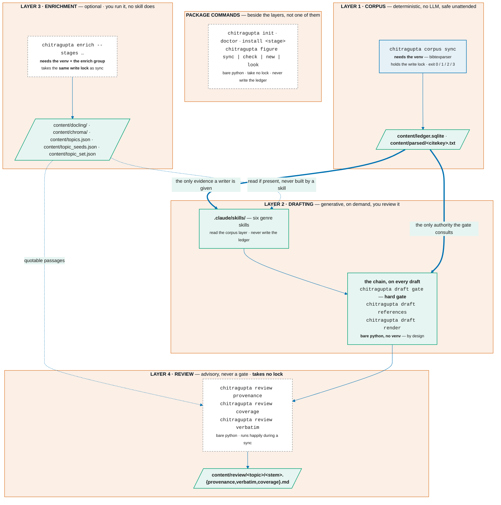

# 🏗 Architecture

Status: **reference.**

What runs, what each part writes, and which parts are optional. Written
for someone who has the pipeline working and wants to change something.
Every flag is in [CLI.md](CLI.md), every setting in
[CONFIG.md](CONFIG.md), and the design rationale in
[DESIGN.md](DESIGN.md).

## 🧩 The four layers

A deterministic **corpus layer**, a generative **drafting layer**, an
optional **enrichment layer** that deepens the corpus, and an advisory
**review layer** you run over a finished draft. The numbers are the order
you meet them, not a dependency rank. Every edge is one layer reading a
file another wrote; no layer calls into another:

```text
corpus (sync) ──ledger, parsed/──▶ drafting (skills + gate chain) ──draft──▶ review
     │                                    ▲                                    │
     └──▶ enrichment (-m chitragupta.enrich) ─docling/, chroma/, passages──┘              │
                        └───────────────── passages ────────────────────────────┘
```

<!-- diagram: architecture-layers -->


Two properties carry the safety argument:

- **The bibliography is the only entrance.** Citekeys come from your own
  BibTeX export. The pipeline never fetches a paper, never invents a
  citekey, and never renames one.
- **The gate is the only exit.** `chitragupta.draft gate` consults
  `content/ledger.sqlite` and nothing else, so a citekey no `sync` ever put
  there cannot survive into a rendered draft.

### 📦 Package commands beside the layers

`chitragupta init`, `doctor`, `install <stage>` and `figure
sync|check|new|look` sit on the package rather than in a layer. None of
them reads or writes the ledger or takes the write lock. `figure` works on
one figure file rather than a draft, so it is not a `draft` verb
([figure-checks/README.md](figure-checks/README.md)).

## 📚 Layer 1: the corpus layer

One entry point, `python -m chitragupta.corpus`, with four verbs: `sync`
does the work, and `ledger`, `topics` and `discover` read what it recorded.

`sync` reads `papers/bibliography.bib`, updates one ledger row per
citekey, resolves each PDF from the entry's `file` field, and extracts
text to `content/parsed/<citekey>.txt`. It is incremental: a PDF whose
bytes have not changed is not re-parsed. It also reports near-duplicate
citekeys, a backend that starts losing word boundaries, and stale
citekeys (deleted only under `--remove-stale`). Exit codes are `0` clean,
`1` a parse failed, `2` another writer holds the lock, `3` the
bibliography has a hole ([CLI.md](CLI.md#-running-sync-on-a-schedule)).

`ledger` is read-only, takes no lock and runs on bare `python`, so it
answers "what does the corpus hold?" while a sync runs.

## ✍ Layer 2: the drafting layer

Eleven user-facing skills in `.claude/skills/`: six write a new draft,
three revise an existing one, `book-assembler` composes a book from
accepted units, and `figure-drawer` draws the figures the others ask for.
[GENRE.md](GENRE.md) says what each produces.

Each skill retrieves from the corpus layer, drafts into
`content/drafts/`, then runs the same chain on its own output:

1. `python -m chitragupta.draft gate <draft>`: the hard gate. The skill
   loops until it exits 0 and presents nothing before that.
2. `python -m chitragupta.draft references <draft>`: an IEEE reference
   list from exactly the citekeys cited (skipped for thesis `.tex`
   fragments, whose surrounding LaTeX owns the bibliography).
3. `python -m chitragupta.draft render <draft> --format pdf`.

The gate runs at three points, and only one depends on the skill. A hook
runs it on every write under `content/drafts/`, the skill runs it before
presenting, and `draft render` runs it before producing any format, so a
draft written around the hook still cannot become a document.
[HARNESS.md](HARNESS.md) has what each harness enforces and
[HOOKS.md](HOOKS.md) the hooks themselves.

The skills only read the corpus. They never run `sync` or the enrichment
layer: both take the write lock and can run for tens of minutes, so
starting one is your decision. Only `sync` writes the ledger, through
`ledger.connect()`; every reader opens it with `ledger.read_connection()`,
which creates nothing and refuses a missing or outdated ledger. The gate
is the exception: with no ledger it still runs and fails every citekey
closed. On an empty ledger the citation-grounded genres stop, and the two
teaching genres ask whether to continue uncited.

## 🧠 Layer 3: the enrichment layer

This layer extends the corpus layer. Nothing in it is generative, no
skill runs it, and it takes the *same write lock* as `sync`. Its one entry
point is `python -m chitragupta.enrich`:

```bash
.venv-full/bin/python -m chitragupta.enrich --stages docling,embed
.venv-full/bin/python -m chitragupta.enrich --for-draft content/drafts/digital-twins.md
```

| Stage | Writes |
| --- | --- |
| `docling` | `content/docling/<doc>.md` and a `.passages.json` sidecar of quotable passages; the only stage `--for-draft` scopes |
| `embed` | `content/chroma/`: a vector per 200-word chunk |
| `bertopic` | `content/topics.json`: a cluster per document |
| `extract-keywords` | `content/keywords.toml`: the papers' own declared keywords |
| `seed-topics` | `content/topic_seeds.json`: citekeys matching the seed phrases |
| `converge` | `content/topic_set.json`: emergent and named topics joined |
| `topic-graph` | `content/topic_graph.json` ([TOPIC-DISCOVERY.md](TOPIC-DISCOVERY.md)) |

A review report and a render are deliberately not stages: hosting them
here would make this layer import the review and drafting layers, and
make them wait on a running `sync`. Each stage reports `ok`, `partial`,
`skipped` or `error` instead of crashing on a missing dependency, and none
needs an LLM API key. What the stages are *for* is in
[RETRIEVAL.md](RETRIEVAL.md); scoping is in
[LADDERS.md](LADDERS.md#-scoping-a-run-to-one-draft).

A skill reads what this layer produced (`content/chroma/`,
`content/docling/`) when it exists and falls back to the lightweight
default when it does not. Reading an artefact is not calling a layer.

## 🔍 Layer 4: the review layer

Eleven aids behind one command, run over a finished draft (or, for
`union`, a book). [REVIEW.md](REVIEW.md) covers what each answers and how
to read its report; this section is the layer's boundary only:

- **A skill runs one only where its `SKILL.md` says so.** A genre skill
  runs `verbatim scan` before presenting, and `agenda-reviser` reads
  `review agenda` when asked. The rest are yours to run.
- **They take no lock**, so they keep working during a `sync`.
- **None of them gates anything, and none may be promoted to one.**

Output lands in `content/review/`, mirroring the draft's path, with
`chitragupta/review/__init__.py` owning that contract. The layer is
called *review*, not *verification*, because the gate is the
verification and lives in the drafting layer.

**Which side a check falls on is decided by what it is measured against,
not by how decidable its answer is.** The gate compares a citekey to the
ledger, which is ground truth, so an absolute verdict is available. A
check measured against a recorded preference or against a parse can be
wrong for reasons outside the draft. `quotation` is the hard case: its
answer is binary, but it is measured against today's parse, which a
re-parse or a switched backend can change, so it needs a third outcome,
`unverifiable`. Such a check reports and never blocks, whichever layer it
lives in. A harness may guarantee that it runs and that its findings are
seen, never that they were obeyed, which is why `DEVELOPER-AGENTS.md`
bars promoting any new check into a gate beside
`chitragupta/citation_gate.py`.

`verbatim scan` is the gate's complement: the gate proves each citekey is
*real*, and the scan reports what *wording* came with it. It stays a
review aid ([SOUL.md](../SOUL.md), [PLAGIARISM.md](PLAGIARISM.md)).

## ♻ Incremental by default, honest about failure

**Nothing is recomputed without a reason.** `sync`, the embedding index,
the topic model and the Docling stage each skip input that has not
changed, so a second run over an unchanged corpus costs close to nothing
and `sync` is safe on a schedule. **A stage that cannot run says so**,
with `missing-binary` or `skipped`, rather than crashing or silently
succeeding.

## 🔁 What is reproducible, and what is not

Run the pipeline twice over an unchanged bibliography and some artifacts
come back byte-identical, some equivalent, and one genuinely different.

| Artifact | Stable across a re-run on unchanged input? |
| --- | --- |
| `content/ledger.sqlite` rows | **Yes, except `last_synced`**, which is wall-clock. Paths are stored relative, so moving the project re-parses nothing |
| `pdf_size`, `pdf_mtime_ns` | Only while the file is untouched; a fresh mtime causes a re-hash, not a re-parse |
| `content/parsed/<citekey>.txt`, `pdftotext` | **Yes**: byte-identical, measured |
| `content/parsed/<citekey>.txt`, `docling` | **No**, under a worker pool: about 1 in 300 differed |
| `content/parsed/<citekey>.passages.json` | **No**, and this is the one that matters (below) |
| `content/rendered/*.md`, `*.tex` | **Yes**: byte-identical, measured |
| `content/rendered/*.pdf`, `content/review/*.pdf` | **No**: the TeX engine embeds a timestamp and `/ID` |
| `content/review/*.md` and `.json` | **Yes**: no wall-clock line, so they diff against the next revision. A re-parse that moved a quoted span moves them too |
| `content/topics.json` | **Yes**, but a topic id is not a stable identifier: adding a document can renumber every topic |
| `content/retrieval_index.json`, `retrieval_passage_index.json`, `content/overlap/` | Caches: delete them and the next run rebuilds them |
| `content/chroma/` | Persistent and incremental; inherits its input text's instability |

**The passage sidecar.** Docling groups elements slightly differently
under load, and `chitragupta/passages.py` writes one passage per element,
so a bibliography entry can split in two or two can merge. About 1% of
across-configuration comparisons changed a passage's text. So:

- **A previously quoted span is not guaranteed to survive a re-parse.**
  If a reviewed quotation matters, the reviewed text is the artifact, not
  its offset.
- **Serial parsing is the stable configuration.** `[parser].workers = 1`
  (the default) has not been observed to vary. A pool on one quiet GPU
  kept passage text stable over 1,200 comparisons; a contended GPU did
  not.

Docling exposes no determinism setting, and torch's
`use_deterministic_algorithms` raises rather than degrades.
[bench/RESULTS.md](https://github.com/prasadtalasila/chitragupta/blob/main/bench/RESULTS.md)
has the measurements.

## 🚫 What this architecture does not do

- **It does not fetch papers** or write back to your reference manager.
- **It does not verify claims.** The gate guarantees a citekey is *real*,
  not that its sentence is *right*; the review aids help you check that.
- **It takes an outline only if you write one** (`spec.md` for a book,
  `outline.md` in a draft's dossier, [DOSSIER.md](DOSSIER.md)).
- **It notices a hand edit but does not adapt to it on its own**
  ([USER-EDITS.md](USER-EDITS.md)).
- **It does not record who wrote a sentence, and will not.** An
  authorship marker would go stale while still looking authoritative
  ([DESIGN.md](DESIGN.md#-what-happens-to-prose-a-person-supplies)).

It also does not sandbox a PDF, a TeX run or Pandoc;
[SECURITY.md](https://github.com/prasadtalasila/chitragupta/blob/main/docs/SECURITY.md)
lists what it does and does not protect.

## 🔧 What each capability requires

| Capability | What it needs |
| --- | --- |
| Parse the bib file | `bibtexparser` (venv) |
| Extract PDF text | `pdftotext` (`os-deps` stage), or `docling` ([CONFIG.md](CONFIG.md#-backend-pdftotext-or-docling)) |
| Ledger, BM25 retrieval, gate, references, `md` render | stdlib only |
| Prose conformance (`draft style`) | stdlib, plus `vale` on PATH |
| Docling, embeddings, BERTopic, `review support`'s model, `verbatim scan`'s embedding tier | venv, `enrich` group |
| `tex`/`pdf` render | `pandoc`, LuaLaTeX, `latexmk` and the fonts in `chitragupta/pdf_fonts.py` |
| `draft diff --format pdf` | `latexdiff` and `bibtexu`, plus the above |

## 🐍 Which interpreter, and why

| Tier | Needs | Commands |
| --- | --- | --- |
| 1 | bare `python`, stdlib only | `chitragupta.draft` (all thirteen commands), `chitragupta.corpus ledger`, `chitragupta.review` (all eleven aids) |
| 2 | venv + `bibtexparser` | `chitragupta.corpus sync` |
| 3 | venv + the `enrich` group | `python -m chitragupta.enrich` |

The gate chain is deliberately in tier 1, so the pipeline's one safety
guarantee cannot be blocked by a broken or missing virtual environment
(PEP 668 makes that a slow fix on most distributions).
[CLI.md](CLI.md#-which-interpreter) lists each command's tier. Two review
aids reach past tier 1 for one optional part (`review support`'s model,
`verbatim scan`'s embedding tier) and report that part as not run without
it.

**One entry point per layer, one level deep.** The command surface is
`chitragupta <layer> <verb>`, with `python -m chitragupta.<layer> <verb>`
alongside it for the hooks and skills ([PACKAGING.md](PACKAGING.md)). A
layer's code may nest as deep as it likes; its command surface does not.
The submodules inside `chitragupta/enrich/` and `chitragupta/review/`
carry no `__main__` block, so `python -m chitragupta.enrich.docling_parse`
imports the module and exits 0 having done nothing, a silent trap for
which the price is exactly one `--help` per layer. The drafting layer's
modules sit flat in `chitragupta/` behind `chitragupta/draft.py` and
carry no `__main__` block either. The one module that refuses instead is
`chitragupta/sync.py`, because it is the spelling that sits in a
crontab: it prints `python -m chitragupta.corpus sync` and exits **64**.
`tests/test_review_entrypoint.py`, `tests/test_draft_entrypoint.py`,
`tests/test_corpus_entrypoint.py` and `tests/test_command_depth_scan.py`
pin the rule in code and prose.

Every `--help` uses `ClickParser` from `chitragupta/help_format.py`:
argparse laid out the way click prints it, with no new dependency.

## 🪜 Ladders and tiers

A **ladder** is a chain the code walks *automatically*, falling to the
next rung when one cannot answer: evidence passages, the enrichment text
source, and the accelerator. A **tier** is a menu you choose from, with
no automatic descent: the parser backend, the interpreter, the render
format. A ladder degrades silently; a tier fails loudly and says what is
missing. [LADDERS.md](LADDERS.md) has each one and what its bottom rung
costs.

The detection tiers of `verbatim scan` are the exception: all that can
run do, and each finding is labelled `exact`, `skip-gram` or
`embedding`. A tier that could not run says so, so a clean run means
"nothing found by the tiers that ran"
([PLAGIARISM-DESIGN.md](PLAGIARISM-DESIGN.md)).

## 🔒 One writer at a time

`sync` and the enrichment layer take the same lock,
`content/pipeline.lock.db`. The second writer to start exits `2`, and the
lock releases itself if its holder is killed. Readers are never blocked:
`corpus ledger`, the gate, retrieval and the review layer all run during
a sync. [DESIGN.md](DESIGN.md) has the reasoning.
