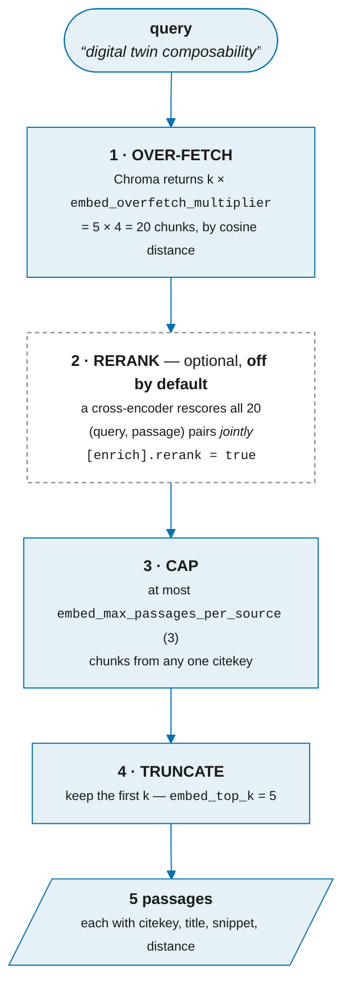
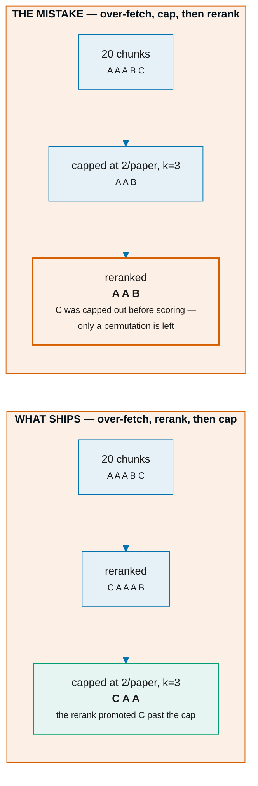

# 🔭 Corpus search: how a query becomes passages

Status: **reference.**

[RETRIEVAL.md](RETRIEVAL.md) answers *which* search to build. This page
covers what happens **inside** one `embed_index.search()` call: the four
stages a query passes through, why they are in that order, and which you
can change from `config.toml`. Read it if you are turning
`[enrich].rerank` on, choosing a `rerank_model`, or wondering why a
paper you know is in the corpus did not come back.
[RAG.md](https://github.com/prasadtalasila/chitragupta/blob/main/docs/RAG.md)
compares the same stages across six other RAG systems.

## ❓ Before stage 1: the shape of the query

On the BM25 path the wording of a query changes the answer more than any
setting further down.

**Asking a question retrieves different papers than asking in keywords.**
Six paired queries over the 497-parsed corpus at `k=10`, each phrased as
a question and as the equivalent keyword string:

| | mean overlap@10 | top-1 identical |
| --- | --- | --- |
| question form vs keyword form | **4.7 / 10** | 2 of 6 |

The cause is in the tokenizer. The stopword set (`CORE_STOPWORDS` in
`chitragupta/_tokens.py`, read by `chitragupta/retrieval.py` as `INDEX`
and extended by the review layer as `DISTINCTIVE`) holds nineteen
function words and **no interrogatives**, and the length filter passes
`how`, `why`, `who` and `can`:

```text
'what are the failure modes of co-simulation' -> ['what', 'failure', 'modes', 'co', 'simulation']
'why does model calibration matter'           -> ['why', 'does', 'model', 'calibration', 'matter']
```

Words like `what`, `why`, `does` and `matter` are **rare in academic
PDFs**, so they carry high IDF and compete against the terms you meant.

**Fixed query-side, in `_query_terms()` (`chitragupta/retrieval.py`).**
The document tokenizer `_tokenize` does not strip them, since a
symmetric fix would re-rank every query for no further gain. `search()`,
`evidence()`, the passage unit and `dossier/_drift.py`'s replay of a
recorded query all score through `query_terms()`: `_tokenize()` minus a
small hand-maintained set of wh-words and question auxiliaries, plus
[acronym
expansion](RETRIEVAL.md#-an-acronym-in-the-query-can-reach-the-words-it-stands-for).
The illustration above shows `_tokenize()`; a real query is scored
without the interrogatives.

**Against real ground truth, question phrasing costs recall.**
`bench_retrieval_keyword_selfretrieval.py` uses a paper's own
author-assigned `keywords` as the query and that paper as the answer, a
ground truth **no retrieval method built**. Over the 208 parsed entries
with keywords, wrapping each in interrogative glue (`what is X`, `how
does X work`, `why is X important`):

| Query form | recall@5 | recall@10 |
| --- | --- | --- |
| author keywords (baseline) | **0.808** | **0.865** |
| wrapped as a question | 0.731 (-0.077) | 0.812 (-0.053) |
| question, interrogatives stripped | 0.788 (-0.019) | 0.846 (-0.019) |
| keywords, interrogatives stripped | 0.808 (**+0.000**) | 0.865 (**+0.000**) |

- **Stripping is inert on keyword queries** (+0.000 at both cut-offs).
- **It recovers most of the loss, not all: 75% at k=5, 64% at k=10.**
  With wordier templates adding ordinary words such as "role" or
  "evaluate", recovery falls to about a third, because no stopword list
  can reach them. A question carries generic content words that compete
  on their own.
- So stripping is **not** a licence to write queries as questions.
  Keywords remain the advice.

**This is a BM25 property.** The embedding path encodes the whole
string, so an interrogative shifts the vector slightly rather than
competing as a high-IDF term.

The token-length floor is **2**, so `co` in `co-simulation`, and terms
like `AI`, `ML`, `5G` or `QA`, are indexed and scored
([RETRIEVAL.md](RETRIEVAL.md#-where-the-token-length-floor-came-from) has
the sweep). A single-character query word cannot rank, so `retrieve`
names one on stderr rather than letting a query of them return empty
unexplained.

## 🪜 The four stages

`chitragupta/enrich/embed_index.py::search(query, k)` is four stages, of
which the second is optional and off by default.

<!-- diagram: corpus-search-stages -->


Every size in that diagram is an `[enrich]` key, validated at load;
[CONFIG.md](CONFIG.md#-the-three-that-size-a-search) is the reference:

| Stage | Key | Default | Reach for it when |
| --- | --- | --- | --- |
| 1 | `embed_overfetch_multiplier` | `4` | the right paper never comes back **at all** |
| 2 | `rerank` / `rerank_model` | `false` | the right paper comes back 4th or 5th |
| 3 | `embed_max_passages_per_source` | `3` | one paper is filling the whole result |
| 4 | `embed_top_k` | `5` | you want more or fewer passages per search |

**Why over-fetch.** Chroma ranks *chunks*, so one thoroughly matched
paper could otherwise fill all `k` slots. Fetching `k × 4` gives the cap
something to promote *from*; at a multiplier of `1` the cap could only
shorten the result.

**Why the cap is keyed on citekey, not title.** Two untitled or
same-titled documents are still different papers.

**`snippet_chars` stops being cosmetic when stage 2 is on.** The
cross-encoder scores the *truncated snippet*, not the whole 200-word
chunk, so what you are shown is exactly what was ranked. Callers pass
it; it is not a `config.toml` key.

## ⚖ Why the rerank sits where it does

The wrong order looks identical in a code review.

<!-- diagram: corpus-search-rerank -->


Dropping a dominant paper's excess chunks **promotes another paper's
chunk into the window**. Rerank first and a promotion can change *which
document* survives; rerank after, and it can only permute the papers the
bi-encoder already chose. Over 256 real queries, the two orders return
a **different set of papers on 217 of them (85%)**, and the correct
order scores better (nDCG@5 0.5281 against 0.4962).
`tests/test_enrich_embed_index.py::TestSearchReranks` pins it so a
refactor cannot swap the two unnoticed.

## 📊 What reranking does and does not buy

Every measurement on this page, with its method and raw data, is in
[bench/RESULTS.md](https://github.com/prasadtalasila/chitragupta/blob/main/bench/RESULTS.md).

Measured on this project's corpus (642 ledger items, 497 parsed, 40,741
chunks) against 256 queries whose correct answer no retrieval method
chose:

| | off (shipped) | on (`ms-marco-MiniLM-L6-v2`) | change |
| --- | --- | --- | --- |
| recall@3 | 129 / 256 | **139 / 256** | **+10 queries** |
| recall@5 | 156 / 256 | 156 / 256 | **none** |
| nDCG@5 | 0.4949 | **0.5281** | +0.033 |
| distinct papers in top 5 | 3.590 | 3.574 | **none** |

- **It improves ordering, not recall.** The right paper is found
  *higher*, not more often: worth something if you read the top 3, and
  nothing if you read all 5. recall@5 is unchanged because the correct
  paper is lost 20 times and gained 20 times.
- **It does not improve source diversity, and cannot.** With a cap of 3
  and `k` of 5, the distinct papers in a result are bounded to
  {2, 3, 4, 5} by the **cap**. For more sources per query, lower
  `embed_max_passages_per_source` or raise `k`.

## 💸 What it costs

A reranker runs once per `search()` call, inside a drafting loop, so
what matters is the added latency per call (pool 20, the shipped
setting):

| device | baseline `search()` | + `ms-marco-MiniLM-L6-v2` | + `bge-reranker-base` |
| --- | --- | --- | --- |
| GPU | 12.4 ms | 18.9 ms (**2.5x**) | 67.0 ms (**6.4x**) |
| CPU | 44.2 ms | 210 ms (**5.8x**) | 1001 ms (**23.6x**) |

Plus ~1.8-3.5 s of model construction on a process's first reranked
call. The `enrich` extra needs no GPU, and a genre skill issues many
searches per draft, so on CPU `bge-reranker-base` adds a second to each.
Deepening the pool is expensive: 5 → 20 → 50 chunks costs roughly 1x →
3.3x → 7.2x.

### ⚡ FlashRank, evaluated and declined (2026-08-29)

[FlashRank](https://github.com/PrithivirajDamodaran/FlashRank) (ONNX
Runtime, no torch, a 4.4M-parameter default model) is the obvious way to
make rerank cheap enough to default on. Benchmarked against 20 real
corpus chunks at the shipped path's snippet length (~110-130 tokens):

| Reranker | ms/call | implied `search()` cost |
| --- | --- | --- |
| `ms-marco-MiniLM-L6-v2`, torch fp32 (**shipped**) | 216 | 5.75x |
| FlashRank `TinyBERT-L-2` (its default) | 54 | **2.20x** |
| FlashRank `MiniLM-L-12` (its "best") | 390 | **9.57x** |
| the shipped L6 weights exported to **ONNX int8** | 113 | **3.50x** |

**Declined, on three independent grounds:**

- **Licence.** The library is Apache-2.0 but **the weights it downloads
  are CC-BY-SA-4.0**. A ShareAlike obligation reaching a project that
  ships a release archive is disqualifying on its own.
- **2.2x is not free, and the advantage shrinks toward our shape.**
  From 512 to 128 tokens the torch baseline falls 7.6x and FlashRank
  only 1.9x, as fixed overhead dominates; its "best" model is *slower
  than what already ships*.
- **The fast model is materially worse:** NDCG@10 69.84 against 74.30,
  MRR@10 32.56 against 39.01 on the sbert authors' own table. The rerank
  gain here already held with two *stronger* models (L12 and
  `bge-reranker-base`), so a weaker one has no upside.

Two determinism findings generalise. Dynamic int8 quantisation makes a
score depend on **what else is in the batch** (one pair scored 4.82e-5
in a pool of 20 and 4.37e-5 alone, 9.2% relative, against 0.000% for
torch fp32); ordering within a fixed pool is unaffected, but scores are
not comparable across `k` or `embed_overfetch_multiplier`. And
FlashRank's weights are fetched from `resolve/main` with **no revision
pin and no checksum**, so a silent re-upload would change results with
no version bump, unacceptable for a pipeline built on reproducibility.

One option surfaced: exporting the *existing* Apache-2.0 L6 weights to
ONNX int8 is 1.9x faster at the shipped shape with no new dependency or
licence question. ONNX alone bought 1.2x; the win is the quantisation,
which brings the batch-composition caveat with it.

## 🧮 Choosing a reranker

`rerank_model` takes a **cross-encoder**, which scores a
`(query, passage)` pair jointly and returns one relevance logit;
`embedding_model` takes a bi-encoder, which embeds each side separately.

> **The bge-\*/e5-\* prefix warning does not carry over.**
> [CONFIG.md](CONFIG.md#-choosing-an-embedding-model) rules those
> families out of `embedding_model` because they expect
> `"query: "` / `"passage: "` prefixes this code does not add, which
> only bi-encoders need. `BAAI/bge-reranker-base` is
> `XLMRobertaForSequenceClassification` with `num_labels=1`, a true
> cross-encoder, and is a drop-in here.

### ✅ Measured candidates

On the same 256 queries, reranked before the cap, against an
un-reranked baseline of recall@3 129, recall@5 156, nDCG@5 0.4949:

| Model | recall@3 | recall@5 | nDCG@5 | GPU cost | CPU cost | Verdict |
| --- | --- | --- | --- | --- | --- | --- |
| `cross-encoder/ms-marco-MiniLM-L6-v2` **(default)** | 139 | 156 | **0.5281** | **2.5x** | **5.8x** | Best nDCG, cheapest |
| `cross-encoder/ms-marco-MiniLM-L12-v2` | 138 | 152 | 0.5107 | 3.8x | 10.1x | **Rejected**: worse than L6 on every metric, at twice the cost |
| `BAAI/bge-reranker-base` | **144** | **157** | 0.5175 | 6.4x | 23.6x | **Rejected as default**: best recall by 5 queries in 256, for 3.5-4.8x the cost. Reasonable on a GPU if you read only the top 3 |

The default is the cheapest and won the ordering metric; the recall
winner's margin is too small for one ground truth to resolve.

### 🚫 Not a drop-in

- **Any bi-encoder**, such as `sentence-transformers/all-mpnet-base-v2`:
  it has no notion of a pair, and `CrossEncoder` will refuse it or
  produce nonsense.
- **LLM-as-reranker.** Out of scope by design: ranking stays
  deterministic and local.

## 🔧 Turning it on

Two keys under `[enrich]` in your `config.toml` (created from
`config.toml.example`):

```toml
[enrich]
rerank = true
rerank_model = "cross-encoder/ms-marco-MiniLM-L6-v2"

# The stage sizes, all optional -- these are the defaults.
embed_top_k = 5
embed_max_passages_per_source = 3
embed_overfetch_multiplier = 4
```

Or for one run:

```bash
RERANK=true python -c "from chitragupta.enrich import embed_index; print(embed_index.search('digital twin composability'))"
```

Two keys, because `rerank_model = ""` cannot safely mean "off": a string
setting with the wrong TOML type falls back to its default *silently*
([CONFIG.md](CONFIG.md#-how-values-are-parsed)), so a typo would look
like a deliberate off-switch. The boolean says what was intended; the
string says what to load.

Nothing needs rebuilding: unlike `embedding_model`, `rerank` changes
ranking only.

**If the model cannot be loaded, `search()` raises**, naming the key and
the model id. It does not fall back to un-reranked results, which would
look entirely normal, the silent misconfiguration
[CONFIG.md](CONFIG.md#-how-configuration-is-loaded) refuses elsewhere.

## 🕵 When a paper does not come back

Reranking is often the wrong thing to reach for: **69 of 256 correct
papers (27%) never entered the 20-chunk pool at all**, a ceiling of 0.73
on dense recall@5 that no reordering can lift. Work down this list
instead:

| Symptom | Likely stage | What to change |
| --- | --- | --- |
| You phrased the query as a question | **before stage 1** | Re-phrase as keywords; on BM25 that changes over half the result ([above](#-before-stage-1-the-shape-of-the-query)) |
| The corpus says "twins" and you searched "twin" | **before stage 1** | Neither path stems ([below](#-what-bm25-does-instead)); search the corpus's form, or both |
| The paper has no parsed text | before stage 1 | It is not citable. Re-run `sync` and check the PDF parsed |
| A paper mentioning your subject in passing outranks the paper about it | **before stage 1** | A BM25 lever: raise `[retrieval].k1` so a repeated term saturates later; read [RETRIEVAL.md](RETRIEVAL.md#-k1-and-b-are-settings-and-the-defaults-were-swept) before moving it from 1.5 |
| One paper fills the result | stage 3 | Lower `embed_max_passages_per_source` (`1` for maximal diversity) |
| The right paper is in the results but 4th or 5th | stage 2 | This is what reranking is for |
| The right paper is absent entirely | stage 1 | Raise `embed_overfetch_multiplier` or `embed_top_k` (the pool is their product). Reranking will not help |
| It uses different vocabulary than your query | stage 1 | What embeddings are *for*; if it still misses, the chunk may straddle a boundary |

## 🆚 What BM25 does instead

`chitragupta/retrieval.py::search()` takes the same `query`, `k` and
`snippet_chars` (plus a `collection` filter), returns `SearchResult`s
rather than dicts, and has none of these four stages. It scores whole
documents, so it is **one result per citekey by construction** and needs
no cap.

Its passage-unit sibling, `retrieval_passages.py::search_passages()`
(`retrieve search --unit passage`), scores paragraphs and so *does* need
the cap, `[retrieval].max_passages_per_source`, but no over-fetch: BM25
scores every passage in memory, so the cap walks the fully ranked list
([RETRIEVAL.md](RETRIEVAL.md#-the-passage-unit) has the figures).

BM25 has **no cap-position question** and no `rerank` key. Reranking its
own over-fetched list was measured and did not help: nDCG@5 fell from
0.7321 to 0.6886.

**It does not stem, by measurement.** A query for "digital twin" does
not reach a paper that only says "digital twins"; search the corpus's
form (the second row of the table above). Porter stemming both sides was
declined on both ground truths. On 96 real drafting-session queries it
was a wash (recall@5 down one query, recall@1 up two, nDCG@5 down
1.91pp, 17 queries better and 15 worse); on 256 author-keyword queries
it lost at every query width, including the one- to three-term widths
the case for it rested on. It shrinks the index from 68,477 terms to
54,705 and raises the mean document frequency of a query's terms by
~17%, so each term carries less IDF.

On this project's corpus BM25 outscores the dense path on every ground
truth tried so far; [RETRIEVAL.md](RETRIEVAL.md#-which-should-i-build)
is where that choice belongs.
