# 📐 The workflow, drawn fourteen ways

Status: **reference.**

Every diagram here describes the same pipeline. They come in four groups:

- [The ladder](#-the-ladder): six views of the whole workflow, ordered
  by how much you already know, from one that assumes nothing to one that
  assumes you are about to change the worker pool.
- [By genre](#-by-genre): three views of how the *writing* skills
  differ in what they ask of the pipeline. The six genre skills are not
  variations on one template; they disagree about how much of it is worth
  running.
- [Appendix](#-appendix): the same workflow in time order, and the
  ledger's state machine for one citekey.
- [Topic discovery](#-topic-discovery): two views of the corpus's
  topic structure and the reader over it, the one group here that applies
  *before* any draft exists ([TOPIC-DISCOVERY.md](TOPIC-DISCOVERY.md)).

Read the one that matches your question and ignore the rest.

One property holds in the eleven workflow views: **a genre skill loops on the citation
gate until it exits 0, and shows you nothing before that.** All six
genre skills' SKILL.md files carry that instruction, each in its own
words; `deep-research`'s reads *"Fix and re-run until `OK`. Never
present a draft that hasn't passed."* A gate failure is normally
something you never see.

**Drawing a figure is left out of every view.** When a genre skill
decides a figure is warranted, it hands off to the `figure-drawer`
skill, which starts the figure with `chitragupta figure new`, checks it
with `chitragupta figure check` and looks at it with
`chitragupta figure look`, then hands back
([FIGURE-DRAWER.md](FIGURE-DRAWER.md)). Where a view lists
`chitragupta review figure` among the review aids, that is the
draft-wide pass over a few of `figure check`'s rules, not the per-figure
check ([figure-checks/README.md](figure-checks/README.md)).

The fenced `mermaid` blocks below are the source of truth, and GitHub
renders them inline, so a change to the pipeline and a change to its
diagram land in the same diff. `docs/diagrams/` carries the same fourteen as
standalone `.mmd` sources and `.svg` exports, for slides, a paper, or a
viewer that doesn't render Mermaid, and does the same for every diagram
in the other documents; see [Editing these](#-editing-these) at the end.

---

## 🪜 The ladder

| # | Diagram | Written for | Answers |
| --- | --- | --- | --- |
| 1 | [One glance](#-1-one-glance) | Someone who has never heard of this | what are the steps, and who does each one? |
| 2 | [Your first run](#-2-your-first-run) | Someone installing it today | what do I type, in what order, and what does each step tell me? |
| 3 | [The full workflow](#-3-the-full-workflow) | Someone reading the source | what actually runs, what does it write, and where does the module I'm looking at fit? |
| 4 | [Everything on disk](#-4-everything-on-disk) | Someone deciding what to back up, or debugging a wrong file | what are all these files, who wrote them, and what is safe to delete? |
| 5 | [Gates and exit codes](#-5-gates-and-exit-codes) | Someone whose run just failed, or who is scripting it | why did this exit 1, and what is safe to retry automatically? |
| 6 | [Inside one parse](#-6-inside-one-parse) | Someone tuning `[parser].workers`, or changing the pool | what does a worker pool actually do here, and what happens when part of it dies? |

### 🔭 1. One glance

**Written for:** Someone who has never heard of this.
**Answers:** what are the steps, and who does each one?

This is deliberately the least detailed diagram here. Two properties do
all the work: phase 1 is the only entrance (citekeys come from your
BibTeX export and nowhere else), and phase 4 is the only exit, with no arrow
around it. This is the version in [the README](../README.md#-how-it-works).

The `FAIL` arrow loops back to **drafting**, not to you. A failing
gate is normally invisible: the skill discards the unsupported claim,
rewrites it and runs the gate again. You only get involved in the rarer
case where the paper isn't in the corpus yet, and that means going back
to phase 1 and adding it.

It carries no commands and no file paths on purpose, because it is for
someone who has not decided to install anything yet. A reader who
wants either has [CLI.md](CLI.md) for the commands and
[the artifacts diagram](#-4-everything-on-disk) for the paths.

Two enclosures show the division of labour. `LLM` holds drafting,
the gate and the dossier: the part a model runs, loops over on its own,
and keeps its working state in. `Author Proofs` holds publishing and
review: the part you run once a draft is finished. Nothing crosses
between them except a draft that has passed the gate.

The two dashed boxes are stores and reports, not steps.
`DOSSIER` ([DOSSIER.md](DOSSIER.md)) is written while a draft is
written and read back to change it, which is why revision does not
re-run the genre skill. `REVIEW` ([REVIEW.md](REVIEW.md)) is ten
advisory aids for a finished draft. Its arrow back to drafting is dotted
where the gate's is solid, because a review finding is yours to weigh
and does not block the pipeline.

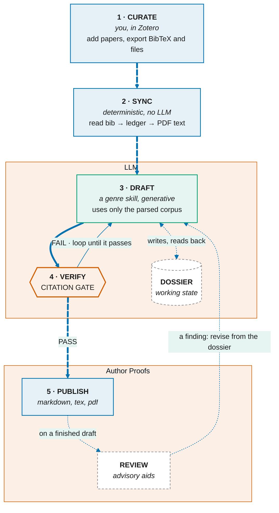

### 🚀 2. Your first run

**Written for:** Someone installing it today.
**Answers:** what do I type, in what order, and what does each step tell me?

The same path as [the Quickstart](../README.md#-quickstart), drawn with
the two checkpoints where people most often go wrong. The first is the **Export
Files** tick box, which silently produces a bibliography with no PDFs
attached. The second is the first `python -m chitragupta.corpus ledger` after a
sync, which is where you find out whether anything became citable.

Exit codes are on the diagram because at this stage they are the only
feedback you have.

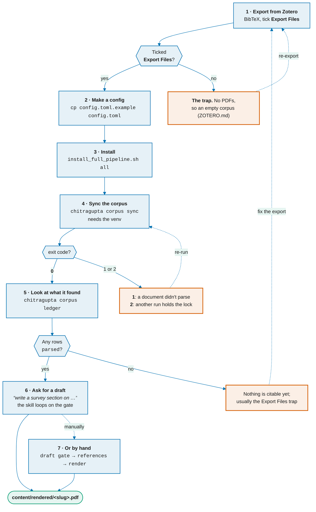

### 🔄 3. The full workflow

**Written for:** Someone reading the source.
**Answers:** what actually runs, what does it write, and where does the module
I'm looking at fit?

The reference diagram. Every module on the corpus-to-gate-to-render spine
appears here exactly once.
[ARCHITECTURE.md](ARCHITECTURE.md) is the prose companion to it: the
same system in words, plus what each part needs to run.

It is drawn to make three things obvious. The thick edge from
`content/ledger.sqlite` to the gate is the entire safety argument: the
gate consults the ledger and nothing else. The gate sits on the only path
from a draft to `content/rendered/`. And the `FAIL` edge does not leave
the system: it runs back into the skill, which re-drafts and re-runs the
gate until it exits 0.

The enrichment layer's `docling` stage reads **the PDF itself**,
not `content/parsed/`. It is a second, independent extraction of the same
source, not a refinement of the first one, which is why it can produce
figures and layout-aware passages that `pdftotext` cannot.

Dotted edges are optional or conditional: the enrichment layer is opt-in,
and each consumer checks the stack exists before using it and degrades to
the lightweight default when it doesn't.

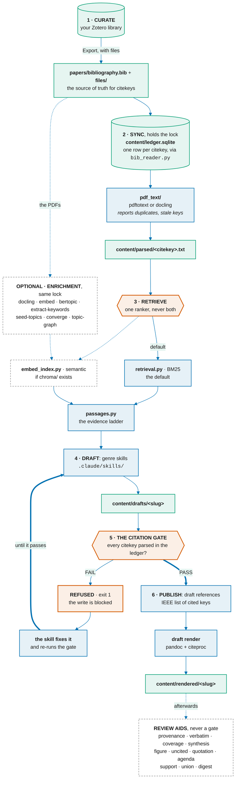

### 📁 4. Everything on disk

**Written for:** Someone deciding what to back up, or debugging a wrong file.
**Answers:** what are all these files, who wrote them, and what is safe to delete?

Same pipeline, but the files are the nodes and the modules are the edge
labels: the inverse of the full workflow diagram.

Everything `sync` and `enrich` write under `content/` is disposable:
delete it and one `sync` plus one enrichment run rebuilds it. What you
author there is not: drafts, dossiers, book specs and seed topics
([MIGRATION.md](MIGRATION.md) lists them). Nothing under `papers/` is
disposable either, and neither is `config.toml`; both are gitignored and
per-host, so a backup needs them and the authored half of `content/`.

With `[enrich].docling_images` on, `docling` also writes each document's
figure bitmaps into `<doc>_artifacts/` and an index of them in
`<doc>.figures.json`: page, caption, bounding box and
the string to cite each figure by, for each picture that is a real
figure ([CONFIG.md](CONFIG.md#-docling_images) has what that excludes and
why). Those are a reading aid for checking a draft against its sources.
Having a paper in your library grants no right to reproduce its figures;
see DEVELOPER.md's "Figures and copyright".

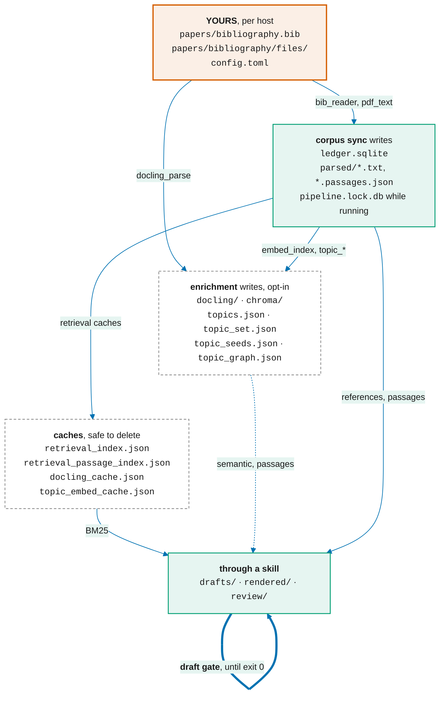

### ✅ 5. Gates and exit codes

**Written for:** Someone whose run just failed, or who is scripting it.
**Answers:** why did this exit 1, and what is safe to retry automatically?

Exit codes are the API for unattended callers: `0` corpus in sync, `1`
corpus not in sync and a human is needed, `2` cycle skipped and no work
was lost.

Read the failure branch carefully. A document the backend cannot read
is **never retried**, since re-reading it every run would spend the same
minutes to reach the same answer, but it **never goes quiet either**: it
fails the run until someone deals with it. A failure caused by the *run*
instead of the *document* (a dead worker, a timeout, a CUDA OOM) retries
itself next time without being asked.

The gate's `exit 1` is the one failure on this diagram that usually
reaches nobody, because the skill loops on it itself.

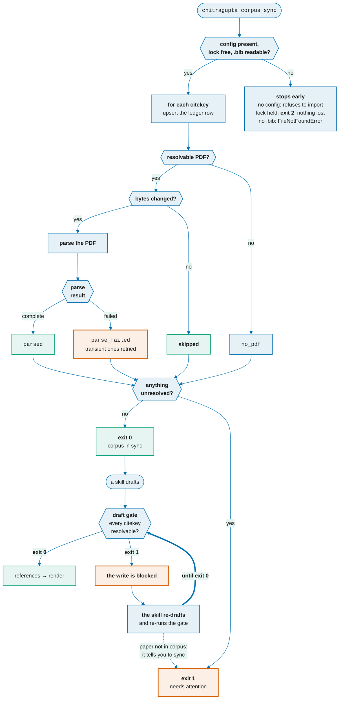

### 📄 6. Inside one parse

**Written for:** Someone tuning `[parser].workers`, or changing the pool.
**Answers:** what does a worker pool actually do here, and what happens when
part of it dies?

The deepest view, and the only part of the repository that runs work in
parallel. Everything else (retrieval, gating, rendering) is
deliberately serial.

**The pool is clamped to the host, not to the
request.** The ceiling counts the CPUs *this process* may run on
(`os.sched_getaffinity`), not the machine's. An over-large request is
clamped *and said out loud*: silently obeying thrashes, and silently
ignoring leaves someone believing they configured something they did
not.

Five failure modes hang off the pool, each handled where it can be, and
the parent process keeps everything only it can do: sqlite has a single
writer, and the parent is the only place that can order results
deterministically. The full component-by-component write-up is in
[docs/PARALLELISM.md](PARALLELISM.md); the reasoning behind the lock is in
[docs/DESIGN.md](DESIGN.md).

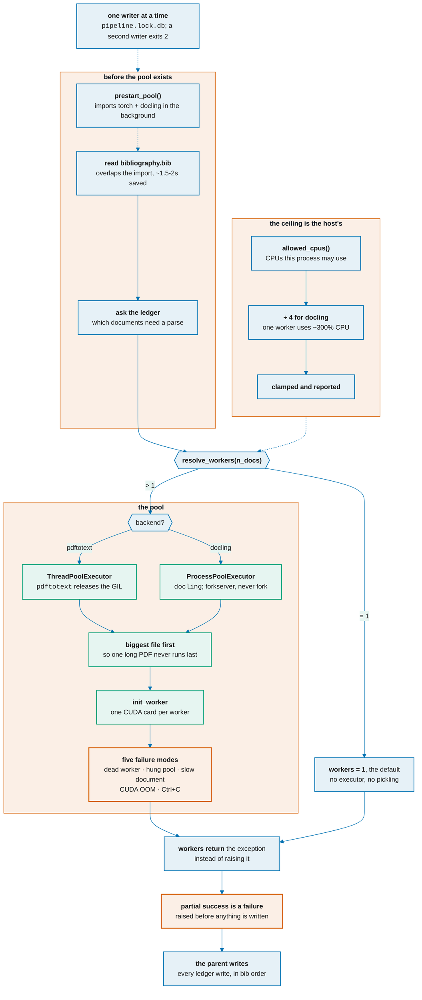

---

## 🎭 By genre

The ladder above draws the pipeline as one thing. It is not quite one:
the six genre skills in `.claude/skills/` use very different amounts of
it.
The enrichment layer in particular is worth building for two of them,
largely wasted on two others, and reduced to a preview step for the fifth.

| Genre | Skills | Retrieval | Enrichment stages | `chitragupta.draft references` |
| --- | --- | --- | --- | --- |
| [Genre A: corpus-led](#-genre-a-corpus-led) | `survey-writer`, `deep-research` | BM25 **or** `embed_index` | `docling` + `embed`, both worth it | yes |
| [Genre B: teaching](#-genre-b-teaching) | `tutorial-writer`, `textbook-chapter-writer` | BM25 only | none | yes (custom heading) |
| [Genre C: LaTeX-native](#-genre-c-latex-native) | `thesis-chapter-writer` | BM25 only | none | **no, skipped** |

All five run the same gate, in the same loop.

### 📚 Genre A: corpus-led

**Skills:** `survey-writer`, `deep-research`

The corpus is the content. Nearly every sentence is a cited claim, so
these are the two skills that pay off the enrichment layer. `docling`
gives passages good enough to survive review; `embed` gives semantic
recall, finding the paper that makes your point in words you did not
search for. The shared genre steps every writer reads
(`.claude/skills-common/references/genre-steps.md` §1) name
`chitragupta/enrich/embed_index.py` as the ranker retrieval uses once it
is built, and these two genres gain the most from it.

Both read the same corpus the rest of the pipeline does, and that corpus
is the bibliography and nothing else, so every document either skill can
reach carries a citekey the gate will accept, and there is no class of
source that has to be discussed by title because it may not be cited.

`bertopic` sits off to one side because **no skill calls it.** It is for
you, deciding what the survey should be about before anything is drafted.

For the same reason, in the other direction, `chitragupta.review`'s
`coverage` aid ("retrieval surfaced
this paper: did the draft actually cite it?") only asks a meaningful
question in this genre.

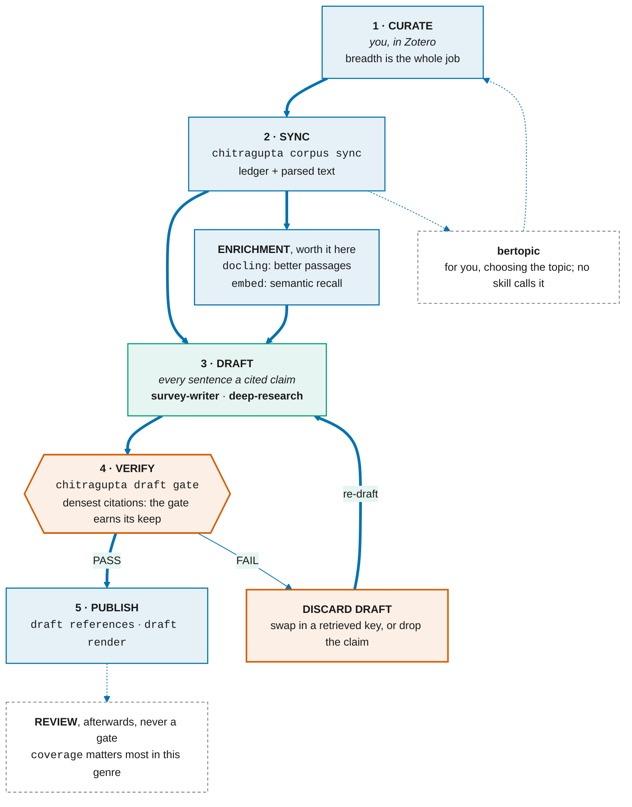

### 🎓 Genre B: teaching

**Skills:** `tutorial-writer`, `textbook-chapter-writer`

The corpus plays a minor part. Most of the content is original: worked
examples, exercises, a lesson that has to run. Citations are
deliberately confined: `tutorial-writer` bans them mid-lesson and allows
them only in a closing "Where to go next", and `textbook-chapter-writer`
uses them for motivation and background.

So the enrichment layer is mostly wasted here. Both skills read the same
shared genre steps that name `embed_index`, but they search so little
that `chitragupta.retrieval.search()`, which is stdlib BM25, serves them.
Building a semantic index to place four citations is not worth the
effort. The rendering they do want at the end is not an enrichment stage
at all: `render_output` is the drafting layer's own publish step, and
needs no package from the `enrich` group.

This is also the one genre where **the gate can legitimately pass with
zero citations**, and both SKILL.md files say so. An empty reference list
is a correct outcome for a tutorial.

The real risk in this genre is writing the wrong genre, such as a
tutorial that explains instead of instructing; a bad citekey is the
lesser risk.
Both skills open by warning about that, and no gate in this repository
can catch it.

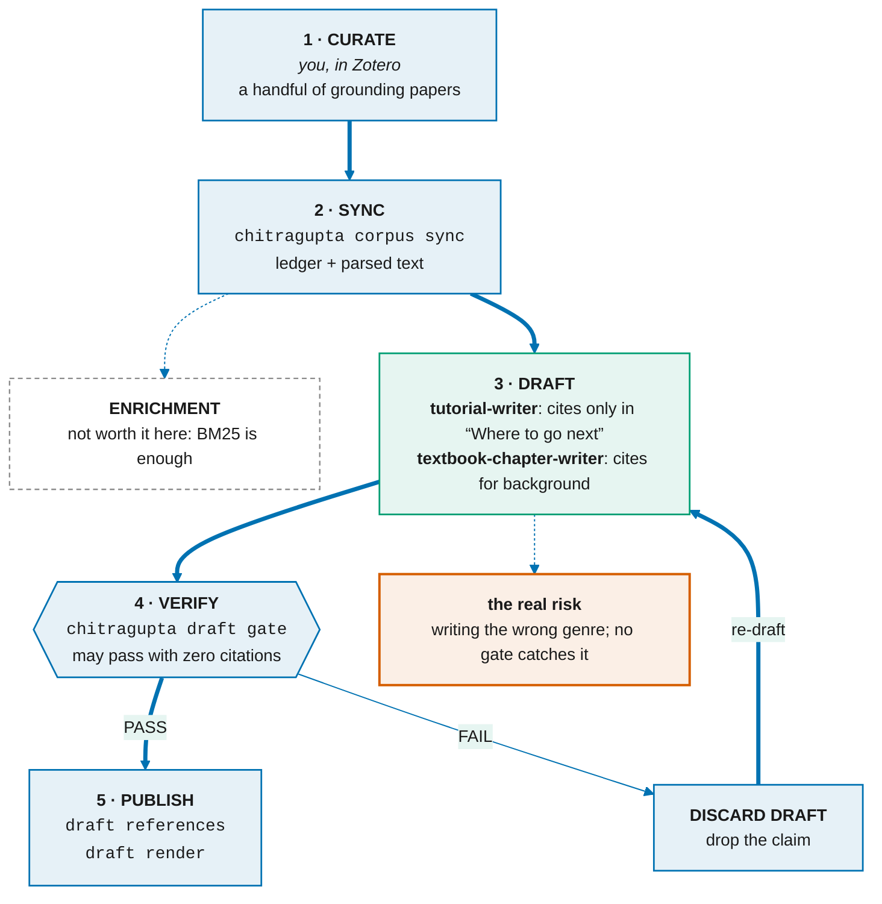

### ✍ Genre C: LaTeX-native

**Skills:** `thesis-chapter-writer`

The output isn't the deliverable. This skill emits a standalone `.tex`
fragment with `\citep`/`\citet` and no preamble, meant to be `\input` by
your own thesis document, so rendering produces a *preview*, not the
artifact that matters. A rendering failure
never blocks presenting the draft.

It is also the only skill that **deliberately skips `chitragupta.draft references`**.
Your thesis owns its own bibliography; a second reference list inside the
fragment would collide with it. That exception is easy to miss when
reading the README's `gate -> references -> render` chain, which is why
it gets its own diagram.

The gate is not relaxed for LaTeX: `chitragupta.draft gate` reads
`\citep`/`\citet` as readily as Markdown `[@key]`, and the loop-until-`OK`
rule is the same as in the other four skills.

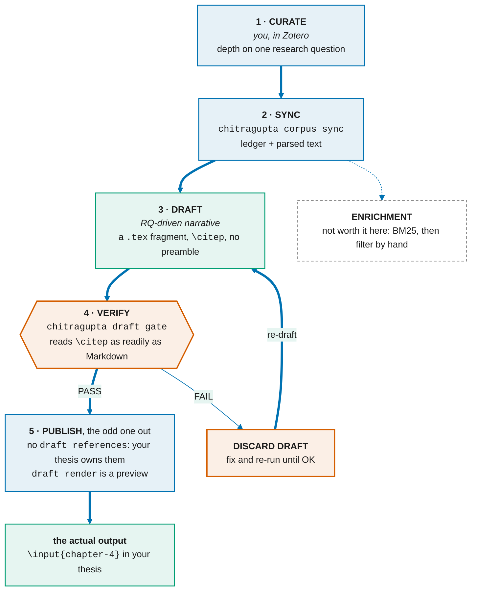

---

## 📎 Appendix

These three answer narrower questions than the groups above, and are kept
separate for that reason.

### ⏱ One draft, in time order

The full workflow with time on the vertical axis instead of dependency. It
shows two things. The first is that **the gate runs
twice**: the PostToolUse hook fires on every write under `content/drafts/`, so
a bad citekey written to disk is refused straight back to the model even if a
skill forgets, and the skill then runs the gate itself, because the hook fires
only on the tool call that wrote the file. The second is the **loop**
that wraps both of them.

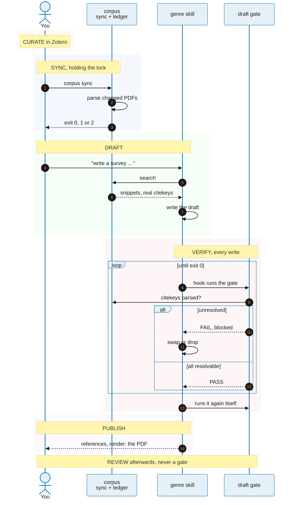

### 📖 The life of a single citekey

The ledger's own state machine, for when the question is "why can't I
cite this paper?". `parsed` is the only state that makes a citekey
citable, and the self-loop on it is the incremental path that makes a
routine re-run nearly free.
`parse_failed` covers two kinds of failure: a transient one (a worker
died, a timeout) is retried on the next sync, and a deterministic one
only under `sync --reparse`.

Note that `stale` deletes nothing. A bib export that comes back short a
citekey is far more often a botched re-export or a `BIB_FILE` pointing at
the wrong path than an intentional deletion, so the row survives until you
re-run with `--remove-stale`.

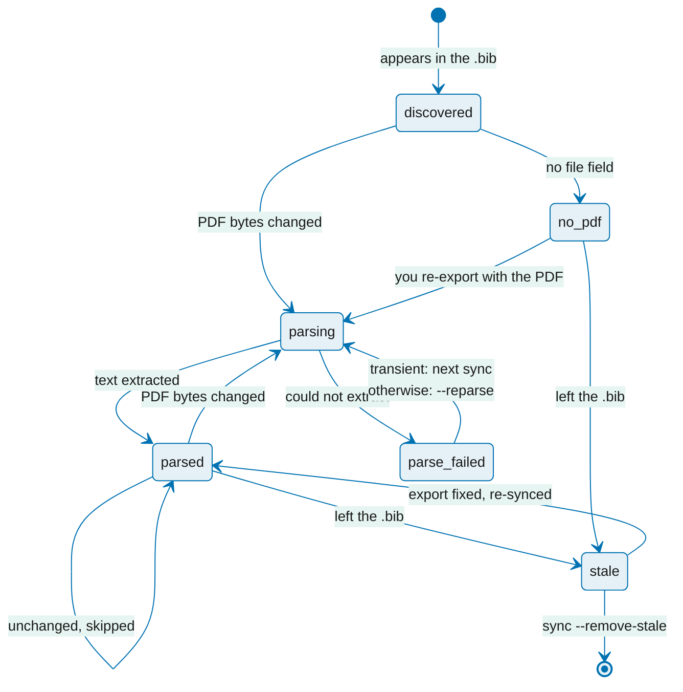

### 🗺 Ladders and tiers, mapped

The six automatic-or-chosen decisions from
[LADDERS.md](LADDERS.md#-the-mapping),
each read left to right: the decision, what implements it, and what it
leaves on disk. Tiers are chosen before a run; ladders descend on their
own at run time. Two decisions leave nothing on disk, so neither shows up
in a backup. LADDERS.md holds the same mapping as a table.

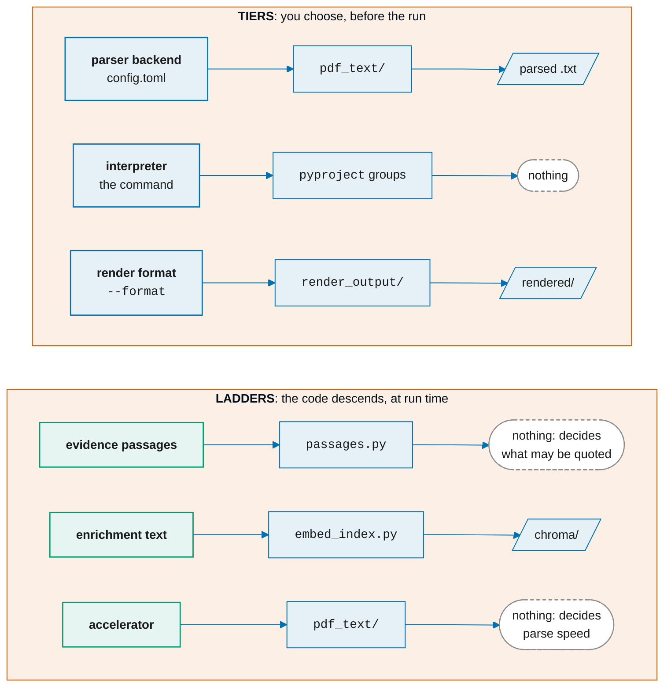

---

## 🕸 Topic discovery

Two views of the discovery feature
([TOPIC-DISCOVERY.md](TOPIC-DISCOVERY.md)), the one group here that
lives before any draft exists: how a free phrase becomes a topic that
exists in the corpus, and what the two topic graphs are.

### 🪜 12. The resolution ladder

Which rung answered is part of the answer. The output's
`resolved_via` field names it, because a topic membership and a
plausible guess must never look alike.

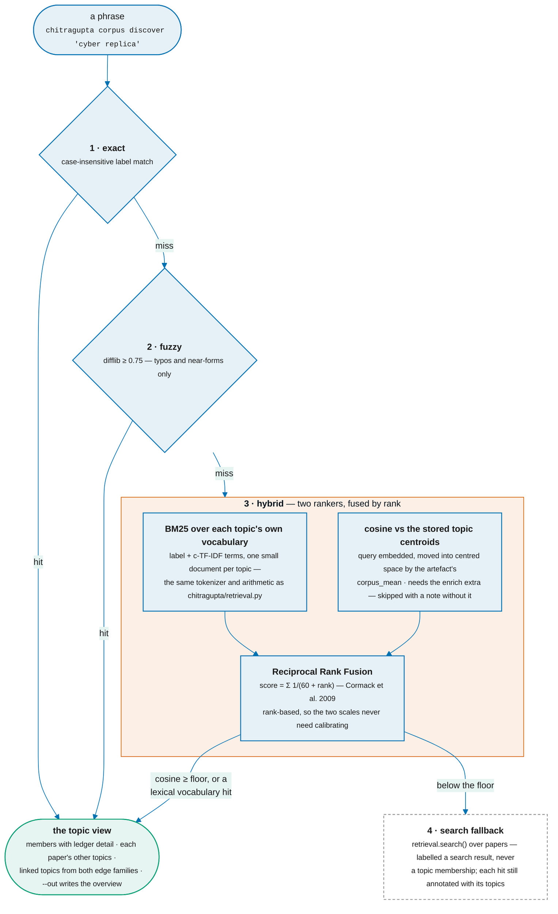

### 🕸 13. The two graphs

Two relations, two files, and the edge families are never merged into
one score. Where they disagree (many shared papers but different
subjects, or the same subject with none), the disagreement is itself a
discovery cue.

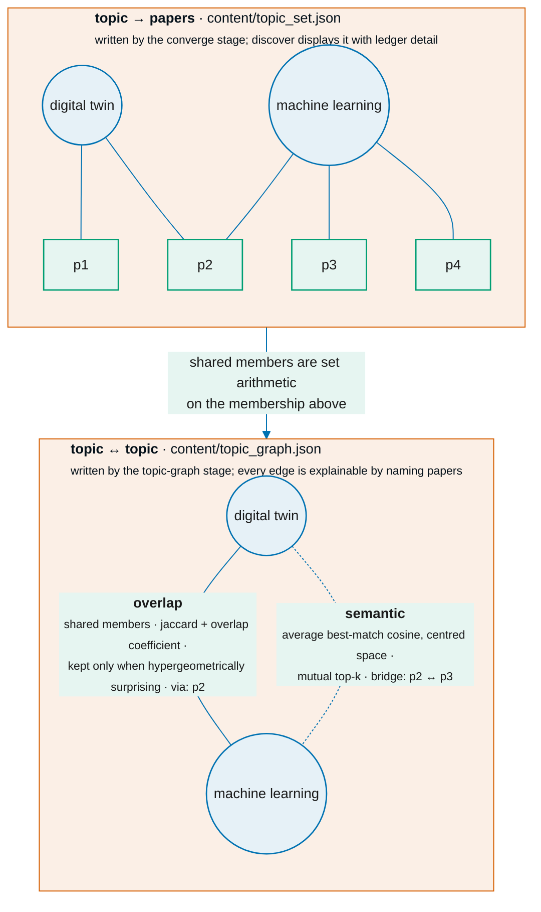

---

## ✏ Editing these

Each diagram is plain Mermaid in a fenced block above. GitHub renders
them, and so does any Mermaid-aware editor. **That block is the source of
truth.**

The same fourteen are also checked in as standalone files, so you can drop
one into a slide deck or a paper without copying it out of this document:

| Path | What it is |
| --- | --- |
| `docs/diagrams/<name>.mmd` | the Mermaid source, with a title line |
| `docs/diagrams/svg/<name>.svg` | for the web: GitHub, the docs site, a browser. On white, at the diagram's own width, laid out on a 1900px page |
| `docs/diagrams/pdf/<name>.pdf` | for a paper or slides: vector, one page cropped to the diagram, text selectable |

**Use the SVG only where a browser draws it.** Mermaid writes a
diagram's labels as HTML inside `<foreignObject>`, which every browser
renders and LaTeX, Inkscape, `rsvg-convert` and most slide tools do not:
they show the boxes and arrows with no text. The PDF comes from the same
browser render, so its labels survive anywhere. Turning
`htmlLabels` off instead was tried and rejected: the labels' `<b>`, `<i>`,
`<small>` and `<br/>` then print as literal tags and the spaces between
words collapse.

| Diagram | `<name>` |
| --- | --- |
| 1. One glance | `v1-overview` |
| 2. Your first run | `v2-first-run` |
| 3. The full workflow | `00-main-workflow` |
| 4. Everything on disk | `v3-artifacts` |
| 5. Gates and exit codes | `v4-gates-and-failure` |
| 6. Inside one parse | `v5-parallelism` |
| Genre A: corpus-led | `g1-corpus-led` |
| Genre B: teaching | `g2-teaching` |
| Genre C: LaTeX-native | `g3-thesis` |
| Appendix: one draft, in time order | `extra-sequence` |
| Appendix: the life of a single citekey | `extra-ledger-state` |
| Appendix: ladders and tiers, mapped | `ladders-mapping` |
| Topic discovery: the resolution ladder | `t1-discovery-ladder` |
| Topic discovery: the two graphs | `t2-topic-graphs` |

### 🗂 Diagrams in other documents

A Mermaid block anywhere else under `docs/` is exported the same way. The
line directly above its fence names it:

```markdown
<!-- diagram: book-index-flow -->
```

`--sync` refuses a block with no such line, and a name used twice, so no
diagram in the documentation goes without an export or overwrites
another's. There are fifteen:

| Diagram | In | `<name>` |
| --- | --- | --- |
| The four layers | [ARCHITECTURE.md](ARCHITECTURE.md) | `architecture-layers` |
| The four stages | [CORPUS-SEARCH.md](CORPUS-SEARCH.md) | `corpus-search-stages` |
| Why the rerank sits where it does | [CORPUS-SEARCH.md](CORPUS-SEARCH.md) | `corpus-search-rerank` |
| The guarantee everything else serves | [FEATURES.md](FEATURES.md) | `features-guarantee` |
| The four layers | [FEATURES.md](FEATURES.md) | `features-layers` |
| The dossier | [FEATURES.md](FEATURES.md) | `features-dossier` |
| Where the stage sits | [GROBID-CITATION-GRAPH.md](GROBID-CITATION-GRAPH.md) | `grobid-stage` |
| The citation graph | [GROBID-CITATION-GRAPH.md](GROBID-CITATION-GRAPH.md) | `grobid-citation-graph` |
| The terms | [LADDERS.md](LADDERS.md) | `ladders-terms` |
| The pipeline in one pass | [LADDERS.md](LADDERS.md) | `ladders-pipeline` |
| A single-context skill | [PROMPTS.md](PROMPTS.md) | `prompts-single-context` |
| The orchestrating context | [PROMPTS.md](PROMPTS.md) | `prompts-orchestrator` |
| A dispatched subagent's context | [PROMPTS.md](PROMPTS.md) | `prompts-subagent` |
| The short answer | [RETRIEVAL.md](RETRIEVAL.md) | `retrieval-short-answer` |
| How the book index is built | [book/BOOK-INDEX.md](book/BOOK-INDEX.md) | `book-index-flow` |

All twenty-nine are exports, not a second source. Edit the fenced block
first, then sync and re-render, or the two drift apart:

```bash
python scripts/render_diagrams.py --sync        # stamp the theme, copy blocks to .mmd
npm install -g @mermaid-js/mermaid-cli@11       # 12 dropped the -w flag used here
python scripts/render_diagrams.py v1-overview   # or no name, for all of them
```

`--sync` prints the names whose `.mmd` changed, which are the ones to
re-render. It touches no export itself. It stamps the house theme below
into every block it exports, in whichever document the block lives, and
writes `docs/stylesheets/mermaid.css`, which sets the docs site's own
Mermaid colours to the same palette: mkdocs-material's colour variables
otherwise override the theme, and an unclassed node turned amber.

### 🎨 The house theme

Every block opens with the same `%%{init: ...}%%` directive, and every
flowchart closes with the same four `classDef`s. Neither is typed by
hand: `--sync` generates both from the `\definecolor` block in
[TIKZ-STYLE.md](TIKZ-STYLE.md#-the-house-palette), so a diagram and a
paper figure share one palette with no hex written twice. GitHub renders
a fenced block as it stands and cannot include a shared file, so the
text has to be repeated in every block. Restamping replaces it rather
than adding a second copy, so after a palette change, `--sync` and a
re-render are the whole job. `tests/test_diagrams_in_sync.py` fails on
a block carrying an older theme, on a `classDef` of a diagram's own, and
on any hex the theme does not hold.

A node takes one of four roles, the same four the TikZ palette gives:

| Class | Drawn as | Use it for |
| --- | --- | --- |
| `flow` | blue tint, blue rule | the spine: steps, questions, anything a run passes through. An unclassed node looks the same |
| `alt` | green tint, green rule | a second class of node: a store beside the steps, a generative step beside the deterministic ones, a success end |
| `key` | vermilion tint, heavier rule | the one thing the figure is about, such as the citation gate and its refusal, or the ways a run stops |
| `absent` | white, grey dashed rule | off the path: review aids, caches, opt-in enrichment, things you may never see |

As in TikZ, `key` marks one idea per figure. Accent two things and
neither stands out. `--sync` adds the roles to flowcharts and state
diagrams, the two types Mermaid lets a `classDef` style. A sequence
diagram has no classes, and the directive alone gives it the palette.

The script runs `mmdc -i <name>.mmd -b white` twice, to
`svg/<name>.svg` with `-w 1900` and to `pdf/<name>.pdf` with `--pdfFit`,
and records the fingerprint of each `.mmd` whose two exports both
rendered in
`docs/diagrams/svg/sources.json`. `tests/test_diagrams_in_sync.py`
checks every export against that file, so an `.mmd` edited without a
re-render fails, naming the diagram to re-render. On a host that cannot
sandbox Chromium (a container, CI), pass `--puppeteer-config` a JSON
file holding `{"args": ["--no-sandbox"]}`. mermaid's layout is not
deterministic run to run, so a re-render of an unchanged source can move
edges; only the labels and the fingerprint are pinned.

If a diagram and the code disagree, the diagram is the bug.
