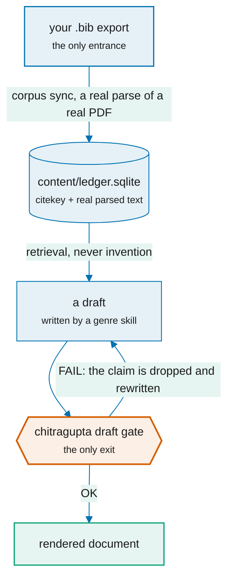
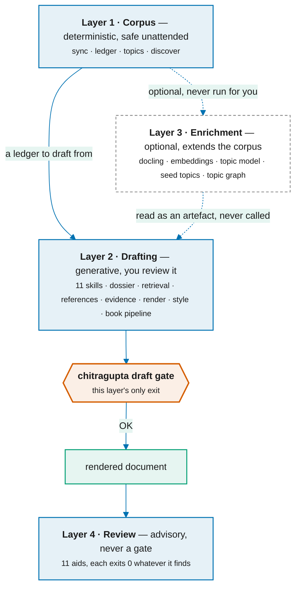
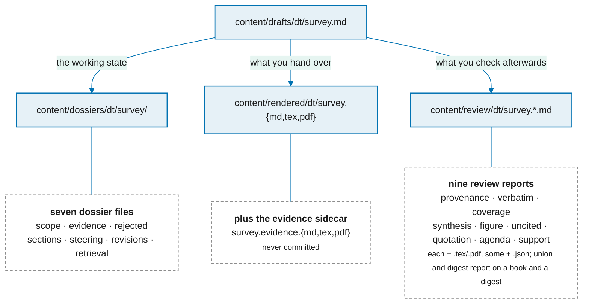

# ✨ Features

Status: **reference.**

**Written for** you: someone who writes technical documents (a
survey, a thesis chapter, a textbook, a report) and is deciding whether
this tool does what you need, or wants its whole capability surface in
one place. **Assumed:** nothing. **Not covered here:** how to invoke
any of it ([CLI.md](CLI.md)), how the workflow *flows*
([DIAGRAMS.md](https://github.com/prasadtalasila/chitragupta/blob/main/docs/DIAGRAMS.md)
draws it fourteen ways), or why the architecture is shaped this way
([ARCHITECTURE.md](ARCHITECTURE.md), [SOUL.md](../SOUL.md)).

This document routes and does not restate: every feature names the
document that owns its detail, and stops there
([how that is enforced](#-how-this-document-stays-true)). Every artefact
named below also exists as a committed example in
`docs/examples/sample-project/` ([the examples map](examples/README.md)),
produced by running the pipeline over five sample papers.

## 🔑 The guarantee everything else serves

Every feature in this document exists to support one sentence:

> **A citekey may be used only if it appears in your own `.bib` export
> *and* was picked up into the ledger by a real parse of a real PDF.**

Fabricated placeholder references have reached real published papers.
The guarantee rests on the pipeline's shape:

<!-- diagram: features-guarantee -->

- **One entrance.** Citekeys come from your reference manager's export,
  read by exactly one module (`chitragupta/bib_reader.py`). Nothing in
  the pipeline fetches a paper, invents a citekey, or renames one.
- **One exit.** `chitragupta draft gate` sits on the single path between
  a draft and a rendered document, and a `FAIL` is treated like a
  failing test. A `PostToolUse` hook also runs it on every write to a
  draft ([HOOKS.md](HOOKS.md)).

A failed gate loops back to *drafting*, not to you: the skill discards
the unsupported claim and writes again. You are involved only when the
paper genuinely is not in the corpus yet.

## 🏗 The four layers

Everything below is one of four layers, numbered by the order you meet
them; layer 3 is optional and nothing needs it.
[ARCHITECTURE.md](ARCHITECTURE.md) explains the split.

<!-- diagram: features-layers -->

| Layer | Generative? | Blocks you? | Takes the corpus write lock? |
| --- | --- | --- | --- |
| 1 · Corpus | No: no LLM, no judgement calls | Only the gate, which lives in layer 2 | **Yes** |
| 2 · Drafting | Yes | The gate does, and only the gate | No; read-only over the corpus |
| 3 · Enrichment | No | No | **Yes**, same lock as `sync` |
| 4 · Review | No | **Never** | No; keeps working during a `sync` |

## 📚 Corpus layer: turning a library into a ledger

Deterministic and safe to run unattended: same bibliography in, same
citekeys out.

| Feature | What it gives you | Detail |
| --- | --- | --- |
| `corpus sync` | bib read, ledger update, PDF text extraction, duplicate-citekey check, stale-citekey report | [ARCHITECTURE.md](ARCHITECTURE.md) |
| `corpus ledger` | inspect what the corpus holds, by citekey, collection or status | [CLI.md](CLI.md) |
| `corpus topics` | the topic clustering, once the enrichment layer has built it | [TOPIC-MODELLING.md](https://github.com/prasadtalasila/chitragupta/blob/main/docs/TOPIC-MODELLING.md) |
| `corpus discover` | start from any phrase and find the topics, papers and neighbours your corpus holds | [TOPIC-DISCOVERY.md](TOPIC-DISCOVERY.md) |
| Two parser backends | `pdftotext` (fast, bit-reproducible) or Docling (layout-aware) | [PDF-PARSER.md](PDF-PARSER.md) |
| Zotero group support | export a shared group library without Better BibTeX | [EXPORT-ZOTERO-GROUPS.md](EXPORT-ZOTERO-GROUPS.md) |

Four things to know before you rely on it:

- **Removal is opt-in.** `sync` only *reports* a citekey that dropped
  out of your bib export, naming every artefact that still references
  it, and deletes nothing until re-run with `--remove-stale`.
- **A citekey is also a filename stem.** One containing a path
  separator, a character Windows forbids, or a reserved device name is
  **skipped with a warning naming it**, never sanitised; rename it in
  your reference manager.
- **Determinism has one asterisk.** Docling is not bit-reproducible;
  [ARCHITECTURE.md](ARCHITECTURE.md) says where that bites.
- **A topic id is not a stable identifier.** Adding one document can
  renumber every other document's topic.

## 🕸 Finding what to write about: topic discovery

`chitragupta corpus discover` maps your own library before you draft:
what it is about, which papers belong to a theme, and what sits next to
it. There is no web search and no generated summary, and every paper is
named by its real citekey.

| You ask | You get |
| --- | --- |
| `corpus discover` | every topic, with how many papers each holds |
| `corpus discover "digital twin"` (any phrasing) | the nearest topic's papers, their other topics, and the linked topics with the shared papers that link them |
| `... --groups`, `--clusters`, `--hops`, `--path`, `--compare`, `--why` | broad areas, disagreements between relations, neighbourhoods, chains, side-by-side views, and why two topics have no edge |
| `... --out`, `--html`, `--app` | a topic overview to seed a draft, an offline topic map, or an interactive app you can hand to anyone |

Nothing is generated: relations are computed from shared papers and
closeness in meaning, and every link names the papers behind it. You
can score the lookup on your own corpus with questions you write.
[TOPIC-DISCOVERY.md](TOPIC-DISCOVERY.md) has the detail;
[EXPLORE-CLI.md](EXPLORE-CLI.md) and [EXPLORE-WEB.md](EXPLORE-WEB.md)
are worked tours of the terminal and the app.

## ✍ Drafting layer: writing something grounded

### 🤖 Eleven skills

Six write a new draft, three change one that already exists, one
assembles a book from units the others wrote, and one draws the figures
the others hand it. Asking in ordinary words selects one
([GENRE.md](GENRE.md)).

| Skill | Writes | Reader |
| --- | --- | --- |
| `survey-writer` | literature survey, related work, "state of the art" | someone entering a field who needs the map and the gaps |
| `thesis-chapter-writer` | a `.tex` chapter fragment, RQ-driven | an examiner reading adversarially |
| `textbook-chapter-writer` | undergraduate chapter with worked examples | a student studying, not typing |
| `tutorial-writer` | a hands-on lesson to a working result | a learner at a keyboard |
| `deep-research` | multi-perspective report, heaviest by design | someone who needs perspectives reconciled |
| `review-digest` | a verbatim digest: a survey whose body is the papers' own words, a citation on every run, checked by `review digest` | someone studying privately ([VERBATIM-DIGEST.md](VERBATIM-DIGEST.md)) |
| `draft-reviser` | edits an existing draft, from its dossier | (the cheap, default path for any change) |
| `corpus-reviser` | edits an existing draft, re-searching everything | (by explicit request only) |
| `agenda-reviser` | repairs the unattended findings a review agenda found | (one item at a time) |
| `book-assembler` | one LaTeX book from accepted units | [WRITE-A-BOOK.md](WRITE-A-BOOK.md) |
| `figure-drawer` | one TikZ figure and its ASCII twin, for a draft | [FIGURE-DRAWER.md](FIGURE-DRAWER.md) |

The rule that saves the most money is never to re-run a genre skill to
change a draft that exists
([TOKENS.md](https://github.com/prasadtalasila/chitragupta/blob/main/docs/TOKENS.md)
measures it).

### 🗂 The dossier: why a draft is revisable months later

Every drafting run writes `content/dossiers/<the draft's path minus its
suffix>/`: Markdown files readable by a human or a model with no
tooling.

<!-- diagram: features-dossier -->

One path, mirrored four ways, so everything belonging to a draft is
findable from the draft's own path, and `draft dossier export` can
bundle it by matching paths. [DOSSIER.md](DOSSIER.md) explains each
file, the `claim:`/`quote:` contract and why it is Markdown; it is
machine-facing, where [REVIEW.md](REVIEW.md) is written for you.

`chitragupta draft dossier` works with one by hand. Its `status` names
citekeys new to the corpus apart from cited ones that have left it, and
reports a hand edit since the last `stamp`. `dossier init --outline`
lets you declare the structure and queries before drafting, and `status`
reports whether the draft ran them. `draft diff <draft>` compares the
draft with a snapshot the reviser kept, linking each changed section to
its `revisions.md` entry, with a latexdiff redline under `--format pdf`.
[DRAFT-ITERATION.md](DRAFT-ITERATION.md) has the reasoning.

### 📖 Evidence: `claim:` and `quote:`

Kept evidence records what a source establishes in the drafter's own
words (`claim:`) separately from its exact wording (`quote:`, optional,
one line per passage meant to be quoted).
Only `claim:` may be drafted from, and it is written before any sentence
of the draft exists. `chitragupta draft evidence` renders the quoted
spans into an **evidence sidecar** beside the render, the one legitimate
home for verbatim material. Four of the six genres emit one;
[DOSSIER.md](DOSSIER.md#-the-evidence-sidecar-decided-per-genre) records
why `tutorial-writer` and `review-digest` do not. A sidecar is never
committed.

### 🔎 Retrieval, references and rendering

| Feature | What it gives you | Detail |
| --- | --- | --- |
| `draft retrieve` | BM25 search and evidence windows over the parsed corpus | [RETRIEVAL.md](RETRIEVAL.md) |
| `draft references` | an IEEE reference list built only from citekeys the draft already cites | [CLI.md](CLI.md) |
| `draft render` | `.md`, `.tex`, `.pdf`, `.docx` via Pandoc, numbered IEEE-style | [CLI.md](CLI.md) |
| `draft style` | prose checked against the house writing standards; a review aid, never a gate | [WRITING-STANDARDS.md](WRITING-STANDARDS.md) |
| TikZ figures | figures drawn to a documented style from a scaffold per layout metaphor (`assets/tikz/`), kept current by `figure sync`, checked by `figure check`, started by `figure new` and previewed by `figure look`; a figure corrected with a pen is revised from a photo ([MANUAL-FIGURE.md](MANUAL-FIGURE.md)) | [TIKZ-STYLE.md](TIKZ-STYLE.md) |

### 📕 Book-scale drafting

`draft spec`, `draft unit` and `draft registry` turn the same machinery
into a book: an outline you sign off, a per-section generation contract
with a recorded acceptance, and terminology/claim/cross-reference checks
over the accepted units. Two human sign-offs, not one.
[WRITE-A-BOOK.md](WRITE-A-BOOK.md) has the workflow.

### 🔭 Per-citekey TL;DR

`draft tldr write <citekey>` (summary on stdin) and `draft tldr show
<citekey>` cache a one-paragraph summary per citekey under
`content/tldr/`. The tool never generates one, and it is keyed to a
fingerprint of the parsed text, so `show` reports a summary stale after
a re-parse. Where nobody wrote one, `show` falls back to the authors'
own abstract from the passage sidecar, extracted rather than summarised
and re-derived on every read, and says so when there is none
([TLDR.md](TLDR.md)). A written summary may be LLM output, so it stays
out of `corpus ledger`.

### 🖼 Per-citekey figures

`draft figures <citekey>` lists one paper's figures (caption, page, the
string to cite each by, and the path to its crop), the only route
figures have to drafting, since retrieval indexes text alone. **Consider,
never replicate**: the crops are a reading aid, and no source image is
placed in a draft except beside its words in a verbatim digest
([VERBATIM-DIGEST.md](VERBATIM-DIGEST.md)). It tells a paper with no
figures from one the docling stage has not reached
([CLI.md](CLI.md#-chitragupta-draft-figures)).

## 🔍 Review layer: eleven advisory aids

Run by hand on a finished draft. **None of them gates anything, and none
may be promoted to a gate**; [SOUL.md](../SOUL.md) has why. Each
produces evidence for a human judgement and exits 0 whatever it finds.

| Aid | Answers |
| --- | --- |
| `review provenance` | what in each cited source actually supports the claim citing it, quoting a real passage |
| `review verbatim` | how much wording the draft shares with its sources, and with **any** parsed source, cited or not |
| `review coverage` | retrieval surfaced these sources; did the draft cite them? |
| `review synthesis` | how many sources each unit rests on, at the unit its genre binds at |
| `review figure` | what a TikZ figure's geometry and source say: overlapping nodes, protrusion, overlong labels, stranded arrowheads, a hand-loaded TikZ library |
| `review uncited` | which sentences carry no citation at all. The one aid that reads no corpus |
| `review quotation` | is each quoted span in the dossier really in the source it is attributed to? The one aid whose answer is binary |
| `review agenda` | merges the eight draft-level aids' reports into one ranked, deduplicated worklist |
| `review support` | does the cited source actually entail this claim, scored by a real NLI entailment model |
| `review union` | does an assembled book still cite every citekey its accepted units stand on? The one aid that reads a book rather than a draft |
| `review digest` | how much of a verbatim digest is not the sources' own words, and what each such sentence is. The one aid over a genre of its own, and the one the agenda never reads |

The gate answers a question with one correct answer, so it can be
absolute. Eight of the eleven aids answer questions of judgement.
`quotation` is binary but measures against the parse rather than the
ledger ([ARCHITECTURE.md](ARCHITECTURE.md)); `union` is set arithmetic
that decides nothing about whether dropping a source was right; `agenda`
inherits its items' answers. [REVIEW.md](REVIEW.md) explains each aid
and the two limits to know before you trust a report.

## 🧠 Enrichment layer: optional depth

Nothing above needs it, and a skill never runs it on your behalf,
because it is expensive.

| Stage | What it adds |
| --- | --- |
| `docling` | layout-aware parsing, and per-passage sidecars |
| `embed` | a semantic index for retrieval and the verbatim embedding tier |
| `bertopic` | topic clustering over the corpus |
| `extract-keywords` | the papers' own declared keywords, aggregated into `content/keywords.toml` |
| `seed-topics` | your own seed topics, unioned with the extracted keywords, folded into that clustering |
| `converge` | seed and emergent topics, joined into one topic set |
| `topic-graph` | the topic graph: how topics relate, by shared papers and by meaning |

[TOPIC-MODELLING.md](https://github.com/prasadtalasila/chitragupta/blob/main/docs/TOPIC-MODELLING.md)
carries the evidence for the topic stages,
[TOPIC-DISCOVERY.md](TOPIC-DISCOVERY.md) the graph, and
[PERFORMANCE.md](PERFORMANCE.md) the costs.

## 🧩 Cross-cutting features

| Feature | What it gives you | Detail |
| --- | --- | --- |
| One CLI, one level deep | `chitragupta <layer> <verb>`, four layers plus `init`/`doctor`/`install`/`figure` | [PACKAGING.md](PACKAGING.md) |
| `--help` everywhere | every layer and command has `--help` in one layout | [CLI.md](CLI.md#-every-command-and-flag) |
| `chitragupta init` | scaffolds a project directory to draft in | [PACKAGING.md](PACKAGING.md) |
| `chitragupta doctor` | tells you what is missing and what to type next | [CLI.md](CLI.md) |
| `chitragupta figure sync` | keeps the house figure-style block current in every figure file, and never overwrites one you edited | [CLI.md](CLI.md#-chitragupta-figure-sync) |
| `chitragupta figure check` | reports every rule one figure file breaks, by rule id, including WCAG 2 contrast; exits 0 whatever it finds | [CLI.md](CLI.md#-chitragupta-figure-check) |
| `chitragupta figure new` | starts a figure from a layout's scaffold, and never overwrites a figure | [CLI.md](CLI.md#-chitragupta-figure-new) |
| `chitragupta figure look` | shows one figure as it will print, as a PDF and a 300 dpi PNG, or with `--draft` on its page | [CLI.md](CLI.md#-chitragupta-figure-look) |
| Config in one file | `config.toml`, every key overridable by environment variable | [CONFIG.md](CONFIG.md) |
| Hooks | the citation gate enforced on every draft write | [HOOKS.md](HOOKS.md) |
| Docker | two images: one that installs the Pandoc/TeX toolchain when you lack root, one that hosts a Claude Code agent with the published package | [DOCKER.md](../DOCKER.md) |
| Graceful degradation | every optional dependency has a documented fallback, and says which one it took | [LADDERS.md](LADDERS.md) |
| Parallelism and locking | a worker pool for parsing, one write lock for the corpus | [PARALLELISM.md](PARALLELISM.md) |

The ladders are the feature most worth understanding: nothing fails
because an optional package is absent; it drops to the next rung and
*says which rung it is on*.

## 🚫 What this deliberately does not do

- **It does not fetch papers.** Curation is yours, in your reference
  manager. There is no auto-download and no auto-sync.
- **It does not rewrite a citekey**, ever, whether to sanitise it or
  to deduplicate it.
- **It does not promote a review aid to a gate.** Eleven advisory aids
  and one gate is the design. See [SOUL.md](../SOUL.md).
- **It does not have a genre for everything.**
  [GENRE.md](GENRE.md#-genres-this-project-does-not-have) lists the ones
  it declines and why.
- **It does not revise a draft by re-running the skill that wrote it.**

## 🗺 Where to go next

- Never used it: [README.md](../README.md), then
  [ZOTERO.md](ZOTERO.md) to get your library in.
- Deciding what to write about: [TOPIC-DISCOVERY.md](TOPIC-DISCOVERY.md).
- Choosing a genre: [GENRE.md](GENRE.md).
- Looking for a command: [CLI.md](CLI.md).
- Want the picture:
  [DIAGRAMS.md](https://github.com/prasadtalasila/chitragupta/blob/main/docs/DIAGRAMS.md),
  fourteen views.
- Wondering what is coming:
  [FEATURE-ROADMAP.md](https://github.com/prasadtalasila/chitragupta/blob/main/docs/FEATURE-ROADMAP.md).

## 🧷 How this document stays true

For the maintainers: the lists and the prose counts here are pinned to
the code by `tests/test_features_doc.py`, so adding a review aid or a
genre skill without updating this file fails that test.
