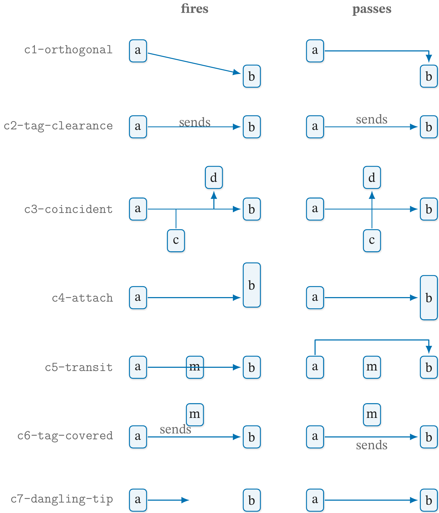
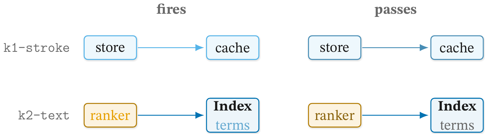
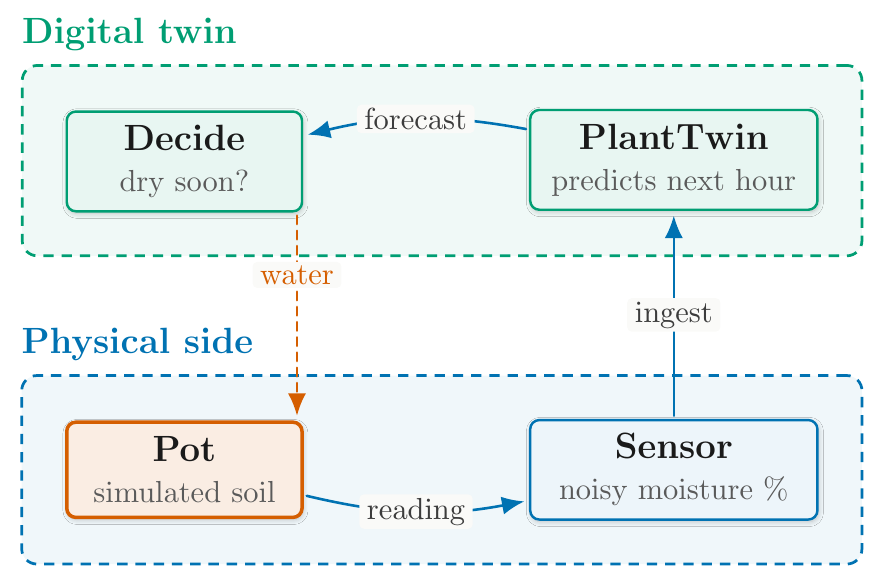

# 🖍 Drawing a figure: the `figure-drawer` skill

Status: **guide.** Written 2026-10-06 (#1027).

**Written for** anyone who wants a figure in a draft: a pipeline, a
control loop, a taxonomy or an architecture, drawn once as TikZ for
the PDF and once as ASCII for every other format. **Assumed:** you have
a draft under `content/drafts/`, or are about to have one from a genre
skill ([GENRE.md](GENRE.md)). **Not covered here:** the figure rules
themselves. The two-form contract, the marker syntax and originality
are [WRITING-STANDARDS.md](WRITING-STANDARDS.md) §10, and what makes
the TikZ half good is [TIKZ-STYLE.md](TIKZ-STYLE.md). This page says
how the skill applies them and when it runs.

## 🧭 Table of contents

- [What it is, and what it is not](#-what-it-is-and-what-it-is-not)
- [Three ways it runs](#-three-ways-it-runs)
- [What you get](#-what-you-get)
- [What it does, step by step](#-what-it-does-step-by-step)
- [What `figure check` looks for in lines and colours](#-what-figure-check-looks-for-in-lines-and-colours)
- [A worked example](#-a-worked-example)
- [Thesis fragments](#-thesis-fragments)
- [What it never does](#-what-it-never-does)
- [Why the genre skills keep a short figure step](#-why-the-genre-skills-keep-a-short-figure-step)
- [When something goes wrong](#-when-something-goes-wrong)

## ⚖ What it is, and what it is not

`figure-drawer` owns **how** a figure is drawn: the layout metaphor,
the scaffold it starts from, panel letters, the ASCII twin, the compile
probe and the geometry review. It does not decide **whether** a draft
gets a figure. Each genre sets its own threshold, from the tutorial
(draw every figure that makes a step clearer) to the survey (rarest of
all, since the comparison table usually does the work). `deep-research`
draws no figures.

It also **never presents a draft**. It draws one figure, checks it,
and returns to whichever skill called it. The gate, the render, the
prose check and the verbatim scan stay with that skill.

## 🚦 Three ways it runs

| Who calls it | When | What happens after |
| --- | --- | --- |
| A genre skill: `survey-writer`, `tutorial-writer`, `textbook-chapter-writer`, `thesis-chapter-writer` | mid-draft, once the genre's figure step decides a figure is warranted | back to the genre skill's next step, which places the marker and caption, gates and renders |
| `draft-reviser` | you asked to redraw or fix a figure in an existing draft | back to `draft-reviser`, which logs the change in `revisions.md` |
| You, directly | you asked for a figure in an existing draft | a revision: the session continues in `draft-reviser`'s write-back and gate steps |

You never name a skill. Ask in ordinary words and the right one
answers. A direct request needs three things: **which draft, where in
it, and what the figure shows.**

```text
Draw a figure for step 4 of
content/drafts/labs/first-twin.md showing the loop between the pot,
its sensor and the twin.
```

```text
The retrieval diagram in content/drafts/rag/survey.md overflows the
page. Redraw it.
```

```text
Add a figure to section 2 of content/drafts/thesis/methods.tex showing
the three study phases.
```

On a direct request the genre's threshold does not apply, because you
asked for the figure. With no draft to put it in, the skill says so and
stops.

## 🎯 What you get

Two files under the draft's topic directory, plus one line (or block)
in the draft that names them:

| Draft | In the draft | Files |
| --- | --- | --- |
| `.md` (survey, tutorial, textbook chapter) | `<!-- figure: figures/<name> -->` on a line of its own, a caption line directly below it if the figure warrants one, and `<!-- figureref: <name> -->` wherever prose points at it | `figures/<name>.tex` and `figures/<name>.txt` |
| `.tex` (thesis chapter) | `\input{figures/<name>.tex}` then `%figure: figures/<name>`, inside a hand-written `figure` float with `\caption` and `\label` when captioned | the same pair |

The renderer puts the TikZ in the `tex` and `pdf` outputs and the ASCII
form, in a code block, in `md`, `html` and `docx`. Nothing writes
"Figure 3" by hand: the renderer, or your thesis's own LaTeX, numbers
it.

A flat draft (`content/drafts/<slug>.md` with no topic directory) would
put its figures in `content/drafts/figures/`, shared with every other
flat draft. The skill asks whether to move the draft and its dossier
into a topic directory first, or to drop the figure.

## 🪜 What it does, step by step

Each step names the document that owns its rule.

1. **Looks before drawing.** `python -m chitragupta.draft figures
   <citekey>` lists a cited paper's figures, with a crop of each. Seeing
   how a concept is usually drawn is fine. Reproducing one is not
   ([AGENTS.md](../AGENTS.md), [WRITING-STANDARDS.md](WRITING-STANDARDS.md)
   §10).
2. **Commits to a layout metaphor and starts from its scaffold** in
   `assets/tikz/`: pipeline, map, layered stack, control loop, branching
   tree, hub-and-spoke or zoned spine.
   `python -m chitragupta.figure new <figures-dir> <name> --layout <id>`
   copies it, keeps its `% cg-layout:` line, runs `figure sync` on the
   copy to keep the house style block current, and never overwrites a
   figure ([CLI.md](CLI.md#-chitragupta-figure-new)). The skill then
   re-labels it and leaves the house style block alone
   ([TIKZ-STYLE.md](TIKZ-STYLE.md)).
3. **Letters the panels** `(a)`, `(b)`, `(c)` in both forms, if the
   figure has more than one.
4. **Writes the ASCII twin** in §10's 7-bit alphabet, showing the same
   boxes, arrows and letters.
5. **Keeps every citekey out of both files**, because the gate reads
   the draft and does not follow `\input`.
6. **Probes and compiles.** `kpsewhich tikz.sty` first. If TikZ is
   missing, it writes no pair: the ASCII goes inline instead (a fence in
   Markdown, `verbatim` in a thesis fragment), with no marker. Otherwise
   it compiles the figure alone in a minimal document with `lualatex`,
   the pdf render's engine, because a broken figure fails the whole PDF
   render.
7. **Checks it.** `python -m chitragupta.figure check figures/<name>.tex`
   reports every rule the figure breaks, by rule id: width, stray
   space, more than one accented node, overlaps, protrusions and the
   rest. The skill fixes each finding or records why it is deliberate
   with a `% cg-allow:` line in the figure
   ([TIKZ-STYLE.md](TIKZ-STYLE.md#-the-rules-figure-check-reports)).
   Beside them it prints advisory size reports (height, slack, short
   arrows, node and edge counts), each against the reference range of
   the layout the figure's `% cg-layout:` line names; those are read,
   never resolved. It exits 0 whatever it finds; it is an aid, never a
   gate.
8. **Looks at the real render.** The probe is a bare article class,
   but the pipeline's own PDF is the draft's whole document, with its
   floats and neighbouring text, so labels can wrap and gaps close
   differently there. `python -m chitragupta.figure look` sets the
   figure alone on the render's own page, cropped to it, as a PDF and a
   300 dpi PNG; once the draft carries the marker, `--draft` renders the
   PDF too and writes a PNG of the page that holds the figure
   ([CLI.md](CLI.md#-chitragupta-figure-look)). The skill checks both
   against the same pre-flight list. This needs LuaLaTeX and `pdftoppm`
   (poppler), and `pandoc` for the page, which `chitragupta install
   os-deps` installs on Linux; without them, or in a harness that cannot
   view an image, the skill skips the look and says so.
9. **Returns** the two paths, whether the probe passed, what
   `figure check` reported and allowed, and whether it checked the
   rendered page.

The skill reads `.claude/skills/figure-drawer/references/figures.md` (one
copy, whichever harness runs it) only when a step sends it there: which
metaphor fits, a worked panelled figure, fitting a figure without scaling it,
and an annotated exemplar. Beside it, `references/patterns.md` routes what a
figure argues to a layout, and `references/layouts/` holds one file per
layout with its anti-patterns and the reference ranges (node and edge counts,
width, height, slack) measured from its scaffold and exemplars.

## 🔬 What `figure check` looks for in lines and colours

Most of what `figure check` reports is about the whole picture: its
width, its one accented node, nodes that overlap. Nine rules look
closer. **c1 to c7** measure the *connectors*, the lines TikZ drew
between two nodes, and **k1 and k2** measure *contrast*, whether a
line or a word can be told apart from the colour behind it. Each one
names a defect a reader sees in the PDF and that no one notices in the
`.tex`.

This section explains them. The thresholds, and the exact wording of
what each reports, are in [TIKZ-STYLE.md's
table](TIKZ-STYLE.md#-the-rules-figure-check-reports), which is the one
place a number is stated. Each **Fix** below is the line
`references/check.md` gives the skill, word for word;
`tests/test_figure_rule_ids.py` holds the two to the same text.

In each picture the left panel fires the rule and the right one passes
it. `tests/test_figure_rule_gallery.py` re-checks both pictures, so
they stay true when a threshold moves.





### Which rules matter for which layout

A rule that *applies* is measured on every figure of that layout.
*Exempt* means `figure check` skips the rule for a figure whose
`% cg-layout:` line names that layout, because the layout's grammar
breaks it on purpose. *Rare* means the rule is measured, but the
layout seldom gives it anything to find.

| Rule | Pipeline | Map | Layered stack | Control loop | Branching tree | Hub-and-spoke | Zoned spine | Comparison | State machine | Sequence | Timeline |
| --- | --- | --- | --- | --- | --- | --- | --- | --- | --- | --- | --- |
| c1-orthogonal | applies | rare | applies | applies | applies | exempt | applies | applies | exempt | applies | applies |
| c2-tag-clearance | applies | rare | applies | applies | applies | applies | applies | applies | applies | applies | rare |
| c3-coincident | applies | rare | applies | applies | applies | applies | applies | applies | applies | rare | rare |
| c4-attach | applies | rare | applies | applies | applies | exempt | applies | applies | exempt | exempt | applies |
| c5-transit | applies | rare | applies | applies | applies | applies | applies | applies | applies | exempt | applies |
| c6-tag-covered | applies | rare | applies | applies | applies | applies | applies | applies | applies | applies | rare |
| c7-dangling-tip | applies | rare | applies | applies | applies | applies | applies | applies | applies | applies | applies |
| k1-stroke | applies | applies | applies | applies | applies | applies | applies | applies | applies | applies | applies |
| k2-text | applies | applies | applies | applies | applies | applies | applies | applies | applies | applies | applies |

A map argues by where things sit, so its scaffold draws no line, and
c1 to c7 seldom have anything to measure. A timeline's lines are the pieces of
its axis, which carry no tag and never run side by side, so c2, c3
and c6 seldom fire on it; the rest hold every piece. A comparison's lines run
inside each panel, never between them, and are held to every rule. A
state machine is exempt from c1 and c4 like the hub, because an
automaton's transitions curve and loop back on their own state.

### c1-orthogonal: lines run level, upright, or as an elbow

**The rule.** A connector between two nodes that are offset both
across and down the page must turn a corner (`-|` or `|-`), not cut
across on a slant or a curve.

**Why it matters.** A slanted line between boxes on a grid reads as a
different kind of relation, and two of them cross at angles the eye has
to untangle.

**Where.** Every layout built on a grid: pipelines, stacks, spines,
trees (the house tree fans its edges out square) and sequences, whose
messages are level by construction. A hub is exempt, because its spokes
are diagonal by design, and so is a state machine, whose transitions
curve. A control loop's `bend` passes only between nodes that are level
with each other, which is how its scaffold draws it.

**Fix.** Route the edge as an elbow, `-|` or `|-`, or line the two
nodes up.

### c2-tag-clearance: a tag sits just beside its line

**The rule.** The words on a line (its tag) sit between 0.8mm and 3mm
from it: not on it, and not floating away from it.

**Why it matters.** A tag on its line cuts the line where the eye is
following it; a tag far from its line is read as belonging to the next
one.

**Where.** Wherever lines carry words: a control loop's output, a
spine's hand-offs, and above all a sequence, where every message is
tagged.

**Fix.** Use `cgtag` (unfilled, `auto`), which sits 1mm clear; never a
filled tag over its line.

### c3-coincident: two lines never share a stretch

**The rule.** Two connectors may not run on top of each other for more
than 2mm. Two that leave the same point are a fork and are allowed.

**Why it matters.** Where two lines coincide the reader sees one, and
cannot tell where either goes.

**Where.** Where several lines head the same way: into a hub, between
the layers of a stack, along a spine. A sequence rarely meets it, since
each message has its own moment.

**Fix.** Give each edge its own lane: attach at a different point, or
offset one.

### c4-attach: a line meets the middle of a side

**The rule.** One line arriving at a side meets it at the midpoint;
several arriving at one side are spread evenly along it, at least 2mm
apart.

**Why it matters.** A line that lands near a corner looks as if it
belongs to the next box, and lines bunched at one end of a side read as
a single wider line.

**Where.** Every grid layout. A hub is exempt, because its spokes meet
the centre at every angle, and so is a state machine, whose curved
transitions leave a state wherever the bend takes them. A sequence is
exempt, because messages meet a lifeline wherever time puts them, not
at even spacing. A curve's ends, like a control loop's bends, are not
measured.

**Fix.** Attach a lone edge at the side's midpoint (`a.east`); spread
several evenly along the side, at least 2mm apart.

### c5-transit: a line goes round, not through

**The rule.** A connector may not pass through a node that is neither
of its two ends. A zone card around one of its ends does not count.

**Why it matters.** A line through a box reads as passing through that
stage, which is a claim the figure did not mean to make.

**Where.** Wherever a long line has boxes in its way: a spine whose
lines cross zone members, a stack whose calls skip a layer. A sequence
is exempt: a message that passes over the lifelines between its ends is
how the diagram says "these parties are not involved".

**Fix.** Re-route the edge around the node it crosses, or move the
node.

### c6-tag-covered: a tag stays clear of other boxes

**The rule.** A line's tag may not lie over a node.

**Why it matters.** A tag under a box is half hidden, and a tag over a
box reads as part of that box's label.

**Where.** Wherever tagged lines run close to other boxes: tight
control loops, spines with zone members near the path, sequences with
short gaps between parties.

**Fix.** Move the tag clear of the node it sits under.

### c7-dangling-tip: every arrow lands on something

**The rule.** An arrow that leaves a node must end on a node or on
another line, within 1mm. An axis or a dimension line, which leaves no
node, is not read.

**Why it matters.** An arrow ending in empty space points at nothing,
and the reader looks for the box that is missing.

**Where.** Every layout with arrows. It is most often a computed end
point, `(a.north |- b.south)`, that lands beside the box it was aimed at
instead of on it.

**Fix.** End the arrow on the node it points to (`(b)`, `(b.north)`),
not on a computed point beside it.

### k1-stroke: borders and lines stand out from their ground

**The rule.** A box's border, and every connector, meets WCAG's 3:1
contrast against what is behind it: the box's own fill, or the paper or
zone under the line.

**Why it matters.** A border drawn in the same pale tint as its fill
vanishes in print and on a projector, and a pale line looks like a
gap.

**Where.** Every layout, most of all those that lean on tinted cards:
zone cards in a spine, layer bands in a stack, the accented `cgkey`
node, and the dashed return lines (`cgweak`, `cgback`) of a loop or a
sequence.

**Fix.** Draw in the hue's `Line` shade (`draw=cgAuxLine`, not
`draw=cgAux`); a palette name fills, a `Line` name draws.

### k2-text: words are readable on their fill

**The rule.** A node's text meets 4.5:1 contrast against its fill, or
3:1 where it is large text (14pt bold, or 18pt).

**Why it matters.** Grey or tinted words on a tinted box are the first
thing lost when a page is printed, photocopied or read by someone with
low vision.

**Where.** Every layout, wherever a gloss line or a coloured label sits
on a tinted card: the accented node, warm and rose cards, zone titles.

**Fix.** Write in the hue's `Text` shade (`text=cgAccentText`,
`\textcolor{cgAccentText}{...}`), or `cgInk`.

### Re-rendering the pictures

Each picture's TikZ source is beside its PNG in
`docs/images/figure-drawer/`. After changing one, re-render it and copy
the PNG over:

```bash
chitragupta figure look docs/images/figure-drawer/connector-rules.tex
cp content/rendered/connector-rules.look.png docs/images/figure-drawer/connector-rules.png
```

## 🌱 A worked example

Step 4 of a potted-plant tutorial wires a simulated pot to a digital
twin that predicts when the soil will dry and waters it. The request:

```text
Draw a figure for step 4 of the potted-plant tutorial showing the loop
between the pot, its sensor and the twin.
```

The cycle closing is the whole point, so the metaphor is a **control
loop**, and the drawing starts from `assets/tikz/control-loop.tex`.
Two zone cards separate the physical side from the twin, and the one
edge that crosses back (the twin watering the pot) is drawn as the
loop's return:



The figure's own body, below the house style block the scaffold
carries:

```latex
\begin{tikzpicture}[cg]
  \node[cgkey, text width=24mm] (pot) {\cglab{Pot}{simulated soil}};
  \node[cgbox, right=26mm of pot, text width=30mm] (sensor)
    {\cglab{Sensor}{noisy moisture \%}};
  \node[cgalt, above=24mm of sensor, text width=30mm] (twin)
    {\cglab{PlantTwin}{predicts next hour}};
  \node[cgalt, above=24mm of pot, text width=24mm] (decide)
    {\cglab{Decide}{dry soon?}};
  \draw[cgedge] (pot) to[bend right=12] node[cgtag] {reading} (sensor);
  \draw[cgedge] (sensor) -- node[cgtag] {ingest} (twin);
  \draw[cgedge] (twin) to[bend right=12] node[cgtag] {forecast} (decide);
  \draw[cgback] ([xshift=13mm]decide.south)
    -- node[cgtag, text=cgAccentText, pos=0.3] {water}
    ([xshift=13mm]pot.north);
  \begin{scope}[on background layer]
    \node[cgzone=cgFlow, fit=(pot)(sensor)] (zp) {};
    \node[cgzone=cgAlt, fit=(twin)(decide)] (zt) {};
  \end{scope}
  \cgzonelabel{zp}{cgFlow}{Physical side}
  \cgzonelabel{zt}{cgAlt}{Digital twin}
\end{tikzpicture}
```

and its ASCII twin, which is all a reader of the `md`, `html` or `docx`
output sees:

```text
  Digital twin
  +---------------+    forecast    +---------------------+
  |    Decide     |<---------------|      PlantTwin      |
  |   dry soon?   |                | predicts next hour  |
  +---------------+                +---------------------+
          :                                   ^
          : water                             | ingest
          v                                   |
  +---------------+    reading     +---------------------+
  |      Pot      |--------------->|       Sensor        |
  | simulated soil|                | noisy moisture %    |
  +---------------+                +---------------------+
  Physical side
```

The first draw did not pass the pre-flight list in
[TIKZ-STYLE.md](TIKZ-STYLE.md): the two zone cards overlapped, "moisture"
hyphenated inside its box, and the return edge ran through the
"Physical side" title. Wider boxes, more vertical room and an offset
return edge fixed all three, with no change of scale. After that,
`review figure` reported no layout findings and `figure sync --check`
reported the block current.

The probe is not the last word. A second figure, a five-layer stack for
a chapter on the digital twin ecosystem, passed its probe and still
printed in the chapter's own PDF with "Dashboard" hyphenated inside its
box and an arrow running through a layer title, because that PDF sets
labels in a larger body font than the probe does. Step 8 exists for
that case: wider boxes and arrows anchored to each card's right edge
fixed it, checked on the rendered page itself.

## 🎓 Thesis fragments

A thesis chapter is a `.tex` fragment that you `\input` into your own
thesis, so two things are yours to act on:

- **TikZ libraries.** When the render prints a `[tikz-libraries]` line,
  add the `\usetikzlibrary{...}` it names to your thesis preamble,
  beside `\usepackage{tikz}`. Keep the figure's own `\usetikzlibrary`
  line and add nothing else about loading, such as flag-clearing or a
  hook save and restore ([TIKZ-STYLE.md](TIKZ-STYLE.md) says why).
- **Unicode.** When it prints a `[unicode]` line, copy
  `chitragupta-unicode.sty` next to your thesis and load it.

A third line, `[floats]`, is a choice rather than a fix. It copies
`chitragupta-floats.tex` beside the fragment: `\input` it in your thesis
preamble to get the float placement the pdf preview used, which keeps a
figure that fits on a text page out of a page of its own (#1065), or
leave it out to keep your template's.

The fragment never writes `\renewcommand{\thefigure}`: your thesis's
own counter numbers the figure. [WRITE-A-THESIS-CHAPTER.md](WRITE-A-THESIS-CHAPTER.md)
covers the rest of putting a fragment into a thesis.

## 🚫 What it never does

- **Never puts a citekey in a figure file.** Attribution goes in the
  prose beside the figure, where the gate can see the key (CLAUDE.md's
  one rule).
- **Never reproduces a source figure**, in either notation.
- **Never scales a figure to fit.** No `\resizebox`, no `scale=`. A
  figure that does not fit gets a different layout.
- **Never gates.** `figure check`, `review figure` and
  `figure sync --check` report;
  `python -m chitragupta.draft gate` stays the only gate.
- **Never presents a draft.** It returns to its caller.

## 🧱 Why the genre skills keep a short figure step

Skills are picked by their trigger descriptions, not called by name, so
a step that says "now use `figure-drawer`" depends on the model actually
loading it, in Claude Code, Codex and OpenCode alike. Each genre's
figure step therefore keeps whatever must hold even if that handoff is
skipped:

- its threshold for drawing at all;
- its output shape (the marker, or the thesis's `\input` and float);
- the TikZ probe and the compile check, with its inline fallback;
- an originality line;
- **no citekey inside either figure file.**

Everything else lives once, in `figure-drawer`.
`tests/test_skill_figure_step.py` pins each stub and fails if a rule
that moved comes back into a genre skill.

## 🩹 When something goes wrong

| Symptom | Likely cause | What to do |
| --- | --- | --- |
| The figure came back as ASCII inline, with no marker | `kpsewhich tikz.sty` found no TikZ on this host | install TeX Live's `texlive-pictures`, then ask for the figure again |
| The whole PDF render fails | a figure file does not compile | ask to fix that figure; the skill re-runs the probe |
| A label hyphenates or an arrow crosses a title in the PDF, though the probe looked fine | the PDF sets labels in the draft's body font, larger than the probe's | widen the boxes or move the edge, and check the rendered page again |
| Labels look small in the PDF | the draft wraps the figure in `\resizebox` | remove the wrapper and ask for a re-layout ([TIKZ-STYLE.md](TIKZ-STYLE.md)) |
| `figure check` reports `nothing-measurable` for a busy figure | its nodes have no names, so nothing was measured | name every node |
| A render warns that the figure's style block is stale | the block predates the installed one | `python -m chitragupta.figure sync <file>` |
| Your thesis build fails on `of` in a node position | the TikZ library is not loaded in your preamble | add the `[tikz-libraries]` line's libraries to it |
| A survey asked for a figure and got none | the survey's threshold: the comparison table usually carries that structure | ask directly if you still want one |
