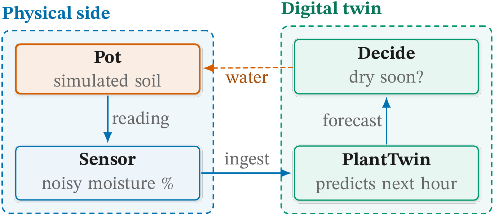

# 🖍 Drawing a figure: the `figure-drawer` skill

Status: **how-to.**

**Written for** anyone who wants a figure in a draft: a pipeline, a
control loop, a taxonomy or an architecture, drawn once as TikZ for
the PDF and once as ASCII for every other format. **Assumed:** you have
a draft under `content/drafts/`, or are about to have one from a genre
skill ([GENRE.md](GENRE.md)). **Not covered here:** what a good figure
looks like, which is [TIKZ-STYLE.md](TIKZ-STYLE.md); the two-form
contract, the marker syntax and originality, which are
[WRITING-STANDARDS.md](WRITING-STANDARDS.md) §10; and what each
`figure check` finding means, which is
[figure-checks/README.md](figure-checks/README.md). This page says what
the skill does and when it runs.

## 🧭 Table of contents

- [What it is, and what it is not](#-what-it-is-and-what-it-is-not)
- [Three ways it runs](#-three-ways-it-runs)
- [What you get](#-what-you-get)
- [What it does, step by step](#-what-it-does-step-by-step)
- [The eleven layouts](#-the-eleven-layouts)
- [What the skill reads](#-what-the-skill-reads)
- [Checking a figure](#-checking-a-figure)
- [A worked example](#-a-worked-example)
- [Thesis fragments](#-thesis-fragments)
- [What it never does](#-what-it-never-does)
- [Why the genre skills keep a short figure step](#-why-the-genre-skills-keep-a-short-figure-step)
- [When something goes wrong](#-when-something-goes-wrong)

## ⚖ What it is, and what it is not

`figure-drawer` owns **how** a figure is drawn: the layout, the
scaffold it starts from, panel letters, the ASCII twin, the check and
the look at the render. It does not decide **whether** a draft gets a
figure. Each genre sets its own threshold, from the tutorial (draw
every figure that makes a step clearer) to the survey (rarest of all,
since the comparison table usually does the work). `deep-research`
draws no figures.

It also **never presents a draft**. It draws one figure, checks it,
and returns to whichever skill called it. The gate, the render, the
prose check and the verbatim scan stay with that skill.

## 🚦 Three ways it runs

| Who calls it | When | What happens after |
| --- | --- | --- |
| A genre skill: `survey-writer`, `tutorial-writer`, `textbook-chapter-writer`, `thesis-chapter-writer` | mid-draft, once the genre's figure step decides a figure is warranted | back to the genre skill's next step, which places the marker and caption, gates and renders |
| `draft-reviser` | you asked to redraw or fix a figure in an existing draft | back to `draft-reviser`, which logs the change in `revisions.md` |
| You, directly | you asked for a figure in an existing draft | a revision: the session continues in `draft-reviser`'s write-back and gate steps |

You never name a skill. Ask in ordinary words and the right one
answers. A direct request needs three things: **which draft, where in
it, and what the figure shows.**

```text
Draw a figure for step 4 of
content/drafts/labs/first-twin.md showing the loop between the pot,
its sensor and the twin.
```

```text
The retrieval diagram in content/drafts/rag/survey.md overflows the
page. Redraw it.
```

```text
Add a figure to section 2 of content/drafts/thesis/methods.tex showing
the three study phases.
```

On a direct request the genre's threshold does not apply, because you
asked for the figure. With no draft to put it in, the skill says so and
stops.

## 🎯 What you get

Two files under the draft's topic directory, plus one line (or block)
in the draft that names them:

| Draft | In the draft | Files |
| --- | --- | --- |
| `.md` (survey, tutorial, textbook chapter) | `<!-- figure: figures/<name> -->` on a line of its own, a caption line directly below it if the figure warrants one, and `<!-- figureref: <name> -->` wherever prose points at it | `figures/<name>.tex` and `figures/<name>.txt` |
| `.tex` (thesis chapter) | `\input{figures/<name>.tex}` then `%figure: figures/<name>`, inside a hand-written `figure` float with `\caption` and `\label` when captioned | the same pair |

The renderer puts the TikZ in the `tex` and `pdf` outputs and the ASCII
form, in a code block, in `md`, `html` and `docx`. Nothing writes
"Figure 3" by hand: the renderer, or your thesis's own LaTeX, numbers
it.

A flat draft (`content/drafts/<slug>.md` with no topic directory) would
put its figures in `content/drafts/figures/`, shared with every other
flat draft. The skill asks whether to move the draft and its dossier
into a topic directory first, or to drop the figure.

## 🪜 What it does, step by step

These are the nine steps of `.claude/skills/figure-drawer/SKILL.md`, in
its order.

1. **Looks, never copies (optional).** `python -m chitragupta.draft
   figures <citekey>` lists a cited paper's figures, with a crop of
   each. Seeing how a concept is usually drawn is fine. Reproducing one
   is not ([AGENTS.md](../AGENTS.md), [WRITING-STANDARDS.md](WRITING-STANDARDS.md)
   §10).
2. **Picks the pattern, then the layout.** It names what the figure
   argues, routes that to one of the
   [eleven layouts](#-the-eleven-layouts), and reads that layout's
   reference file before drawing.
3. **Runs the taste gate.** Before anything is written it asks: would a
   sentence or a table do this? Which node, edge or label can go? Which
   two nodes always travel together and become one? Is there one focal
   node? Is this one figure or two? It makes the trims itself. If the
   answer is a sentence, a table or two figures, it draws nothing and
   returns that verdict to the caller, or asks you on a direct request.
4. **Starts from the scaffold.** `kpsewhich tikz.sty` first. If TikZ is
   missing, it writes no pair: the ASCII goes inline instead (a fence in
   Markdown, `verbatim` in a thesis fragment), with no marker.
   Otherwise `python -m chitragupta.figure new <figures-dir> <name>
   --layout <id>` copies the layout's scaffold and its twin, keeps its
   `% cg-layout:` line, brings the house style block up to date as
   `figure sync` would, and never overwrites a figure
   ([CLI.md](CLI.md#-chitragupta-figure-new)).
5. **Draws below the house block**, never inside it
   ([TIKZ-STYLE.md](TIKZ-STYLE.md#-the-house-figure-style)). It
   re-labels, names every node, places nodes relative to one another,
   letters panels `(a)`, `(b)` if there is more than one, and keeps every
   citekey out of the figure file, because the gate reads the draft and
   does not follow `\input`.
6. **Redraws the ASCII twin** at `figures/<name>.txt`, in §10's 7-bit
   alphabet: the same boxes, arrows and panel letters, named in the
   TikZ's own words.
7. **Checks it** with `python -m chitragupta.figure check
   figures/<name>.tex`, and resolves or allows every objective finding.
   See [Checking a figure](#-checking-a-figure).
8. **Looks at the real render.** `figure check` compiles the figure in
   a bare article class, but the pipeline's own PDF is the draft's whole
   document, with its floats and neighbouring text, so labels can wrap
   and gaps close differently there. `python -m chitragupta.figure look`
   sets the figure alone on the render's own page, cropped to it, as a
   PDF and a 300 dpi PNG; once the draft carries the marker, `--draft`
   renders the PDF too and writes a PNG of the page that holds the
   figure ([CLI.md](CLI.md#-chitragupta-figure-look)). The skill reads
   both against the pre-flight list in
   [TIKZ-STYLE.md](TIKZ-STYLE.md#-check-the-drawn-figure-against-this-list).
   This needs LuaLaTeX and `pdftoppm` (poppler), and `pandoc` for the
   page, which `chitragupta install os-deps` installs on Linux. Without
   them, or in a harness that cannot view an image, the skill skips the
   look and says so.
9. **Returns** the two paths (or the taste gate's verdict), what the
   taste gate cut, what `figure check` reported and allowed, and whether
   it looked at the render. The caller places the marker and the
   caption, then gates and renders.

## 🧩 The eleven layouts

Every figure starts from one of eleven scaffolds in `assets/tikz/`:
pipeline, map, layered stack, control loop, branching tree,
hub-and-spoke network, zoned spine, state machine, comparison, sequence
and timeline. [assets/tikz/README.md](../assets/tikz/README.md) says
when to reach for each, and
[TIKZ-STYLE.md](TIKZ-STYLE.md#-commit-to-a-layout-metaphor-before-you-draw)
gives the TikZ idiom each one uses.

## 📚 What the skill reads

`SKILL.md` is a short router. It reads one of these only when a step
sends it there, one copy whichever harness runs it:

| File under `.claude/skills/figure-drawer/references/` | What it holds |
| --- | --- |
| `patterns.md` | what a figure argues, routed to the nearest layout |
| `layouts/<layout>.md` | one per layout: its anti-patterns and the reference ranges (node and edge counts, width, height, slack) measured from its scaffold and exemplars |
| `taste.md` | the taste gate's questions, and what goes back to the caller |
| `figures.md` | choosing a metaphor, panels, fitting without scaling, an annotated exemplar, looking at a source's figures, libraries and compiling, looking at the render |
| `placement.md` | where the pair goes, a host with no TikZ, a flat draft, a thesis fragment |
| `check.md` | the fix for each `figure check` finding, and the `cg-allow` form |

## 🔎 Checking a figure

`python -m chitragupta.figure check figures/<name>.tex` compiles the
figure and reports every rule it breaks, one line each, by rule id. For
each objective finding the skill either changes the figure or records
why the break is deliberate with a `% cg-allow:` line in the figure
file. It reads the advisory size and wording reports but does not act
on them. The command exits 0 whatever it finds, because it is an aid,
not a gate; exit 2 means it checked nothing.

[figure-checks/README.md](figure-checks/README.md) explains how to read
the report, every rule with a faulty and a fixed example, the
`cg-allow` form, and how `review figure` relates to `figure check`.

## 🌱 A worked example

Step 4 of a potted-plant tutorial wires a simulated pot to a digital
twin that predicts when the soil will dry and waters it. The request:

```text
Draw a figure for step 4 of the potted-plant tutorial showing the loop
between the pot, its sensor and the twin.
```

The cycle closing is the whole point, so the layout is a **control
loop**, and the drawing starts from `assets/tikz/control-loop.tex`.
Two zone cards separate the physical side from the twin, and the one
edge that crosses back (the twin watering the pot) is drawn dashed as
the loop's return:



The figure's own body, below the house style block the scaffold
carries:

```latex
\begin{tikzpicture}[cg]
  \node[cgkey, text width=40mm] (pot) {\cglab{Pot}{simulated soil}};
  \node[cgbox, below=12mm of pot, text width=40mm] (sensor)
    {\cglab{Sensor}{noisy moisture \%}};
  \node[cgalt, right=22mm of sensor, text width=40mm] (twin)
    {\cglab{PlantTwin}{predicts next hour}};
  \node[cgalt, above=12mm of twin, text width=40mm] (decide)
    {\cglab{Decide}{dry soon?}};
  \draw[cgedge] (pot) -- node[cgtag] {reading} (sensor);
  \draw[cgedge] (sensor) -- node[cgtag] {ingest} (twin);
  \draw[cgedge] (twin) -- node[cgtag] {forecast} (decide);
  \draw[cgback] (decide) -- node[cgtag, text=cgAccentText] {water} (pot);
  \begin{scope}[on background layer]
    \node[cgzone=cgFlow, fit=(pot)(sensor)] (zp) {};
    \node[cgzone=cgAlt, fit=(twin)(decide)] (zt) {};
  \end{scope}
  \cgzonelabel{zp}{cgFlow}{Physical side}
  \cgzonelabel{zt}{cgAlt}{Digital twin}
\end{tikzpicture}%
```

and its ASCII twin, which is all a reader of the `md`, `html` or `docx`
output sees:

```text
  Physical side                      Digital twin
  +------------------+     water     +--------------------+
  |       Pot        |<..............|       Decide       |
  |  simulated soil  |               |     dry soon?      |
  +------------------+               +--------------------+
           |                                   ^
           | reading                           | forecast
           v                                   |
  +------------------+    ingest     +--------------------+
  |      Sensor      |-------------->|     PlantTwin      |
  | noisy moisture % |               | predicts next hour |
  +------------------+               +--------------------+
```

Each zone holds one column, so every edge is level or upright and meets
the middle of a side, and no edge passes a zone title. With the house
block above it and the twin beside it, `figure check` reports no
findings for this figure.

`figure check` passing is not the last word. At 30mm boxes the same
figure also checks clean, but `figure look` shows "moisture"
hyphenated inside its box on the render's page. Widening every box to
40mm fixed it. Step 8 exists for defects like that one, which only
show on the rendered page.

## 🎓 Thesis fragments

A thesis chapter is a `.tex` fragment that you `\input` into your own
thesis, so two things are yours to act on:

- **TikZ libraries.** When the render prints a `[tikz-libraries]` line,
  add the `\usetikzlibrary{...}` it names to your thesis preamble,
  beside `\usepackage{tikz}`. Keep the figure's own `\usetikzlibrary`
  line and add nothing else about loading, such as flag-clearing or a
  hook save and restore ([TIKZ-STYLE.md](TIKZ-STYLE.md) says why).
- **Unicode.** When it prints a `[unicode]` line, copy
  `chitragupta-unicode.sty` next to your thesis and load it.

A third line, `[floats]`, is a choice rather than a fix. It copies
`chitragupta-floats.tex` beside the fragment: `\input` it in your thesis
preamble to get the float placement the pdf preview used, which keeps a
figure that fits on a text page out of a page of its own, or leave it
out to keep your template's.

The fragment never writes `\renewcommand{\thefigure}`: your thesis's
own counter numbers the figure. [WRITE-A-THESIS-CHAPTER.md](WRITE-A-THESIS-CHAPTER.md)
covers the rest of putting a fragment into a thesis.

## 🚫 What it never does

- **Never puts a citekey in a figure file.** Attribution goes in the
  prose beside the figure, where the gate can see the key (CLAUDE.md's
  one rule).
- **Never reproduces a source figure**, in either notation.
- **Never scales a figure to fit.** No `\resizebox`, no `scale=`. A
  figure that does not fit gets a different layout.
- **Never gates.** `figure check` and `review figure` only report.
  `python -m chitragupta.draft gate` is the only gate. `figure sync
  --check` exits 1 on a stale block, which is what the pre-commit hook
  runs; it does not block a draft.
- **Never presents a draft.** It returns to its caller.

## 🧱 Why the genre skills keep a short figure step

Skills are picked by their trigger descriptions, not called by name, so
a step that says "now use `figure-drawer`" depends on the model actually
loading it, in Claude Code, Codex and OpenCode alike. Each genre's
figure step therefore keeps whatever must hold even if that handoff is
skipped:

- its threshold for drawing at all;
- its output shape (the marker, or the thesis's `\input` and float);
- the TikZ probe and the compile check, with its inline fallback;
- an originality line;
- **no citekey inside either figure file.**

Everything else lives once, in `figure-drawer`.
`tests/test_skill_figure_step.py` pins each stub and fails if a rule
that moved comes back into a genre skill.

## 🩹 When something goes wrong

| Symptom | Likely cause | What to do |
| --- | --- | --- |
| The figure came back as ASCII inline, with no marker | `kpsewhich tikz.sty` found no TikZ on this host | install TeX Live's `texlive-pictures`, then ask for the figure again |
| The whole PDF render fails | a figure file does not compile | ask to fix that figure; `figure check` reports `does-not-compile` with TeX's first error |
| `figure check` exits 2 | no `lualatex` or `tikz.sty` on this host, or a usage error | install them; it checked nothing, so read nothing into the silence |
| A label hyphenates or an arrow crosses a title in the PDF, though `figure check` is clean | the PDF sets labels on the draft's own page | widen the boxes or move the edge, and check with `figure look --draft` |
| Labels look small in the PDF | the draft wraps the figure in `\resizebox` | remove the wrapper and ask for a re-layout ([TIKZ-STYLE.md](TIKZ-STYLE.md#-draw-for-the-width-it-will-be-printed-at)) |
| `figure check` reports `nothing-measurable` for a busy figure | its nodes have no names, so nothing was measured | name every node |
| A render warns that the figure's style block is stale | the block predates the installed one | `python -m chitragupta.figure sync <file>` |
| Your thesis build fails on `of` in a node position | the TikZ library is not loaded in your preamble | add the `[tikz-libraries]` line's libraries to it |
| A survey asked for a figure and got none | the survey's threshold: the comparison table usually carries that structure | ask directly if you still want one |
