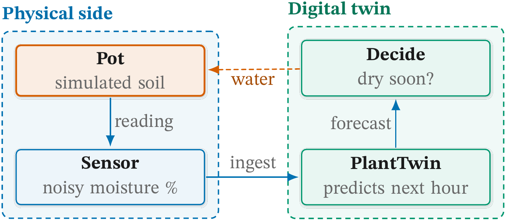

# 🖍 Drawing a figure: the `figure-drawer` skill

Status: **how-to.**

**Written for** anyone who wants a figure in a draft, drawn once as TikZ
for the PDF and once as ASCII for every other format. **Assumed:** you
have a draft under `content/drafts/`, or will have one from a genre
skill ([GENRE.md](GENRE.md)). **Not covered here:** what a good figure
looks like ([TIKZ-STYLE.md](TIKZ-STYLE.md)); the two-form contract,
marker syntax and originality
([WRITING-STANDARDS.md](WRITING-STANDARDS.md) §10); and what each
`figure check` finding means
([figure-checks/README.md](figure-checks/README.md)).

## ⚖ What it is, and what it is not

`figure-drawer` owns **how** a figure is drawn: the layout, the
scaffold, panel letters, the ASCII twin, the check and the look at the
render. Each genre decides **whether** a draft gets a figure, from the
tutorial (any figure that makes a step clearer) to the survey (rarest,
since the comparison table usually does the work). `deep-research`
draws no figures. The skill draws one figure, checks it and returns to
its caller, which keeps the gate, the render, the prose check and the
verbatim scan.

## 🚦 Three ways it runs

| Who calls it | When | What happens after |
| --- | --- | --- |
| A genre skill (survey, tutorial, textbook or thesis chapter) | mid-draft, once its figure step wants a figure | the genre skill places the marker and caption, gates and renders |
| `draft-reviser` | you asked to redraw or fix a figure | `draft-reviser` logs the change in `revisions.md` |
| You, directly | you asked for a figure in an existing draft | `draft-reviser`'s write-back and gate steps |

Ask in ordinary words; you never name a skill. A direct request needs
**which draft, where in it, and what the figure shows.**

```text
Draw a figure for step 4 of
content/drafts/labs/first-twin.md showing the loop between the pot,
its sensor and the twin.
```

```text
The retrieval diagram in content/drafts/rag/survey.md overflows the
page. Redraw it.
```

On a direct request the genre's threshold does not apply. With no
draft to put it in, the skill says so and stops.

## ✍ Correcting a figure on paper

You can hand over a photo or scan instead: a printout corrected in pen,
a figure redrawn by hand, or a sketch. The skill reads your marks back
before changing anything ([MANUAL-FIGURE.md](MANUAL-FIGURE.md)).

## 🎯 What you get

Two files under the draft's topic directory, and a line (or block) in
the draft that names them:

| Draft | In the draft | Files |
| --- | --- | --- |
| `.md` (survey, tutorial, textbook chapter) | `<!-- figure: figures/<name> -->` on its own line, the caption line below it, and `<!-- figureref: <name> -->` where prose points at it | `figures/<name>.tex` and `figures/<name>.txt` |
| `.tex` (thesis chapter) | `\input{figures/<name>.tex}` then `%figure: figures/<name>`, inside a hand-written `figure` float with `\caption` and `\label` | the same pair |

The TikZ goes into `tex` and `pdf` output, the ASCII (in a code block)
into `md`, `html` and `docx`. The renderer, or your thesis, numbers the
figure. A flat draft (`content/drafts/<slug>.md`) would share
`content/drafts/figures/` with every other flat draft, so the skill
asks whether to move it into a topic directory first or drop the
figure.

## 🪜 What it does, step by step

The nine steps of `.claude/skills/figure-drawer/SKILL.md`, in order:

1. **Looks, never copies (optional).** `python -m chitragupta.draft
   figures <citekey>` shows a cited paper's figures. Seeing how a
   concept is drawn is fine; reproducing one is not
   ([AGENTS.md](https://github.com/prasadtalasila/chitragupta/blob/main/AGENTS.md),
   [WRITING-STANDARDS.md](WRITING-STANDARDS.md) §10).
2. **Picks the pattern, then the layout.** What the figure argues
   routes to one of the [eleven layouts](#-the-eleven-layouts), whose
   reference file it reads.
3. **Runs the taste gate.** Would a sentence or a table do? What can
   go? Which nodes merge? Is there one focal node? One figure or two? It
   makes the trims itself; if the answer is a sentence, a table or two
   figures, it draws nothing and returns that verdict (or asks you).
4. **Starts from the scaffold.** `kpsewhich tikz.sty` first. Without
   TikZ it writes no pair: the ASCII goes inline (a fence in Markdown,
   `verbatim` in a thesis fragment), with no marker. Otherwise
   `python -m chitragupta.figure new <figures-dir> <name> --layout <id>`
   copies the scaffold and its twin, keeps the `% cg-layout:` line,
   syncs the house style block and never overwrites a figure
   ([CLI.md](CLI.md#-chitragupta-figure-new)).
5. **Draws below the house block**, never inside it
   ([TIKZ-STYLE.md](TIKZ-STYLE.md#-the-house-figure-style)): named
   nodes placed relative to one another, panels lettered `(a)`, `(b)`,
   and no citekey, because the gate does not follow `\input`.
6. **Redraws the ASCII twin** at `figures/<name>.txt` in §10's 7-bit
   alphabet, with the same boxes, arrows, panel letters and words.
7. **Checks it** with `python -m chitragupta.figure check
   figures/<name>.tex`, and resolves or allows every objective finding
   ([Checking a figure](#-checking-a-figure)).
8. **Looks at the real render.** `figure check` compiles in a bare
   article class, but in the draft's PDF labels can wrap and gaps close
   differently. `python -m chitragupta.figure look` sets the figure
   alone on its page (the book's, for a book unit), cropped, as PDF and
   300 dpi PNG; with the marker in place, `--draft` renders the PDF and
   images the page holding the figure
   ([CLI.md](CLI.md#-chitragupta-figure-look)). The skill reads both
   against
   [TIKZ-STYLE.md](TIKZ-STYLE.md#-check-the-drawn-figure-against-this-list)'s
   pre-flight list. This needs LuaLaTeX, `pdftoppm` and `pandoc`
   (`chitragupta install os-deps` on Linux); without them, or without
   image viewing, the skill skips the look and says so.
9. **Returns** the two paths (or the verdict), what the gate cut, what
   `figure check` reported and allowed, and whether it looked at the
   render.

## 🧩 The eleven layouts

Every figure starts from one of eleven scaffolds in `assets/tikz/`:
pipeline, map, layered stack, control loop, branching tree,
hub-and-spoke network, zoned spine, state machine, comparison, sequence
and timeline. [assets/tikz/README.md](../assets/tikz/README.md) says
when to use each;
[TIKZ-STYLE.md](TIKZ-STYLE.md#-commit-to-a-layout-metaphor-before-you-draw)
gives each one's TikZ idiom.

## 📚 What the skill reads

`SKILL.md` is a router; a step sends it to one of these:

| File under `.claude/skills/figure-drawer/references/` | What it holds |
| --- | --- |
| `patterns.md` | what a figure argues, routed to a layout |
| `layouts/<layout>.md` | per layout: anti-patterns and reference ranges (nodes, edges, width, height, slack) |
| `taste.md` | the taste gate's questions and verdicts |
| `figures.md` | metaphor, panels, fitting without scaling, an exemplar, source figures, libraries, compiling, the render |
| `placement.md` | where the pair goes, no TikZ, a flat draft, a thesis fragment |
| `check.md` | the fix for each `figure check` finding, and `cg-allow` |
| `markup.md` | a hand-marked photo or scan: finding its pair, reading the marks, editing, working from a sketch |

## 🔎 Checking a figure

`figure check` compiles the figure and reports each rule it breaks by
id. The skill fixes each objective finding or records a `% cg-allow:`
line saying why the break is deliberate, and reads the advisory size
and wording reports without acting on them. The command exits 0 as an
aid, not a gate; exit 2 means it checked nothing.
[figure-checks/README.md](figure-checks/README.md) explains every rule
with a faulty and a fixed example.

## 🌱 A worked example

Step 4 of a potted-plant tutorial wires a simulated pot to a digital
twin that predicts when the soil will dry, and waters it (the first
request [above](#-three-ways-it-runs)). The closing cycle is the point,
so the layout is a **control loop**, from
`assets/tikz/control-loop.tex`. Two zone cards separate the physical
side from the twin, and the one edge back (watering) is dashed as the
loop's return:



Its ASCII twin is all an `md`, `html` or `docx` reader sees:

```text
  Physical side                      Digital twin
  +------------------+     water     +--------------------+
  |       Pot        |<..............|       Decide       |
  |  simulated soil  |               |     dry soon?      |
  +------------------+               +--------------------+
           |                                   ^
           | reading                           | forecast
           v                                   |
  +------------------+    ingest     +--------------------+
  |      Sensor      |-------------->|     PlantTwin      |
  | noisy moisture % |               | predicts next hour |
  +------------------+               +--------------------+
```

One column per zone keeps every edge level or upright, meeting the
middle of a side and passing no zone title; `figure check` reports no
findings. With 30mm boxes it also checked clean, but `figure look`
showed "moisture" hyphenated on the rendered page; 40mm boxes fixed
it. Step 8 exists for such defects.

## 🎓 Thesis fragments

A thesis chapter is a `.tex` fragment you `\input` into your thesis,
so two things are yours to act on. A `--fragment` render names each on
its own line (the md and pdf previews print neither):

- **TikZ libraries.** For a `[tikz-libraries]` line, add the
  `\usetikzlibrary{...}` it names to your preamble beside
  `\usepackage{tikz}`. Keep the figure's own `\usetikzlibrary` line and
  add nothing else about loading, such as flag-clearing or a hook save
  and restore ([TIKZ-STYLE.md](TIKZ-STYLE.md) says why).
- **The engine and Unicode.** The pdf preview runs LuaLaTeX, the
  recommended engine for your thesis too. For a `[unicode]` line, copy
  `chitragupta-lualatex.tex` next to your thesis and `\input` it after
  `fontspec` and `unicode-math`, so those characters print from the
  preview's fonts. Only if your template forces pdflatex, copy
  `chitragupta-unicode.sty` and `\usepackage{chitragupta-unicode}`: it
  teaches pdflatex those characters and does nothing under LuaLaTeX.

A third line, `[floats]`, is a choice. It copies
`chitragupta-floats.tex` beside the fragment: `\input` it in your
preamble for the preview's float placement (a figure that fits on a
text page stays off a page of its own), or leave it out to keep your
template's. The fragment never writes `\renewcommand{\thefigure}`;
your thesis's counter numbers the figure.
[WRITE-A-THESIS-CHAPTER.md](WRITE-A-THESIS-CHAPTER.md) covers the rest.

## 🚫 What it never does

- **Never puts a citekey in a figure file.** Attribution goes in the
  prose beside it, where the gate sees the key (CLAUDE.md's one rule).
- **Never reproduces a source figure**, in either notation.
- **Never scales a figure to fit** (no `\resizebox`, no `scale=`); one
  that does not fit gets a different layout.
- **Never gates.** `figure check` and `review figure` only report;
  `python -m chitragupta.draft gate` is the only gate. `figure sync
  --check` exits 1 on a stale block for the pre-commit hook, and blocks
  no draft.
- **Never presents a draft.** It returns to its caller.

## 🧱 Why the genre skills keep a short figure step

Skills are picked by trigger description, so "now use
`figure-drawer`" depends on the model loading it, in every harness.
Each genre's figure step keeps what must hold if that handoff is
skipped: its threshold, its output shape (the
marker, or the thesis's `\input` and float), the TikZ probe and compile
check with the inline fallback, an originality line, and **no citekey
in either figure file**. Everything else lives once, in `figure-drawer`;
`tests/test_skill_figure_step.py` fails if a moved rule returns to a
genre skill.

## 🩹 When something goes wrong

| Symptom | Likely cause | What to do |
| --- | --- | --- |
| ASCII came back inline, with no marker | no TikZ on this host | install TeX Live's `texlive-pictures`, then ask again |
| The whole PDF render fails | a figure does not compile | ask to fix it; `figure check` reports `does-not-compile` with TeX's first error |
| `figure check` exits 2 | no `lualatex` or `tikz.sty`, or a usage error | install them; it checked nothing |
| A label hyphenates or an arrow crosses a title in the PDF, though `figure check` is clean | the PDF sets labels on the draft's own page | widen the boxes or move the edge; check with `figure look --draft` |
| Labels look small in the PDF | the figure is wrapped in `\resizebox` | remove it and ask for a re-layout ([TIKZ-STYLE.md](TIKZ-STYLE.md#-draw-for-the-width-it-will-be-printed-at)) |
| `nothing-measurable` for a busy figure | its nodes have no names | name every node |
| A render warns the style block is stale | it predates the installed one | `python -m chitragupta.figure sync <file>` |
| Your thesis build fails on `of` in a node position | a TikZ library is missing from your preamble | add the `[tikz-libraries]` line's libraries |
| A survey asked for a figure and got none | the comparison table usually carries that structure | ask directly if you still want one |
