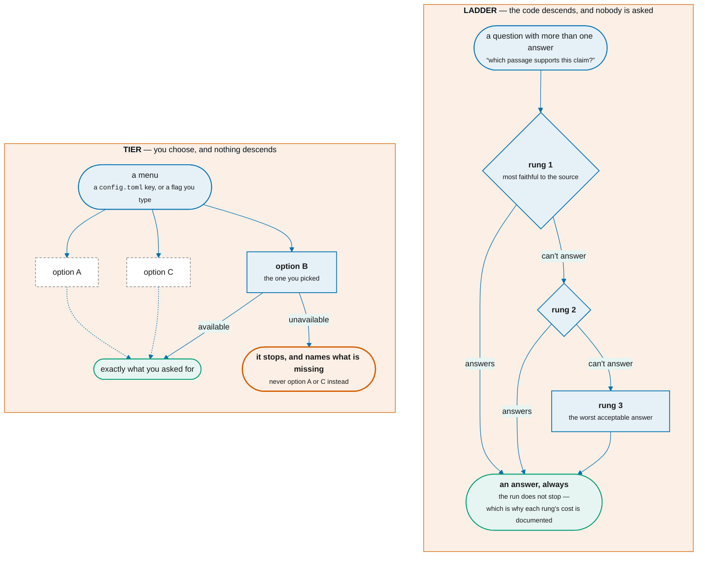
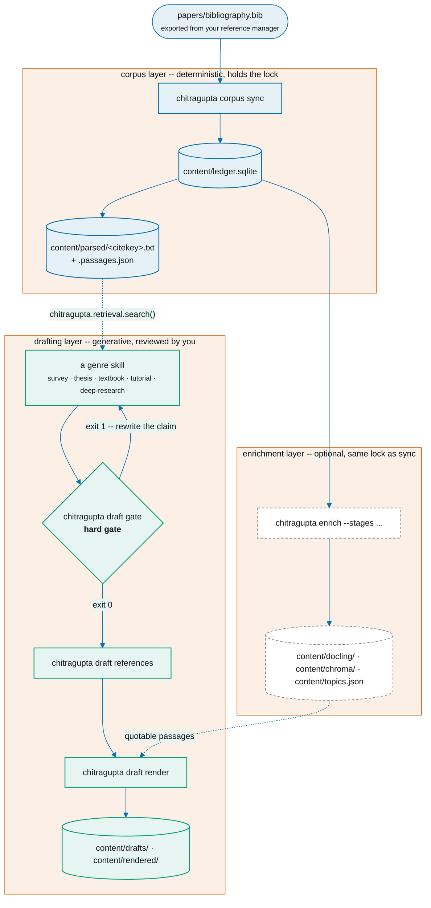
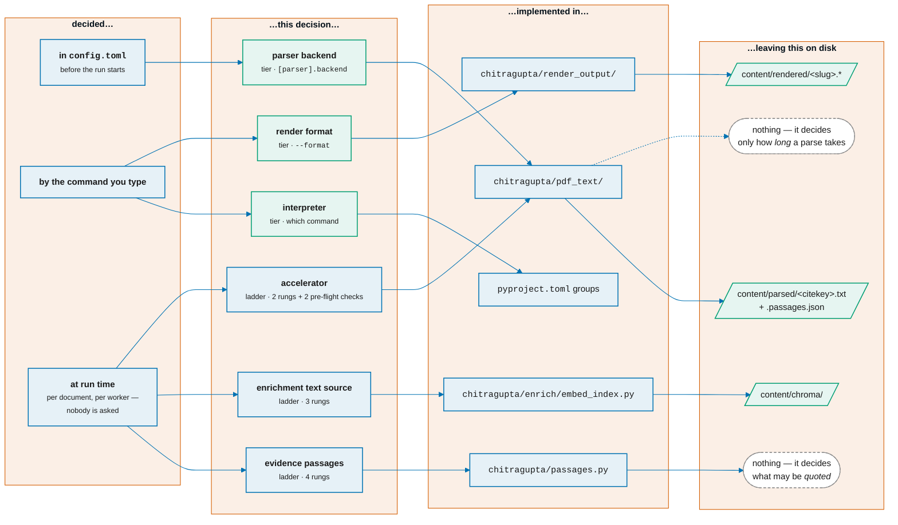

# 🏗 The pipeline, its ladders, and its tiers

Status: **reference.**

**Written for** anyone who has hit a fallback and wants to know what they
lost by it. **Assumed:** [CLI.md](CLI.md) for the commands named here.
**Not covered here:** the code that implements each rung, which is
[ARCHITECTURE.md](ARCHITECTURE.md)'s territory.

This page is about the places where the repository does *one job two
ways*: where a question such as "what text supports this claim?" or "how
do I turn a draft into a PDF?" has more than one answer, and something
has to pick.

There are six such places. Three pick for you, silently, at run time.
Three you pick yourself, in a config file or on a command line. They fail
differently: the first kind degrades without warning and you may not
notice for weeks; the second stops and names what is missing.

## 🏷 The terms

Seven words, used precisely throughout this repository.

**Pipeline.** Everything from a BibTeX export to a rendered document: four
layers run at different times, on different commands.

**Layer.** One of four groups of modules, distinguished by *who runs
them and what they may do*.

| Layer | What it is | Runs when |
| --- | --- | --- |
| **1. Corpus** | `python -m chitragupta.corpus sync` and its ledger. Deterministic, unattended-safe | On demand or on a schedule |
| **2. Drafting** | The genre skills in `.claude/skills/` and the gate/references/render chain. Generative, reviewed by you | When you ask for a draft |
| **3. Enrichment** | `python -m chitragupta.enrich`: Docling, embeddings, topic modelling. Optional; nothing above depends on it | Only if you choose to |
| **4. Review** | The eleven review aids in `chitragupta/review/` ([REVIEW.md](REVIEW.md)). Advisory over a finished draft; never a gate | When you ask, and at the end of a drafting skill's run |

The numbers are introduction order, not a dependency rank.

**Stage.** One step within a layer, with its own name and status. Only
the enrichment layer enumerates them
(`--stages docling,embed,bertopic,extract-keywords,seed-topics,converge,topic-graph`,
each reporting `ok`, `partial`, `skipped` or `error`). All seven write a
corpus artefact, which is why the layer takes the same write lock as
`sync` and its unit of work is the corpus, not a draft.

Those four words also set the run's exit code: **`error` in any stage
exits `1`, and every other combination exits `0`**, `partial` and
`skipped` included, on purpose. `skipped` is honest on a host without the
enrich extra, and `partial` is the steady state of a corpus with two PDFs
that will never parse; a nightly job failing forever over either would
teach its reader to ignore the exit code. Work a stage abandoned rather
than attempted is not `partial`: `docling` escalates to `error` when a
repeatedly dying worker pool made it give up on documents it never
tried. Edge cases are in [CLI.md's `enrich`
section](CLI.md#-chitragupta-enrich).

**Artefact.** A file a stage writes, under `content/`. Layers communicate
only through artefacts: no layer calls into another, and a layer that
hasn't run leaves the file absent rather than empty.

**Ladder.** An ordered chain the code walks *automatically*: it tries the
first rung, and falls to the next when that one cannot answer. Nobody is
asked. The run does not stop.

**Rung.** One option in a ladder. Rungs are ordered best-first, and "best"
always means *most faithful to the source*, never fastest.

**Tier.** A menu you choose from, with no automatic descent. If the option
you picked is unavailable, the pipeline says so and stops that piece of
work. It does not quietly substitute a neighbour.

> A **ladder** answers "this is the best I could do." A **tier** answers
> "you asked for something this host cannot give you."

<!-- diagram: ladders-terms -->

A ladder always reaches an answer, so its worst rung is silent: the
output still looks like output, and nothing in the run says which rung
produced it. A tier gives you what you asked for or nothing, so its
failure is loud and self-describing. A ladder silently reaching its
worst rung is the failure this repository worries about most, which is
why each ladder below states what its bottom rung costs.

## 🔭 The pipeline in one pass

<!-- diagram: ladders-pipeline -->

Every command above and its flags are in [docs/CLI.md](CLI.md).

### 🧠 What the enrichment layer works on

**By default the enrichment layer parses your whole corpus, not the
papers a draft happens to cite.** One flag changes that, for one of the
seven stages.

`chitragupta/enrich/__main__.py` calls `corpus.build_corpus()`, which
returns **every row in the ledger, and nothing else** (`ledger.all_items()`
is a bare `SELECT * FROM items`): every citekey your BibTeX export
produced, including entries with no PDF attached.

The bibliography being the *only* source means every Chroma hit, topic
member and figure record names a real citekey a draft may cite. Raw PDFs
outside it are not swept in, since the gate would reject their ids. If a
paper is worth indexing it is worth cataloguing: add it to your
reference manager, re-export, and re-run `python -m chitragupta.corpus
sync`.

Nothing filters that list by draft unless you ask: a draft citing eleven
papers does not cause eleven papers to be parsed. Only documents with a
PDF are parsed (**642 documents, of which 497 have a PDF to parse**, on
this project's corpus). Hence the layer is opt-in and its cost quoted
per-corpus: a first Docling pass over this project's 501-PDF corpus is
3330s serial and 310s at twelve workers
([docs/PERFORMANCE.md](PERFORMANCE.md)).

### 🎯 Scoping a run to one draft

`--for-draft content/drafts/<slug>.md` narrows that list to the papers
the draft cites (read with the gate's `citation_gate.extract_citekeys`),
so you can try the layer on one chapter before committing to an
hour-long whole-library run. Flags and worked output are in
[docs/CLI.md](CLI.md#-enriching-one-drafts-papers).

It reaches fewer stages than it sounds:

| Stage | Under `--for-draft` | Why |
| --- | --- | --- |
| `docling` | scoped | Per-document: artefacts and cache are keyed by citekey, so eleven of them are a subset of the corpus-wide result |
| `embed` | **refused** | The Chroma collection records nothing about its coverage, and readers ask only whether `content/chroma/` exists, so a partial index would answer as though complete |
| `bertopic` | **refused** | Overwrites `content/topics.json` whole; clustering is whole-corpus (one added document can move every assignment) |
| `extract-keywords` | **refused** | Overwrites `content/keywords.toml` whole; one draft's list would silently replace the corpus-wide one |
| `seed-topics`, `converge`, `topic-graph` | **refused** | Each overwrites one whole-corpus artefact (`content/topic_seeds.json`, `content/topic_set.json`, `content/topic_graph.json`) derived from the topic model |

The refusals are a **tier**, not a ladder, which makes the flag safe to
offer. Asked to scope `embed`, the run stops and prints the two commands
to use instead, rather than running the whole corpus (the hour
`--for-draft` avoids) or indexing the eleven (a silently partial
artefact). The second needs the Chroma collection to record its own
coverage first; until it does, the run refuses.

The scoped `docling` run is safe because its cache is per-document and
never rewritten to match the scope: a narrow run followed by a full one
parses nothing twice, and nor does the reverse.

For the same reason the `docling` stage adopts the corpus layer's parse
where it can: when `[parser].backend = "docling"` has already parsed a
citekey, a second parse of the same PDF buys nothing. The dependency runs
one way: the enrichment layer reads `content/parsed/`, and the corpus
layer does not know it does. Reuse is refused for a document the corpus
layer wrote no parsed text for (no PDF, or a failed parse), for a run
with figures on (the corpus layer writes no bitmaps), and for artefacts
older than their PDF.

## 🪜 The three ladders

### 📖 Ladder 1: Evidence passages

**The question:** a claim cites `smith_2024`; which part of that source
supports it, and may it be quoted?

**Where:** `chitragupta/passages.py`, read through
`passages.source_passages()` by the review aids `provenance`, `support`,
`quotation` and `digest`.
`chitragupta.draft retrieve` reads **rung 2 alone**, through
`passages.corpus_passages`, to find where a document's reference list
starts ([RETRIEVAL.md](RETRIEVAL.md#-a-papers-own-bibliography-is-not-indexed))
and to rank paragraphs under `search --unit passage`
([RETRIEVAL.md](RETRIEVAL.md#-the-passage-unit)), because what BM25
ranks may not depend on whether the enrichment layer (rung 1) has run.

| # | Rung | Written by | Quotable? |
| --- | --- | --- | --- |
| 1 | `content/docling/<citekey>.passages.json` | enrichment layer's `docling` stage | **yes** |
| 2 | `content/parsed/<citekey>.passages.json` | corpus layer, when `[parser].backend = "docling"` | **yes** |
| 3 | `content/parsed/<citekey>.txt` split on form feeds | corpus layer, either backend | no; page only |
| 4 | `pdftotext -layout` run fresh on the PDF | nobody; computed on demand | no; page only |

**Only a `parsed` ledger row climbs it.** The row is read before any
rung. A key the corpus no longer holds reports `not found in the
corpus`, and a row with any other status reports that status; neither
reads a sidecar, the parsed text or the PDF. Otherwise a key dropped
from the `.bib` (sidecars still on disk) or a failed re-parse (old text
kept) would be quoted as the paper's current wording. Retrieval follows
the same rule.

Rungs 1 and 2 hold the same record (`passages.passage_records()`: per
prose item, its text, semantic label, page and bounding box). They are
separate files because each layer owns its directory and schedule: the
corpus layer must invalidate *its* sidecar on every re-parse without
deleting an enrichment sidecar it cannot reproduce. Rung 1 wins when
both exist, being parsed under the enrichment stage's own OCR and figure
settings.

Rung 2 is self-healing: `sync` re-parses a `parsed` citekey whose
sidecar is missing. That check is skipped for `pdftotext`, which writes
no sidecar; demanding one would re-parse the whole corpus every run.

**What the bottom two rungs cost you.** `pdftotext -layout` preserves a
page's *visual* arrangement, not its reading order, so on a two-column
paper one output line can splice two unrelated columns: 82%-89% of long
lines on 4 of the 10 papers in this project's sample. Ranking survives
that; quoting does not, because an excerpt cut from spliced text is a
collage of two arguments that *reads* as evidence. So rungs 3 and 4
return a `Passage` whose `text` is `None`: a caller that wants to quote
has nothing to quote. See
[docs/CITATION-PROVENANCE.md](CITATION-PROVENANCE.md).

### 🧠 Ladder 2: Enrichment text source

**The question:** what text should be embedded, chunked and clustered for
this document?

**Where:** `embed_index.get_text()` in
`chitragupta/enrich/embed_index.py`, also used by
`chitragupta/enrich/topic_model.py`.

| # | Rung | Note |
| --- | --- | --- |
| 1 | `content/docling/<citekey>.md` | the enrichment layer's own parse, image references stripped |
| 2 | the ledger's `parsed_path` `.txt` | the corpus layer's text, verbatim |
| 3 | `pdftotext -layout` into a temp file | for an item the corpus layer has not parsed (a failed parse, or none since the PDF was attached) |

This ladder is why `embed` does not *require* the `docling` stage:
`--stages embed` alone works, on plainer text.

**What the bottom rungs cost you.** Less than in ladder 1: column
splicing moves words *within* a page, which matters little to an
embedding. The cost is retrieval quality, not correctness of
attribution.

**Before you change it:** `build_index()` skips re-encoding a document
whose text hashes the same as last run, and the hash is over whatever
this ladder returned, so changing any rung's *output* re-encodes the
corpus.

### ⚡ Ladder 3: Accelerator

**The question:** which device parses this PDF?

**Where:** `chitragupta/pdf_text/`, for both the corpus layer's docling
backend and the enrichment layer's docling stage.

| # | Rung                                            | Falls when                           |
| - | ----------------------------------------------- | ------------------------------------ |
| 1 | one CUDA device per worker, round-robin         | --                                   |
| 2 | that worker on the CPU, permanently for the run | the device raises CUDA out-of-memory |

Two checks run *before* the ladder and decide what its top rung is:

- `usable_devices()` refuses a card with less than 2560 MiB free (a
  docling worker needs ~1.7 GiB plus a CUDA context). A worker whose
  model load fails does so in ~19s where a working one takes minutes,
  so the pool feeds it work *preferentially*: one run had four such
  workers fail 334 of 456 documents.
- `_parse_visible_devices()` maps `CUDA_VISIBLE_DEVICES` to physical
  cards, because `nvidia-smi` ignores that variable and every CUDA
  process obeys it. Without the mapping a worker can be handed a
  `cuda:3` that does not exist in its own view.

**What the bottom rung costs you.** Time, and nothing else. The demotion
is permanent for the run, not retried per document: a card that just ran
out is likely to again, and thrashing between devices costs more than
finishing slowly. See [docs/PERFORMANCE.md](PERFORMANCE.md).

## 🎚 The three tiers

[ARCHITECTURE.md](ARCHITECTURE.md#-ladders-and-tiers)'s tier-set table
has a fourth: the **detection tiers** behind
`chitragupta/review/verbatim_check/`'s `scan`. It has no section here
because nothing picks one: every available tier runs and the findings
are unioned. [PLAGIARISM.md](PLAGIARISM.md) treats it for a reader of a
report, and [PLAGIARISM.md](PLAGIARISM.md#-how-the-tiers-were-chosen)
for someone changing one.

### 📄 Tier 1: Parser backend

**Set by:** `[parser].backend` in `config.toml`, or the `PARSER` env var.

| Option | Needs | Page breaks | Quotable passages | Speed |
| --- | --- | --- | --- | --- |
| `pdftotext` (default) | `poppler-utils` on `PATH` | yes (form feeds) | no | fastest |
| `docling` | the `enrich` Poetry group, in a venv | yes (form feeds) | **yes**, writes ladder 1's rung 2 | ~6.65s/PDF serial |

**If the one you picked is unavailable:** `sync` warns and skips parsing.
It does **not** substitute the other backend, because a corpus half
parsed by each would be impossible to reason about.

Two other backends were evaluated and are not offered (`markitdown`,
`grobid`); [docs/PDF-PARSER.md](PDF-PARSER.md) records the decision.

### 🐍 Tier 2: Interpreter

**Set by:** which command you are running. Nothing degrades: a module
either imports or raises `ModuleNotFoundError`.

| # | Needs | Commands |
| --- | --- | --- |
| 1 | bare `python`, stdlib only | `chitragupta.draft` (all thirteen commands), `chitragupta.corpus ledger`, `chitragupta.corpus topics`, `chitragupta.corpus discover`, `chitragupta.review` (all eleven aids; `support` and `verbatim`'s tier 3 also need the `enrich` group to score, and say so when it is missing) |
| 2 | a venv with `bibtexparser` | `python -m chitragupta.corpus sync` |
| 3 | a venv with the `enrich` group | `python -m chitragupta.enrich` |

Tier 1 is a design constraint: the citation gate must run everywhere,
including as a hook on a machine that has never installed this
project's dependencies. `chitragupta/passages.py` belongs to it, which
is why it describes a Docling document purely through `getattr` and
never imports the library. See
[docs/ARCHITECTURE.md](ARCHITECTURE.md#-which-interpreter-and-why).

### 📐 Tier 3: Render format

**Set by:** `--format` on `python -m chitragupta.draft render`.

| Format | Needs | Note |
| --- | --- | --- |
| `md` from a `.md`/`.markdown` draft | nothing | done in-process ([RENDERING-FLOW.md](RENDERING-FLOW.md)) |
| `md` from a `.tex` draft | pandoc | a real conversion |
| `tex`, `docx` | pandoc | |
| `pdf` | pandoc + LuaLaTeX ([what it needs](CLI.md#-chitragupta-draft-render)) | |

**If a binary is missing:** reported as `missing-binary`, never a
traceback, and never silently downgraded to a format that would have
worked. A `.pdf` you asked for and did not get is a fact you need to see.

## 🚫 What is deliberately not a ladder

Two near-misses, listed so they aren't mistaken for rungs:

- **The ledger's change detection** (`chitragupta/ledger.py`) checks size
  and mtime before hashing a PDF. That is an *optimisation* with one
  answer: hashing is the fallback stat merely defers, and both agree. A
  ladder's rungs disagree; these don't.
- **The enrichment layer's Docling cache** re-parses when a PDF's
  `(size, mtime_ns)` changes, when `_CACHE_VERSION` moves, or when an
  expected output file is missing. Also one answer, reached three ways.

## 🗺 The mapping

Everything above at once. Read left to right: *when a decision is made,
which decision it is, what implements it, and what it leaves behind.*
The three ladders are all decided at run time; the three tiers are all
settled before a PDF is opened.

<!-- diagram: ladders-mapping -->

The parser backend is the only decision that reaches into two others. It
decides whether the evidence ladder has a rung 2 to land on, and it
shares `chitragupta/pdf_text/` with the accelerator ladder.

Two decisions leave nothing on disk at all. They change what you are
*allowed to do* with the files, or how long it takes to get them, so
neither shows up in a backup or can be inspected after the fact.

Read a row as: *this decision selects this thing, is made here, is
implemented there, and shows up on disk as that.*

| Decision | Kind | Selects | Decided | Implemented in | Artefact |
| --- | --- | --- | --- | --- | --- |
| Evidence passages | ladder, 4 rungs | what may be quoted | at read time, per citekey | `chitragupta/passages.py` | `*.passages.json`, else nothing |
| Enrichment text source | ladder, 3 rungs | what gets embedded | at index time, per doc | `chitragupta/enrich/embed_index.py` | `content/chroma/` |
| Accelerator | ladder, 2 rungs (+2 pre-flight checks) | which device parses | per worker, per run | `chitragupta/pdf_text/` | none; affects time only |
| Parser backend | tier | how PDFs become text | `[parser].backend` | `chitragupta/pdf_text/` | `content/parsed/*.txt` |
| Interpreter | tier | what can run at all | the command you type | `pyproject.toml` groups | none |
| Render format | tier | what the draft becomes | `--format` | `chitragupta/render_output/` | `content/rendered/` |

And the same decisions against the layer that makes them:

| Layer | Ladders it walks | Tiers it obeys | Lock |
| --- | --- | --- | --- |
| 1. Corpus (`chitragupta.corpus sync`) | accelerator | parser backend, interpreter 2 | **holds it** |
| 2. Drafting (genre skills) | evidence passages | interpreter 1, render format | none |
| 3. Enrichment (`python -m chitragupta.enrich`) | enrichment text source, accelerator | interpreter 3, render format | **same lock as sync** |
| 4. Review (the eleven aids) | evidence passages, detection tiers | interpreter 1, render format | none |

The two lock-holders never run at once: the second to start exits `2`
rather than interleaving writes to `content/`.

Review's "none" is load-bearing: the layer is read-only over the corpus
and must keep working during a `sync`. An enrichment stage wrapping
`provenance` or `render` would put a review aid and a drafting-layer
render inside the enrichment lock, so those two stay out of the stage
list.

## 🔗 See also

- [docs/ARCHITECTURE.md](ARCHITECTURE.md): what the parts are, and which
  interpreter each needs
- [docs/DIAGRAMS.md](https://github.com/prasadtalasila/chitragupta/blob/main/docs/DIAGRAMS.md):
  the same workflow drawn eleven ways
- [docs/CONFIG.md](CONFIG.md): every setting these tiers read
- [docs/CITATION-PROVENANCE.md](CITATION-PROVENANCE.md): what ladder 1
  is ultimately for
- [docs/PLAGIARISM.md](PLAGIARISM.md#-how-the-tiers-were-chosen): the
  detection tiers in full
- [docs/PDF-PARSER.md](PDF-PARSER.md): how the parser tier was chosen
- [docs/PERFORMANCE.md](PERFORMANCE.md): what each of these costs
