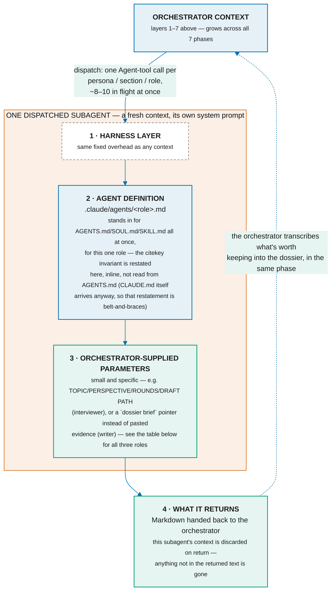

# 🤖 PROMPTS.md

The text the model sees when a genre skill runs, for two skills at
opposite ends of the pipeline's complexity: `textbook-chapter-writer`,
a single-context skill, and `deep-research`, a multi-agent one, and why
their prompts are built differently. Files are named so you can verify
a claim, not because you need to have read them.

## 🏷 Vocabulary this document assumes

- **The prompt**: everything the model is given before it generates:
  the harness's system prompt plus the project files, tool output and
  conversation turns in context.
- **CLAUDE.md**: this repository's one-page router, auto-loaded into
  every Claude Code session. It holds almost no rules; it sends the
  agent to the file that governs the task.
- **AGENTS.md / SOUL.md**: `AGENTS.md` is the rulebook for *drafting
  content* (the citekey invariant, the four layers, the gate); `SOUL.md`
  is the one-page "why" and the tie-breaker. `CLAUDE.md` points to
  both rather than inlining them.
- **A skill**: `.claude/skills/<name>/SKILL.md`. Invoking one loads its
  full body into the current context as more text, not a function
  call. Detail a step needs only sometimes lives in `references/` (or
  `.claude/skills-common/references/` when shared) and enters the
  context only when a step reads it.
- **A subagent**: a *separate* context dispatched by the running skill,
  with its own system prompt (usually `.claude/agents/<name>.md`) and
  only the inputs it is handed. Neither side sees the other's
  conversation; only the return crosses back.
- **The dossier**: `content/dossiers/<draft path minus suffix>/`
  (`scope.md`, `evidence.md`, `rejected.md`, `retrieval.md`,
  `steering.md`, `sections.md`), recording the judgment behind a draft
  so a revision need not reconstruct it
  ([DRAFT-ITERATION.md](DRAFT-ITERATION.md)).

## ✍ 1. A single-context skill: `textbook-chapter-writer`

This skill never dispatches a subagent, so its prompt is one stack
that only grows, in this order:

```mermaid
%%{init: {
  "theme": "base",
  "themeVariables": {
    "fontSize": "14px",
    "primaryColor": "#E6F1F7",
    "primaryBorderColor": "#0072B2",
    "primaryTextColor": "#1A1A1A",
    "lineColor": "#0072B2",
    "secondaryColor": "#E6F5F1",
    "secondaryBorderColor": "#009E73",
    "tertiaryColor": "#FBEFE6",
    "tertiaryBorderColor": "#D55E00"
  }
}}%%
flowchart TB
  L1["<b>1 · HARNESS LAYER</b><br/><i>fixed overhead, present on every turn</i><br/><br/>Claude Code's own system prompt<br/><small>tool definitions · platform · environment</small><br/><br/>SessionStart hook output<br/><small>e.g. the corpus-config preflight check</small>"]

  L2["<b>2 · PROJECT ROUTER</b><br/><i>CLAUDE.md, auto-loaded by the harness every turn</i><br/><br/><b>CLAUDE.md</b><br/>“drafting content? → read AGENTS.md,<br/>that file and the skill are the whole contract”<br/><small>+ the one hard rule, stated once:<br/>never fabricate a citekey</small>"]

  L3["<b>3 · GOVERNING CONTRACT</b><br/><i>read because CLAUDE.md said to</i><br/><br/><b>AGENTS.md</b><br/><small>citekey invariant in full · the bib file as<br/>source of truth · the four layers · the gate</small><br/><br/><b>SOUL.md</b><br/><small>the one-page why · tie-breaker on disagreement</small>"]

  L4["<b>4 · SKILL BODY</b><br/><i>loaded whole the moment the skill is invoked</i><br/><br/><b>.claude/skills/textbook-chapter-writer/SKILL.md</b><br/><small>frontmatter + the full 19-step process (0-18)<br/>(name the reader → objectives → scope →<br/>… → gate → render → present)</small>"]

  L5["<b>5 · CROSS-GENRE STANDARDS</b><br/><i>pulled in on demand, as steps reach them</i><br/><br/>.claude/skills-common/references/*.md — shared steps<br/>.claude/skills/textbook-chapter-writer/references/textbook.md<br/>docs/WRITING-STANDARDS.md — shared prose rules<br/>docs/DRAFT-ITERATION.md — the dossier's design<br/>docs/PLAGIARISM.md — what the verbatim scan<br/>does and does not catch<br/>assets/style/acronyms.toml<br/><small>+ the user's own file, if config.toml points at one</small>"]

  L6["<b>6 · RUN-SPECIFIC STATE</b><br/><i>created and re-read during this run</i><br/><br/>content/dossiers/&lt;slug&gt;/scope.md<br/><small>reader · glossary · covers / does-not-cover</small><br/>content/dossiers/&lt;slug&gt;/retrieval.md<br/><small>every search() call, logged via --log</small><br/>content/dossiers/&lt;slug&gt;/rejected.md<br/><small>worked examples &amp; exercises dropped</small><br/>content/dossiers/&lt;slug&gt;/steering.md<br/><small>the user's in-chat asks</small><br/>content/ledger.sqlite + chitragupta.retrieval.search() hits"]

  L7["<b>7 · THIS TURN</b><br/><br/>The user's actual request<br/><small>topic · reader level · any steering</small><br/>Relevant entries from the user's own<br/>persistent memory, if any"]

  OUT{{"<b>ALL SEVEN LAYERS, CONCATENATED</b><br/>are what the model generates against"}}

  L1 ==> L2 ==> L3 ==> L4 ==> L5 ==> L6 ==> L7 ==> OUT


  class L1 absent
  class L2 flow
  class L3 flow
  class L4 flow
  class L5 flow
  class L6 alt
  class L7 alt
  class OUT key

  %% house roles: generated by scripts/render_diagrams.py --sync
  classDef flow fill:#E6F1F7,stroke:#0072B2,stroke-width:1.4px,color:#1A1A1A
  classDef alt fill:#E6F5F1,stroke:#009E73,stroke-width:1.4px,color:#1A1A1A
  classDef key fill:#FBEFE6,stroke:#D55E00,stroke-width:2px,color:#1A1A1A
  classDef absent fill:#FFFFFF,stroke:#8C8C8C,stroke-width:1.2px,stroke-dasharray:4 3,color:#1A1A1A
```

<!-- diagram: prompts-single-context -->


Layers 1-3 are a fixed cost on every turn, whatever the skill. Layer 4
makes it this skill. Layers 5-6 arrive as the numbered steps need them
(step 0 pulls in `acronyms.toml`, step 3 a retrieval call). Layer 7 is
the only one that changes between invocations.

## 🔎 2. A multi-agent skill: `deep-research`

`deep-research` shares layers 1-3 with every skill. From layer 4 it
differs because it is not one context: one orchestrating context
dispatches and discards a dozen short-lived subagent contexts, each
built fresh from only the fields the orchestrator hands it.

### 🎛 2a. The orchestrating context

Same first three layers as any skill, then:

```mermaid
%%{init: {
  "theme": "base",
  "themeVariables": {
    "fontSize": "14px",
    "primaryColor": "#E6F1F7",
    "primaryBorderColor": "#0072B2",
    "primaryTextColor": "#1A1A1A",
    "lineColor": "#0072B2",
    "secondaryColor": "#E6F5F1",
    "secondaryBorderColor": "#009E73",
    "tertiaryColor": "#FBEFE6",
    "tertiaryBorderColor": "#D55E00"
  }
}}%%
flowchart TB
  PRIOR["<i>layers 1–3: harness, CLAUDE.md, AGENTS.md/SOUL.md —<br/>identical to every other skill, see diagram above</i>"]

  L4["<b>4 · SKILL BODY</b><br/><br/>.claude/skills/deep-research/SKILL.md<br/><small>the 7 phases</small><br/>.claude/skills/deep-research/references/report.md<br/><small>exact protocol, depth-preset defaults,<br/>the report template, the peer-review<br/>reconciliation rule — pulled in because<br/>SKILL.md cites it by name rather than<br/>repeating it</small>"]

  L5["<b>5 · CROSS-GENRE STANDARDS</b><br/><i>same as every other skill</i><br/><br/>docs/WRITING-STANDARDS.md<br/>assets/style/acronyms.toml"]

  L6["<b>6 · RUN STATE</b><br/><i>grows phase by phase — most of what makes a<br/>deep-research prompt large by the time Phase 7 runs</i><br/><br/>content/dossiers/deep-research-&lt;slug&gt;/scope.md<br/>content/dossiers/deep-research-&lt;slug&gt;/evidence.md<br/><small>every interviewer's kept claims (Phase 2) and<br/>every writer's added sources (Phase 5),<br/>transcribed by the orchestrator itself —<br/>a subagent never writes here</small><br/>content/dossiers/deep-research-&lt;slug&gt;/rejected.md<br/><small>every discarded citekey, with the query and why</small><br/>content/dossiers/deep-research-&lt;slug&gt;/sections.md<br/><small>the outline → citekey plan (Phase 4), reconciled<br/>to what the report actually cites (Phase 7e)</small><br/>subagent packets returned from Phases 2, 5 and 7<br/><small>read once, transcribed above, then gone</small>"]

  L7["<b>7 · THIS TURN</b><br/><br/>topic · reader · scope · depth preset<br/>(quick / standard / deep) · any steering"]

  PRIOR ==> L4 ==> L5 ==> L6 ==> L7


  class PRIOR absent
  class L4 flow
  class L5 flow
  class L6 alt
  class L7 alt

  %% house roles: generated by scripts/render_diagrams.py --sync
  classDef flow fill:#E6F1F7,stroke:#0072B2,stroke-width:1.4px,color:#1A1A1A
  classDef alt fill:#E6F5F1,stroke:#009E73,stroke-width:1.4px,color:#1A1A1A
  classDef key fill:#FBEFE6,stroke:#D55E00,stroke-width:2px,color:#1A1A1A
  classDef absent fill:#FFFFFF,stroke:#8C8C8C,stroke-width:1.2px,stroke-dasharray:4 3,color:#1A1A1A
```

<!-- diagram: prompts-orchestrator -->


The orchestrator never pastes a returned packet, or the dossier's
evidence, into a *later* subagent's dispatch prompt. It hands over a
pointer:

```bash
python -m chitragupta.draft dossier brief content/drafts/deep-research-<slug>.md --section "<heading>"
```

Pasted evidence is spent as output tokens once per writer, while a
pointer costs about forty tokens and the writer reads the rows itself
([TOKENS.md](TOKENS.md)). The orchestrator's prompt then grows only by
the transcribed, deduplicated dossier, not by every packet returned.

### 🤖 2b. A dispatched subagent's context (the part that's genuinely different)

Each subagent from Phases 2, 5 and 7 gets a fresh context without the
orchestrator's conversation, `AGENTS.md` or `SOUL.md`. `CLAUDE.md` does
arrive verbatim, so the one hard rule reaches every subagent. Layers 3-4
are replaced by one file the harness loads as its system prompt:

<!-- diagram: prompts-subagent -->


Three roles fill that shape differently:

| Role | Defined in | Gets (step 3) | Returns (step 4) |
| --- | --- | --- | --- |
| `deep-research-interviewer` (Phase 2, one per persona, parallel) | `.claude/agents/deep-research-interviewer.md` | `TOPIC`, `PERSPECTIVE`, `ROUNDS`, `DRAFT PATH` (for `--log`) | Core position, cited claims, one unique insight, citekeys consulted **and** discarded with query and reason |
| `deep-research-writer` (Phase 5, one per section, parallel) | `.claude/agents/deep-research-writer.md` | `TOPIC`, `READER`, `GLOSSARY`, its outline fragment, and a `dossier brief --section` command instead of evidence | The section's cited prose, plus `### Sources added` / `### Candidates discarded` blocks |
| `peer-reviewer` (Phase 7a, one per role, parallel, `standard`/`deep` only) | `.claude/agents/peer-reviewer.md` | The assembled draft, `DRAFT PATH`, and one lens (`domain-accuracy`, `methodology-rigor`, `clarity-completeness`, `devils-advocate`); never another critique | A verdict (`ready` / `needs revision` / `reject`) plus severity-rated concerns |

`SKILL.md` forbids any subagent to write to `content/dossiers/`. A
subagent's context vanishes on return, so the orchestrator transcribes
what is worth keeping in the same phase, before moving on; a packet
left unread while the next is dispatched is how a discarded citekey's
reasoning is lost.

## ⚖ 3. Why the two don't look the same

| | `textbook-chapter-writer` | `deep-research` |
| --- | --- | --- |
| Number of contexts | One, for the whole run | One orchestrator + up to ~10 subagents in flight (capped per `references/report.md` §1), across Phases 2/5/7 |
| Where the citekey invariant lives | Read once, from `AGENTS.md` | Restated in each `.claude/agents/*.md`, since a subagent does not inherit `AGENTS.md` |
| How evidence reaches later steps | Stays in the one context that found it | Transcribed to the dossier, then handed on as a `dossier brief` pointer, never pasted |
| What ends the run's growth | The chapter is written once | Nothing: the orchestrator grows across all 7 phases; the saving is in what *each subagent* is handed |
| Citation stance | Optional: a chapter with none is valid | Mandatory: every claim has a real citekey or says "not found in the corpus" |

Both obey the same router and hard rule, and both write a dossier so
a later revision need not redo this run's judgment. What differs is
where rule and judgment live: in one growing context, or handed piece
by piece into contexts built, used once and thrown away.

## 🧼 4. What was in the context before the skill was invoked

Underneath what a skill adds sits whatever the session already held:
earlier turns, tool output, files read for other tasks. After an hour's
work that is the largest part of the prompt, and nobody designed it.

It carries a risk the gate cannot close. A **fabricated** citekey is
caught every time, since an absent key is absent from the ledger. A
**real** citekey carried in from an earlier task resolves, renders and
passes `python -m chitragupta.draft gate`, while the claim it is
attached to may have nothing to do with the paper; `python -m
chitragupta.review verbatim scan` measures something else.

The remedy is procedural, and
[AGENTS.md](https://github.com/prasadtalasila/chitragupta/blob/main/AGENTS.md)
states it: **start each draft in a fresh session.** That is affordable
because the dossier holds the scope, evidence, rejections and steering
on disk ([DRAFT-ITERATION.md](DRAFT-ITERATION.md)), the same fact that
lets `deep-research` discard a subagent's context. A context is worth
clearing once the judgment inside it is written down elsewhere.
