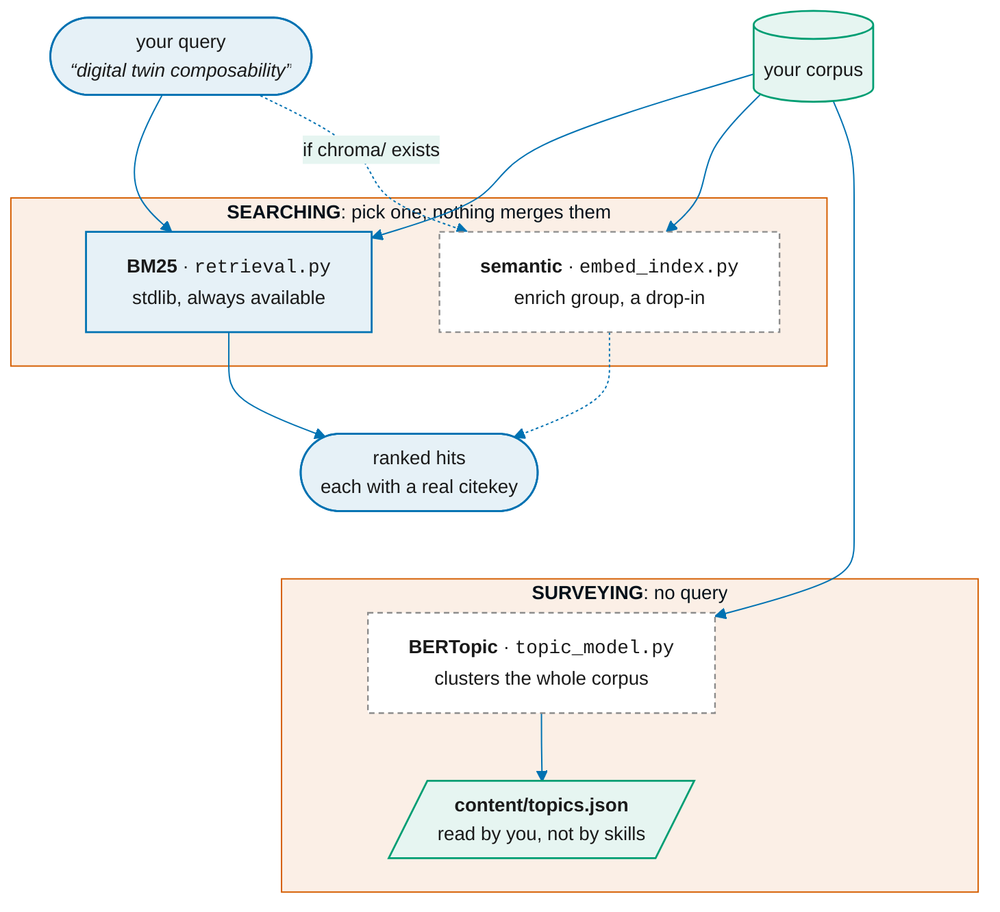

# 🔎 Retrieval: BM25, embeddings, and topic models

Status: **reference.**

Three things in this repository search or organise your corpus. BM25 and
embeddings answer the same question in different ways, and the topic model
answers a different question entirely.

**Written for** someone choosing whether to run
`python -m chitragupta.enrich --stages embed,bertopic`, or wondering why a
draft cited a paper they didn't expect. **Assumed:** you have run
`python -m chitragupta.corpus sync` and have a populated ledger. **Not
covered:** how to tune any of them; see [CONFIG.md](CONFIG.md) for the
settings and [PERFORMANCE.md](PERFORMANCE.md) for what each costs.
For how this pipeline's choices compare with six other RAG systems,
stage by stage, see
[RAG.md](https://github.com/prasadtalasila/chitragupta/blob/main/docs/RAG.md).
The sweeps behind the defaults below, with their full tables, are in
[bench/RESULTS.md](https://github.com/prasadtalasila/chitragupta/blob/main/bench/RESULTS.md).

## 🔭 The short answer

| | **BM25** | **embeddings** | **topic model** |
| --- | --- | --- | --- |
| Module | `chitragupta/retrieval.py`, `chitragupta/retrieval_passages.py` | `chitragupta/enrich/embed_index.py` | `chitragupta/enrich/topic_model.py` |
| Question it answers | which sources match this query? | *the same question* | what clusters exist in my corpus? |
| Takes a query | yes | yes | **no** |
| Method | Okapi BM25 over whitespace tokens | dense vectors, cosine distance | UMAP then HDBSCAN over one vector per document |
| Unit of a hit | a whole document, or **one paragraph**; the caller picks ([below](#-the-passage-unit)) | a 200-word chunk | a whole document |
| Corpus | ledger rows only, so every hit is citable | *the same* | *the same* |
| Needs | stdlib, bare `python` | venv + `enrich` group + a model download | venv + `enrich` group |
| Used by | every genre skill, by default | `survey-writer`, `deep-research`, `draft-reviser` (only if built) | **no genre skill**; the `converge` stage and `corpus discover` read it |

BM25 is split across stdlib modules named `retrieval*.py`; the sections
below name the one each behaviour lives in.

<!-- diagram: retrieval-short-answer -->


## 🔎 BM25 -- the default, and always available

`chitragupta/retrieval.py` ranks whole documents by Okapi BM25 over
whitespace-separated tokens; the scoring lives in
`chitragupta/retrieval_scoring.py`. It is stdlib-only: no model download,
no venv, nothing to build. `search(query, k)` returns
`SearchResult(citekey, title, score, snippet)`, and the snippet is a
window of the real text around the matched terms, so a skill can judge
relevance itself rather than trusting a score. An optional
`collection` argument (`retrieve search --collection NAME`) restricts the
result to one Zotero collection and the ones beneath it, while scoring
stays corpus-wide ([CLI.md](CLI.md)).

- **Every hit is citable.** It reads the ledger, so every result already
  has a citekey that `citation_gate` will accept.
- **It reads the corpus layer's own directory and nothing else:**
  `content/parsed/<citekey>.txt`, plus the `<citekey>.passages.json`
  sidecar beside it. Running the enrichment layer's `docling` stage does
  not improve BM25, because `content/docling/` is not on its read path.
  The only way Docling's output reaches keyword retrieval is
  `[parser].backend = "docling"` in the corpus layer, which changes what
  `sync` writes into `content/parsed/`. That choice also decides whether
  a claim can be quoted from a real paragraph or only located to a page:
  see [CITATION-PROVENANCE.md](CITATION-PROVENANCE.md#-what-the-corpus-layer-keeps-when-it-uses-docling).

Term-frequency statistics are cached to `content/retrieval_index.json`,
keyed by a cheap per-document fingerprint (title, `parsed_path`, ledger
`status`, and the parsed file's size and mtime), so a call re-tokenizes
only documents that changed. The cache's version is a hand-bumped number
joined to a digest of the floor and stopwords in
`chitragupta/_tokens.py`'s `INDEX` setting, and
`content/retrieval_passage_index.json` carries the same digest, so editing
the tokenizer invalidates both files without anyone having to remember to.

A row the ledger calls `parsed` whose `.txt` is gone is indexed on its
title alone, and the CLI counts such rows on stderr:

```text
  [note] 2 parsed source(s) have no parsed text on disk and were ranked
  on their title alone; `python -m chitragupta.corpus sync` re-parses them.
```

The parsed text is decoded with `errors="replace"`, as `sync` and the
review aids do, so BM25 ranks the same text an aid quotes.

### 🎛 `k1` and `b` are settings, and the defaults were swept

Okapi BM25's two free parameters sit under `[retrieval]` in
`config.toml`:

```toml
[retrieval]
k1 = 1.5
b = 0.75
```

`k1` is how fast a term's frequency saturates. `b` is how strongly a document's
score is normalized by its length, from 0 (not at all) to 1 (in full).
Both also govern the [passage unit](#-the-passage-unit). A `k1` below 0
or non-finite, or a `b` outside [0, 1], is rejected when the config
loads: past 1, `b` makes the normalizer `1 - b + b × dl/avgdl` negative
for a short document, which ranks a paper containing your term below one
that does not.

The sweep found no better `b` than 0.75. `k1 = 8` gained 7 queries of
recall@5, but only on the one ground truth the measuring host could build,
which asks a paper's own author keywords to find that paper and so rewards
raw repetition by construction; 1.5 was kept. Raise `k1` if a paper
genuinely about your query keeps losing to one that merely mentions it a
lot. Lower `b` if short documents win on brevity rather than relevance,
raise it if long ones win on size.

### ⚖ Title and abstract can outweigh body text

A query term can count for more when it appears in a paper's **title**
or **abstract**:

```toml
[retrieval]
weight_title = 1.0
weight_abstract = 1.0
```

The weighted term frequency is `tf + (weight - 1) × tf_in_field`, applied
once before BM25's saturation. **1.0 means off, exactly:** the scores are
bit-identical to a build without the feature. Above 1.0 the field counts
for more; 0.0 discounts it entirely; a negative or infinite weight is
rejected when the config loads. **Document length is deliberately not
weighted**, where textbook BM25F normalizes per field, because that would
move the average document length the moment any weight left 1.0 and
leave no measurement a baseline.

**`weight_abstract` needs a structural passage sidecar, and the shipped
`[parser].backend` is `pdftotext`, which writes none.** On a default
install the setting is silently inert; `[parser].backend = "docling"` is
what makes it live. `weight_title` always applies, because a title comes
from the ledger. The abstract is read from the corpus layer's own
sidecar, never from `content/docling/`.

Both ship at 1.0 because no value was supported by both ground truths:
title weighting at 2.0 gained one drafting query in 96, and abstract
weighting left recall unchanged on one arm and cost 1–4 queries on the
other.

There is no `weight_caption` or `weight_table`. A caption field cannot be
built: the corpus layer's sidecar deliberately leaves figure captions out,
so that a claim cannot "match" a journal name repeated on every page. A
table field was built and swept, and lost nDCG on both ground truths at
every weight above 1.0. Tables still reach a drafting session without a
weight: a window that lands in one is
[widened to the whole table](#-a-window-that-lands-in-a-table-keeps-the-whole-table),
and the [passage unit](#-the-passage-unit) returns a table record
verbatim.

### 🔤 An acronym in the query can reach the words it stands for

BM25 is exact-match lexical, so a query for `DT fidelity` reaches no
paper that spells "digital twin" out and never abbreviates it. Query-side
acronym expansion adds the expansion's words to the query's terms:

```toml
[retrieval]
acronym_expansion = true
```

It is on by default, and it is a switch with no weight: an added term
counts exactly as much as one you typed, because sweeping 0.25 / 0.5 /
1.0 of a typed term's weight put full weight ahead on every figure it
moved. Switched off, the ranking is plain BM25 over the terms you typed.

The vocabulary is `assets/style/acronyms.toml` merged with your own
`content/acronyms.toml`, which `chitragupta init` writes and
`dossier acronyms-suggest <draft> --apply` grows from a draft's own
glossary. It is authored rather than derived, so a ranking never depends
on whether an optional enrichment stage has run. A vocabulary
edit takes effect on the next query, with no index rebuild.

Expansion works in one direction. A query saying `DT` reaches documents
saying "digital twin", but not the reverse: that would be document-side
expansion, which would rewrite the index on every edit of the acronym
file. A word you typed is never added a second time, and a one-character
acronym never expands because the token floor drops it first. Every
ranking path expands a query the same way, except `search --y-prev`, whose
second round expands acronyms in the appended draft prose without noting
them.

The CLI says what it added on stderr, and `--log` writes the same string
to the dossier's `retrieval.md` `expanded` column:

```text
  [note] acronym expansion added: dt -> digital twin
```

An acronym file that will not parse is skipped, with one note on stderr;
the vendored file still applies when your own is the broken one.

```text
  [note] acronym file skipped, it could not be parsed as TOML: content/acronyms.toml: ...
```

#### What it is worth, and what it costs

On the shipped vocabulary alone, nothing happens on this project's
corpus: no query in either ground truth contains a vendored acronym
without spelling the term out beside it. On a derived set with each
expansion phrase rewritten to its acronym, expansion made 8 queries
better and 2 worse, raising recall@1 and nDCG@5 while recall@5 stayed
flat, so the gain is in rank rather than reach. The cost is that the mean
document frequency of a query's terms rises from 264 to 292, because
"digital" and "twin" are in far more of this corpus than `DT` is. Where
your expansion words are that ambient, consider switching it off.

### 📝 A misspelled query word can reach its corpus spelling

A query word no paper contains scores zero everywhere, so a typo such as
`strucutral` silently returns nothing or the wrong papers. Spelling
correction adds the corpus word one typing slip away:

```toml
[retrieval]
spelling_correction = true
```

A slip is one letter missing, extra, wrong, or swapped with its
neighbour. The rules:

- Only words of five or more letters that **no paper contains** are
  corrected. A word in even one paper is left alone, however rare.
  Tokens with a digit are never corrected.
- The correction must appear in **at least two papers**. More than half
  the corpus's words appear in only one, and most of those are OCR noise.
- Among several candidates, the word in the most papers wins.
- The typed word **stays** in the query. A correction is added and counts
  as much as a typed word, as an acronym's expansion does.
- Corrections and acronym expansions read only what you typed: neither
  is applied to the other's output.

`retrieve` and `discover search` print each correction on stderr, and
`--log` records it in `retrieval.md`'s `expanded` column as
`strucutral ~> structural`. The citation coverage report lists them per
query.

```text
  [note] spelling: searched 'structural' for 'strucutral'
```

It is **off by default**, and while it is off the ranking is exactly what
it was before it existed. `dossier status` re-ranks every draft's
recorded queries with the current settings, so switching it on can show
as drift on drafts whose queries held a typo.

#### Measured

On this project's corpus
([bench/RESULTS.md](https://github.com/prasadtalasila/chitragupta/blob/main/bench/RESULTS.md),
2026-11-22):

- **Accuracy:** 95.75% of corrections pick the intended word. Most
  wrong ones sit one slip from two real words: `aeing` could be `ageing`
  or `being`.
- **Recovery:** with one typo per query, recall@1 falls from 0.587 to
  0.563. Correction brings it back to 0.591.
- **Harm:** 2 of 964 logged queries were corrected, both valid words
  the corpus lacks. `tumbling` gained `stumbling` and put an unrelated
  paper first. The logs held no genuine typo, which is why it ships off.
- **Cost:** the first query after a sync takes 0.27 s to build the
  vocabulary from a warm cache, or 5.9 s without one. Each later query
  with a five-letter word costs about 28 ms.

### 🔡 Where the token-length floor came from

A token shorter than **two characters** is not indexed and not scored,
on either side. A floor of three puts `AI`, `ML`, `DT`, `5G` and `QA`
outside the index entirely, so a search for one of them returns nothing.
On the 32 self-retrieval queries whose terms the floor changes, two beat
three on every figure (recall@5 0.8438 to 0.9062). A floor of one bought
nothing: it admitted list markers, figure numbers and OCR fragments. The
floor of 2 makes `content/retrieval_index.json` 2.8% larger. Only one
ground truth could be built for this sweep, and it leans toward the
change, since a paper's keywords use acronyms as standalone tokens more
often than typed prose does.

A two-character floor needs window selection to match whole words,
because "ai" sits inside maintainer, said and detail. The boundary is the
tokenizer's, written as lookarounds over `[a-z0-9]` rather than as
Python's `\b`, which treats an underscore and an accented letter as word
characters: `ai_model`, which the index counts as `ai` and `model`, would
rank and then yield no window at all.

Any change to the tokenizer re-ranks every dossier's recorded queries,
so the next `chitragupta draft dossier status --all` reports movement
on drafts nobody edited. That is the index changing, not a draft going
stale, and it settles on the next run.

### 📚 A paper's own bibliography is not indexed

A reference list is dozens of *other* papers' titles inside this one's
body, so a short query naming a subject would match the bibliography of
every paper that merely cites work on it, and the extra length would
penalise that paper under BM25's own length normalization. On the corpus
measured, 18.7% of indexed tokens sat after a reference heading.

The indexed text therefore stops at that heading, and so does every
snippet and every `evidence` window: one cut in
`chitragupta/_reference_cut.py` is applied where all three read their
text. No Docling label identifies the span, so the cut is structural: a
`section_header` passage in `content/parsed/<citekey>.passages.json`
whose text *is* `References` / `Bibliography` / `Works Cited` /
`Literature Cited` (optionally numbered), and everything from the last
such heading to the end of the document. A heading that merely starts
with the word ("Reference architecture") is not one.

A `pdftotext` parse leaves no sidecar, so those items are indexed whole;
459 of 497 parsed items here have a locatable heading. What follows a
reference heading is overwhelmingly acknowledgements and author
biographies, which is why the cut runs to the end of the document; a book
with a bibliography per chapter keeps every chapter's but the last.
`dossier status` scores drift from this same index
([DRAFT-ITERATION.md](DRAFT-ITERATION.md)), so a change to the cut can
surface candidates on a draft nobody edited.

Ranking barely moves: recall@5 is flat or slightly up on the two ground
truths and nDCG@5 slips by up to 0.02, as close members of a top five
swap places. Of 1,760 top-five hits, not one matched only in its
reference list. What changes is the text handed back: without the cut,
18.9% and 9.2% of those snippets on the two arms were author lists, DOIs
and journal titles offered as evidence; with it, none are where the cut
applies.

### 🪟 One window chooser, shared and deterministic

A window around the *first* occurrence of a query term would judge a
document on its abstract mention, and because the term set is a Python
`set`, whose iteration order depends on per-process string hashing, the
same query would return a different snippet run to run.

So `search` and `evidence` go through one chooser. Candidate windows are
anchored on every occurrence of every term **as a whole word** (the
tokenizer's boundary, [above](#-where-the-token-length-floor-came-from)),
scored by how many *distinct* query terms fall inside, de-overlapped, and
returned in document order. Ties break on position, so the result is
deterministic by construction, and it is the best-covering passage, so a
passage late in a long paper is reachable. Were a short window the sole
basis for *rejecting* a source, an irreproducible snippet would mean an
irreproducible rejection; [REJECTION.md](REJECTION.md) has why no such
arrangement exists.

### 📊 A window that lands in a table keeps the whole table

Docling serialises tables as Markdown pipe tables. A real row measures
about 450 characters against a 500-character window, so a plain window
would cut one row and miss the header naming the columns. A chosen window
that touches a run of two or more consecutive lines beginning with `|`
therefore widens to that whole block, rendered **line
by line** rather than whitespace-normalised onto one line. A window that
touches no such block is unchanged. `chitragupta/retrieval_tables.py`
owns it. Two consequences follow:

- **A table hit can exceed the requested width**, capped at 4000
  characters. Over the cap, whole rows are dropped from the end; the
  header row is first, so it is the last thing to go.
- **Fewer windows may come back than were asked for.** Two windows that
  caught different corners of one table become the identical block once
  widened, and the duplicate is dropped.

### 🔍 `evidence` -- zooming in on one document

```bash
python -m chitragupta.draft retrieve evidence "<query>" --citekey <key>
```

Returns the passages of that one document which bear on the query:
2 x 600 characters by default, more text than a snippet, chosen for the
query rather than for where a term first appeared. A passage that lands
inside a table is widened to the whole table, so it can exceed that
width.

It is a lookup, not a stage. Use it when a snippet is not enough to judge
a source you are minded to cite, to make an *acceptance* more careful;
[REJECTION.md](REJECTION.md) has why the reverse (using a cheap read to
reject more) was tried and withdrawn.

Both subcommands take `--log <draft>`, which appends the call and the
size of its payload to that draft's dossier (`retrieval.md`; see
[DRAFT-ITERATION.md](DRAFT-ITERATION.md)), so the cost of retrieval for a
draft is measured instead of estimated.

## 📄 The passage unit

```bash
python -m chitragupta.draft retrieve search "<query>" --unit passage
```

Everything above ranks whole documents. `--unit passage` ranks the corpus
layer's reading-ordered paragraphs instead, and hands back the paragraph
that scored, verbatim, with its page. It uses the same BM25, the same
corpus and the same stdlib-only requirement, over a smaller unit.

It is opt-in because it trades recall for quotability: **recall@5 falls
from 0.8086 to 0.6914** on one arm and 0.8646 to 0.7812 on the other,
while the fraction of returned text cut mid-sentence falls from 99.8% to
16.4% and every hit gains a page number
([figures below](#-what-it-costs-measured)).

| Use `--unit passage` when… | Stay on the default when… |
| --- | --- |
| You want a paragraph you can quote, and the page it sits on | You are asking "did this paper argue X?", a document-level question |
| You already know roughly which papers matter and want their best passage | You are still finding out which papers matter, where recall is the thing that matters |
| Your corpus is parsed with `[parser].backend = "docling"` | Any part of your corpus was parsed with `pdftotext`; those sources are [unreachable here](#-what-this-unit-structurally-cannot-return) |

No genre skill switches to it, and none should on this evidence alone.

### 🔁 What it actually changes: one criterion instead of two

On the document unit, `_bm25_scores` decides the top *k* over the whole
ledger, and only then does `_snippet` → `_windows` pick the text shown, by
counting distinct query terms in a 500-character window. So the evidence
a drafting skill is shown was chosen by a rule that had no part in
deciding the source was worth showing, and it is cut at a character count
rather than at a paragraph. The passage unit collapses the two, so what
ranks is what is shown, and the page comes free with the sidecar record.

### 📚 Where the paragraphs come from

They come from `chitragupta/passages.py`'s rung 2,
`content/parsed/<citekey>.passages.json`, the corpus layer's own parse.
The enrichment layer's richer rung 1 is deliberately not used, because
BM25 promises that running `chitragupta.enrich` does not change what it
ranks. `_reference_cut`'s boundary is read as a *position* in the passage
list, so both units cut the bibliography at the same heading.

Two exclusions stop BM25's length normalization rewarding a short dense
match, which is harmless for a document and not for a paragraph:

- **`section_header` and `title` passages are never indexed.** A
  three-word heading whose text *is* your query would be the
  highest-scoring object in the index, and evidence of nothing. The
  exclusion is structural, not configurable.
- **A passage under `[retrieval].min_passage_tokens` (default 20) is
  not indexed.** This also keeps one-line bibliography entries out on
  documents whose reference heading could not be located; such entries
  are *more* dangerous as passages than as pooled document text.

### 🧢 One paper cannot take the page

The document unit returns one result per citekey by construction. A
well-matched paper has as many passages as it has paragraphs, so this
unit caps them: `[retrieval].max_passages_per_source`, default 3. The cap
is applied to the **fully ranked** list, so dropping a dominant paper's
excess passages promotes another paper's passage rather than shortening
the result. There is no over-fetch multiplier here, unlike the embedding
path, because Chroma returns a pre-truncated candidate list and BM25 does
not. [CONFIG.md](CONFIG.md#-retrieval----bm25s-field-weights-cap-and-floor)
has both keys.

### 📑 An abstract cannot pick the passage either, measured

Four ways of letting a paper's abstract decide which paragraphs this unit
returns were swept on both ground truths: fusing the abstract's score
into its passages, shortlisting papers by abstract, lifting passages that
share its vocabulary, and dropping abstract passages. None is supported
by both arms. The rows that gain anywhere do so by raising the share of
returned passages that are abstract text from 1.7% to 33%, returning the
summary in place of the paragraph, which is what this unit exists to
prevent. Dropping abstract passages costs queries on both arms. Leave the
balance where BM25 put it.

### 🕳 What this unit structurally cannot return

A citekey parsed by `pdftotext` leaves no passage sidecar, so it is
**absent from the index entirely**, however well it matches. Falling back
to a document-level score would put two incomparable numbers in one
ranking, so the CLI counts such sources and names them under the results
instead. On a `pdftotext` corpus this unit has nothing to search, which
is why it is a flag rather than the default.

**Scores from the two units are not comparable.** `N`, every document
frequency and `avgdl` are computed over passages on one path and over
documents on the other. Nothing in this repository sorts them into one
list, and nothing should.

### 📊 What it costs, measured

On the 497-document corpus measured, the passage index holds **47,355
paragraphs**, and a query costs **130 ms against 34 ms** for the document
unit. The index is rebuilt incrementally, in its own file
(`content/retrieval_passage_index.json`) with its own fingerprints and
schema version, because the two indexes are invalidated by different
things.

It also costs recall (passage hits collapsed to citekeys; cap 3, floor
20):

| arm | queries | recall@5 | nDCG@5 |
| --- | --- | --- | --- |
| keyword self-retrieval | 256 | 0.8086 → **0.6914** | 0.7296 → **0.5879** |
| live drafting logs | 96 | 0.8646 → **0.7812** | 0.4729 → **0.3261** |

The loss is structural: **a document pools every paragraph's evidence
into one score, and a passage stands alone.**

What it buys, on the same hits:

| | document | passage (cap 3) |
| --- | --- | --- |
| Hits that begin or end mid-sentence | **99.8%** / 99.8% | **16.4%** / 13.5% |
| Hits carrying a page number | 0% | **100%** |
| Distinct sources in the top five | 5.00 | 3.72 / 4.16 |

(Two figures per cell are the keyword and live-logs arms.) The residual
16% comes from Docling splitting some paragraphs across a page break, and
from table or formula records with no sentence to end. The cap limits how
much source diversity the passage unit spends.

### 🔢 Where the passage-length floor's default came from

This floor is the shortest *passage*, in tokens; the tokenizer's floor
([above](#-where-the-token-length-floor-came-from)) is the shortest
*token*, in characters. 20 was chosen on the live drafting logs, whose
prose queries look like the ones this feature serves; the keyword arm
prefers admitting short passages, because author keywords are exactly the
text that lands in them. The sweep was run at a tokenizer floor of 3 and
not re-measured at 2. A corpus of unusually terse prose is a fair reason
to lower it.

## 🧠 Embeddings -- a replacement for BM25, not an addition

`chitragupta/enrich/embed_index.py` chunks each document into 200 words
with 40 words of overlap, encodes each chunk with a sentence-transformers
model (`sentence-transformers/all-MiniLM-L6-v2` by default), and stores
the vectors in a Chroma collection under `content/chroma/`, namespaced by
model name so switching models starts a fresh collection.

It is a near drop-in: `search(query, k, snippet_chars)` takes BM25's
arguments, though it returns dicts and has no `collection` filter. Nothing
in this repository fuses or re-ranks the two; there is no hybrid search
here. A skill uses one or the other. The over-fetch, the per-source cap
(`[enrich].embed_max_passages_per_source`, default 3) and the optional
cross-encoder rerank are in [CORPUS-SEARCH.md](CORPUS-SEARCH.md), which is
this section at the level of one `search()` call.

BM25 cannot match a paper that argues your point in different words. If
your corpus is large, or spans communities that use different vocabulary
for the same idea, that is the reason to build this; on a small,
vocabulary-consistent corpus BM25 is usually enough.

Every hit is citable, exactly as with BM25: the enrichment layer indexes
the ledger and nothing else, so there is no second source of
uncatalogued PDFs. To make a paper searchable, catalogue it in your
reference manager, re-export, and re-run `sync`.
`python -m chitragupta.enrich` prints what it is about to work on at the
top of every run:

```text
Corpus: 42 doc(s) from papers/bibliography.bib
```

`survey-writer`, `deep-research` and `draft-reviser` name it as the
alternative to BM25, and `deep-research`'s subagents check that
`content/chroma/` exists before reaching for it. The other four genre
skills use BM25 only.

## 🗂 Topic model -- a different question

`chitragupta/enrich/topic_model.py` takes no query. It embeds each
document as the mean of its chunk vectors, reduces with UMAP, clusters
with HDBSCAN, and writes `content/topics.json`: one topic assignment per
document, plus a topic table. It needs at least two documents with text.

- **No genre skill reads `content/topics.json`.** The `converge`
  enrichment stage and `corpus discover` do, for topic terms. It is
  written for you to read when deciding what a survey should even be
  about; `survey-writer` groups its themes by judgement over the evidence
  it retrieved.
- **All-outliers is a correct answer on a small corpus.** HDBSCAN's
  default minimum cluster size will legitimately put every document in
  topic `-1` when there are few of them. Don't force clusters by lowering
  it; the corpus is not yet big enough for the question.
- **It is the one stage that cannot be incremental.** Adding a document
  can move every assignment. Only the encoding is cached
  (`content/topic_embed_cache.json`, keyed by text hash, embedding model
  and pooling method), never the clustering.

## ⚖ Which should I build?

| If you want to… | Do this |
| --- | --- |
| Draft from a modest, consistent corpus | Nothing. BM25 is already running |
| Get a quotable paragraph and a page out of a search | Nothing to build: `retrieve search --unit passage`, if your corpus is docling-parsed. Costs recall; [the figures](#-what-it-costs-measured) |
| Quote sources accurately in a review | `--stages docling`; it is the passage sidecar, not the ranker, that improves quoting |
| Find papers that argue your point in other words | `--stages docling,embed` |
| Decide what your survey should cover | `--stages docling,embed,bertopic`, then read `content/topics.json` yourself |

`docling` comes first in each of those because the embedding stage prefers
`content/docling/<doc>.md` over the plain parsed text when it exists, and
better reading order in gives better chunks out.
