# 🕸 Topic discovery: from a phrase to the papers, the graph, and an overview

Status: **reference.**

Built in full: the `topic-graph` enrichment stage and the analytics it
stores, the `corpus discover` reader and its views, the precision tier,
the gold-set benchmark, the HTML graph page and the interactive app.
[TOPIC-MODELLING.md](https://github.com/prasadtalasila/chitragupta/blob/main/docs/TOPIC-MODELLING.md)
covers how topics come to exist; this page covers relating them, finding
them and reading them.

**Written for** you, before a draft exists, with a synced library and
the question "what is my corpus about, and where should the next draft
start?" Read the worked session first; the how-it-is-computed passages
are safe to skim.

> **On the sources quoted below.** None of the systems and papers this
> feature borrows from is in `content/ledger.sqlite`, so none has a
> citekey; each is named inline and listed in full at the end
> ([AGENTS.md](https://github.com/prasadtalasila/chitragupta/blob/main/AGENTS.md)).
> What was taken from each, and what was deliberately not, is in
> [INSPIRATION.md](https://github.com/prasadtalasila/chitragupta/blob/main/docs/INSPIRATION.md#-topic-discovery).

## 🎯 What the feature is for

Start from a phrase, find the corpus's topics near it, see each topic's
papers with their bibliographic details, walk to linked topics, and take
away an extractive overview grounded enough to seed a draft. It is
scriptable (`--json` everywhere) and interactive, and uses no generative
model: embeddings, BM25, classic statistics and a cross-encoder scorer.
Every citekey shown comes from the ledger via the topic artefacts.

The feature keeps two relations distinct on purpose (figure 13):

- **topic -> papers**: `content/topic_set.json`'s members, displayed
  with ledger detail.
- **topic <-> topic**: derived by the `topic-graph` stage, as two typed
  edge families never merged into one score, because their disagreement
  is itself a discovery cue: two topics can share many papers while
  saying different things, or say the same thing while sharing none.



The "papers and concepts in one graph" shape follows MiniRAG (Fan et
al., 2025), with its LLM-driven entity extraction replaced by this
project's topic model and its Neo4j-scale storage by one JSON file,
because a personal corpus is hundreds of papers, not millions.

## 🧪 A worked session

The five-paper sample corpus commits a full transcript
([`discover_digital_twin.txt`](examples/sample-project/content/discover_digital_twin.txt)),
the graph it read
([`topic_graph.json`](examples/sample-project/content/topic_graph.json)),
the offline page
([`topic_map.html`](examples/sample-project/content/topic_map.html)),
and a gold set with per-rung scores
([`topic_gold.toml`](examples/sample-project/content/topic_gold.toml),
[`topic_gold_results.json`](examples/sample-project/content/topic_gold_results.json)),
including a misspelled query and an out-of-corpus one.

Below is real output from a four-paper fixture (two papers about digital
twins, three about machine learning, `dt2022` in both). Each topic's
provenance is `seed` (a phrase someone named) or `emergent` (the topic
model found it); `--origins` refines `seed` by which file named the
phrase: `seed` (`content/seed_topics.toml`), `keyword`
(`content/keywords.toml`, from the `extract-keywords` stage) and
`corroborated` (both). First, the map:

```console
$ chitragupta corpus discover
2 topics over 4 papers

  digital twin      seed       2 papers
  machine learning  emergent   3 papers
```

Then one topic. Every member carries its ledger entry and the other
topics it belongs to, and both linked-topic families arrive with their
evidence:

```console
$ chitragupta corpus discover "digital twin"
digital twin  (seed, 2 papers)

  [0.90] *dt2021*.
  [0.80] *dt2022*.
         also in: machine learning

linked topics:
  semantically near: machine learning  (0.31, bridge: dt2022 <-> dt2022)
```

When the artefact carries `analysis`, the view ends with a
`brokerage (from the artefact):` block per edge family
([EXPLORE-CLI.md](EXPLORE-CLI.md#-one-topic) shows it on a real corpus).

There is no overlap edge, although the topics share `dt2022`: chance
alone predicts one shared paper here, so the hypergeometric gate (below)
computed p = 1.0 and withheld the edge. On a real corpus that is what
keeps two large topics from being linked merely for being large.

The inverse question, and the machine-readable form:

```console
$ chitragupta corpus discover --paper dt2022
topics:
  [0.80] digital twin
  [0.40] machine learning

$ chitragupta corpus discover "digital twin" --json | jq .resolved_via
"exact"
```

A phrase the corpus cannot place falls back to search, labelled as such
and never presented as a topic membership; each hit is annotated by its
topics so the reader can step back onto the graph:

```console
$ chitragupta corpus discover "cyber replica of a physical system" --json
{
  "resolved_via": "search",
  "results": [
    {"citekey": "dt2021", "topics": [{"label": "digital twin", ...}], ...}
  ]
}
```

## 📦 The topic graph file, and when to look inside it

You normally never open `content/topic_graph.json`; `corpus discover`
and the `--html` page read it for you. `chitragupta enrich --stages
topic-graph` (the seventh and last stage) writes it from the topics
earlier stages found; if those inputs are missing, or were built under a
different embedding model, the stage stops and names the stage to re-run.

```json
{
  "model": "...",
  "n_docs": 497, "n_topics": 53,
  "p_value": 0.01, "neighbors": 5,
  "corpus_mean": [0.0],
  "topics": [{"label": "digital twin", "provenance": "seed",
               "size": 12, "centroid": [0.0],
               "analysis": {"overlap": {"degree": 4, "ego_density": 0.33,
                                         "effective_size": 2.7,
                                         "constraint": 0.41},
                             "semantic": {"...": "same shape"}}}],
  "edges_overlap": [{"a": "...", "b": "...", "jaccard": 0.21,
                      "overlap_coeff": 0.83, "p_value": 0.0004,
                      "shared": ["citekey1", "citekey2"]}],
  "edges_withheld": [{"a": "...", "b": "...", "p_value": 0.83,
                       "shared": ["citekey3"]}],
  "edges_semantic": [{"a": "...", "b": "...", "similarity": 0.74,
                       "bridge": ["citekeyA", "citekeyB"]}],
  "hierarchy": [{"id": "node-0", "a": "...", "b": "...",
                  "distance": 0.31}],
  "communities": {"overlap": "...", "semantic": "..."},
  "paths": {"overlap": "...", "semantic": "..."}
}
```

Beyond the two edge families and the merge tree, the stage stores four
analyses, so `--json`, the terminal and the app read the same numbers:

- `edges_withheld`: each pair sharing a paper that failed the gate,
  with shared citekeys and p-value, for `--why` and the absence panel.
- `analysis` on each topic: degree, ego density, and Burt's effective
  size and constraint, separately for each family.
- `communities`: Markov clustering of each family at every slider
  inflation (1.2 to 4.0 in steps of 0.1), for `--clusters`.
- `paths`: next-hop matrices per family, for `--path` and the app.

Keys are topic **labels**, never topic ids, which are unstable across
runs. The derive-once-read-many split follows FlashRAG's convention (Jin
et al., 2024): one canonical corpus, every index a derived artefact
keyed back to it, as the ledger already is.

## 🔗 Overlap edges: shared members, gated by surprise

An overlap edge links two topics that share more papers than chance
predicts. Three decisions shape it:

- **Both Jaccard and the overlap coefficient travel on every edge.**
  Jaccard (`|A∩B| / |A∪B|`) punishes size imbalance: a seed topic
  capped at `[enrich].seed_topic_max_papers` inside a 40-paper emergent
  cluster scores 0.15 despite full containment. The overlap coefficient
  (`|A∩B| / min(|A|,|B|)`) reads it as a sub-topic, scoring 1.0. Topic
  sizes are unequal by construction, but overlap alone loses the
  symmetric reading, so both are reported and neither is the gate.
- **The gate is a hypergeometric tail test, not a weight floor.** The
  edge survives when the probability of sharing at least this many
  papers by chance (drawing `|B|` papers from `n_docs` with `|A|` of
  them marked) is below `[enrich].topic_graph_p_value`, the test
  gene-set enrichment analysis uses for the same question. A weight
  floor must be re-tuned per corpus; a significance level need not, and
  it refuses the edge two large topics would get merely for being large.
- **`shared` names the citekeys**, so every overlap edge is explainable
  by real papers. It is the property the tests pin first.

## 🧲 Semantic edges: best-match cosine, mutual top-k

Two topics can be about the same thing and share no papers (review
articles and case studies, say). Semantic edges catch that; three
decisions shape them:

- **Average best-match, not centroid-to-centroid.** HDBSCAN clusters
  are non-convex, and such a cluster's centroid can sit outside it. Each
  member of A is scored by its best cosine against B's members and the
  two directions' averages are symmetrised: BERTScore's greedy matching
  (Zhang et al., 2020) applied to papers. At hundreds of documents the
  exact computation costs nothing.
- **Mean-centred space**, as `topic_descriptors` uses: on a corpus about
  one subject every raw vector shares a large common component and
  cosines bunch together; centring removes it. The artefact stores
  `corpus_mean` so the reader can centre a query embedding without the
  embed cache.
- **Mutual top-k selection** (`[enrich].topic_graph_neighbors`): an
  edge survives only when each topic ranks the other within its top k.
  A global floor floods the dense region of topic space or starves the
  sparse one; mutual k-NN adapts to both. Each edge carries `bridge`,
  the closest pair of papers across it, so semantic edges also answer
  "show me why" with citekeys.

## 🌳 The hierarchy

An agglomerative merge tree over the topic centroids
(`scipy.cluster.hierarchy.linkage`, average linkage, cosine distance),
stored for the tree view: which topics are siblings under a broader
theme. It does not use BERTopic's `hierarchical_topics()`, which needs
the fitted model (no stage persists it, and re-fitting is work a
derivation stage's contract forbids) and covers emergent topics only,
whereas every topic here has a centroid.

## 📖 The reader: `corpus discover`

One corpus-layer verb, many views, all with `--json`, all lock-free.
[CLI.md](CLI.md#-chitragupta-corpus-discover) is the per-flag reference
and [EXPLORE-CLI.md](EXPLORE-CLI.md) the worked tour:

```console
chitragupta corpus discover                      # every topic
chitragupta corpus discover "digital twin"       # one topic
chitragupta corpus discover --paper smith2021    # one paper's topics
chitragupta corpus discover --groups 8           # the broad areas
chitragupta corpus discover --clusters           # where the families disagree
chitragupta corpus discover --why "A" "B"        # why there is no edge here
chitragupta corpus discover --path "A" "B" --family overlap   # the chain between two
chitragupta corpus discover --compare "A" "B"    # topics side by side
chitragupta corpus discover "A" --hops 2         # the neighbourhood as rings
chitragupta corpus discover "A" --hops 2 --family overlap  # ...over one family
chitragupta corpus discover --origins seed,corroborated    # only the topics you named
chitragupta corpus discover --app topicapp/      # the interactive app
```

The reader computes no topic and no edge. It resolves, joins ledger
detail (through `reference_entries.entries()`, the one citekey-to-entry
formatter, beneath the drafting layer's `references.py`), and displays.
That keeps it in the corpus layer at tier 1, upgrading its semantic rung
only when the enrich extra is installed.

## 🪜 The resolution ladder



Four rungs, best first. The output names the one that fired
(`resolved_via`), because that separates a topic membership from a
plausible guess:

1. **exact**: case-insensitive equality against topic labels.
2. **fuzzy**: `difflib` near-match at a 0.75 cutoff, for typos only;
   difflib's default 0.6 accepts matches a reader would call wrong.
3. **hybrid**: Reciprocal Rank Fusion of BM25 over each topic's own
   vocabulary (label plus c-TF-IDF terms, scored as
   `chitragupta/retrieval.py` scores) and the query embedding's cosine
   against the stored centroids. RRF
   (`score = Σ 1/(60 + rank)`; Cormack, Clarke and Büttcher, 2009) is
   rank-based, so the two scores never need calibrating, and the paper
   found it beats individual rankers and learned fusion. The rung
   claims the phrase when the best
   centroid cosine clears `[discover].min_similarity` *or* the query
   hit a topic's vocabulary lexically; the floor gates only the
   semantic evidence.
4. **search**: `retrieval.search()` over papers, clearly labelled, each
   hit annotated with its topics.

Fusing a lexical and a dense ranking by rank is LlamaIndex's
`QueryFusionRetriever` pattern, which is LLM-free with `num_queries` set
to one (its optional LLM query expansion is not borrowed). OpenScholar
(Asai et al., 2024) instead unions candidate pools and lets one
cross-encoder be the common scale; the precision tier below adds that on
top: RRF orders the candidates, the cross-encoder rescores them.

Without the enrich extra, or with an embedding model that will not load
(typically no cached checkpoint and no network), the semantic half is
skipped with a one-line note and the rung degrades to BM25 alone. The
failure is remembered for the command, so `--compare A B C` prints the
note once. Every enrich stage's self-probe degrades the same way, never
by silent substitution. An unresolvable phrase whose fallback also
returns nothing exits 1 naming the known topics on **stderr**, like
every refusal this verb raises (an absent artefact, a citekey in no
topic). Stdout carries a document or nothing, so a `--json` caller never
parses English.

## 🎯 The precision tier

Two enrich-tier additions sit on top of the hybrid rung, degrading as
the semantic rung does:

- **Cross-encoder rescoring.** With `[enrich].rerank` on, the fused
  candidates are rescored by the same cross-encoder the embed index
  reranks with (one config key, `[enrich].rerank_model`), over
  (phrase, topic-vocabulary) pairs. Reading query and candidate jointly,
  it catches term overlap without relevance, which two separate
  bi-encoder vectors cannot. This is OpenScholar's recall-then-precision
  cascade sized down to a topic list, where scoring every candidate
  costs milliseconds. It reorders only: it can promote or demote what
  the ladder fused, never add a candidate.
- **A topology-ranked neighbourhood.** When the hybrid rung places a
  phrase near several topics, the view adds a `neighbourhood` ranking:
  personalised PageRank seeded from every matched candidate, each edge
  weighing the stronger of its
  overlap and semantic readings: MiniRAG's topology-based scoring
  without its LLM step. A single resolution gets no walk, since the
  linked-topics lists already answer it.

## 📝 The overview file (`--out`)

The overview is the topic view plus **representative snippets**, as
Markdown raw material for a new draft. From the worked session:

```markdown
# digital twin

A seed topic covering 2 papers.

## Papers

- [0.90] *dt2021*.
- [0.80] *dt2022*.
  - also in: machine learning

## Linked topics

- machine learning -- semantically near (0.31, bridge dt2022 <-> dt2022)

## Representative snippets

> Digital twins mirror physical systems in real time for monitoring.
>   -- `dt2021`
```

Snippets are *selected, never generated*: sentences from member papers'
parsed text, ranked by cosine to the topic centroid in the centred
space, quoted verbatim with their citekeys (FlashRAG's extractive
refiner). Abstractive summaries are declined on the record: a summary
asserting a claim no paper made is in the same failure class as a
fabricated citekey. Without the enrich extra the section says snippets
cannot be ranked; when no member has parsed text it says that.

## 📏 The gold set

`bench/topic_discovery_eval.py` scores the whole ladder against a gold
file you write yourself (`content/topic_gold.toml`, template at
`assets/style/topic_gold.toml.example`): phrases you would actually
type, each with the topics (and optionally the citekeys) it should
reach. It reports hit@1, recall@5, MRR and NDCG@5 for query->topic and
member-recall for topic->paper, **overall and per resolution rung**,
because a floor change moves queries between rungs and an overall mean
would hide that.

`[[group]]` records in the same file name **topics that belong
together** (topic labels only), and `bench/topic_cluster_eval.py` scores
the app's Markov clustering against them, per edge family across the
inflation slider's range, so the slider's default is a measurement. The
score is **pairwise over the gold-covered topics only**, because
grouping gold is partial by design and a metric such as adjusted Rand
wants a complete partition. The partition scored is
**`assets/webapp/families.js`'s own**, run through `node`, so it cannot
disagree with what the browser shows.

On the real 131-topic corpus (21 topics in six groupings) the two
families disagree about the best inflation: paper-sharing peaks well
above the shipped 2.0, semantic nearness at 2.0 itself. That
disagreement is why the app never fuses the two.

The method is legacy AutoRAG's: measure every retrieval configuration
against a small labelled set, never tune by feel. Its LLM-generated QA
datasets were deliberately not borrowed: hand-writing ~40 queries for a
corpus you know is cheaper and more trustworthy, and an invented
expectation measures nothing. The gold set turns
`[discover].min_similarity`'s "0.35 is a starting point" into a
measurement; re-run the script after every knob change and quote the
numbers in the PR that moves the knob.

## 🗣 In plain terms: the two families and the inflation dial

The sixty-second version, for the reader who met "MCL inflation" in the
app's toolbar.

**The two kinds of line**, never mixed:

- An **overlap** edge (drawn solid) means two topics *share actual
  papers*: three of your PDFs belong to both, say. Its evidence is a
  list of citekeys.
- A **semantic** edge (drawn dashed) means two topics *talk about
  similar things*, even if no paper belongs to both. Its evidence is the
  closest pair of papers across the gap.

Two topics that sound alike but share no papers are a literature that
has not met itself yet.

**MCL, the grouping method.** Markov CLustering lets a random walker
step along edges, preferring strong ones; it gets trapped in densely
connected regions, and each trap is a cluster. It needs no cluster count
in advance, and the same input always gives the same answer.

**Inflation, MCL's one dial**, sets how hard the flow is sharpened. High
inflation gives many small, tight clusters; low gives fewer, bigger,
looser ones: 131 topics in ten broad areas, or forty fine ones.

**Why the app clusters twice, at one dial.** Clustering runs once per
edge family, never on a merged graph, and the two families disagree
about the best inflation (previous section), so any stored default would
need one value per family.

## 🖼 The graph page

`chitragupta corpus discover --html topics.html` writes the whole graph
as **one static file**: inline CSS and JavaScript, the data as a JSON
island (with `<` escaped, so no label can close the script tag), and no
network reference. It keeps working from `file://` after the corpus has
moved on. Topics sit on a circle (no force layout: at tens of topics a
circle is legible, deterministic and needs no physics code) **in the
stored merge tree's leaf order**, so neighbours are similar topics and
chords come out short. A topic the tree does not mention (no vector, or
fewer than two topics had one) keeps its artefact order after the
leaves. Overlap edges are solid, semantic dashed; `seed` topics are
green, the rest blue. Clicking a topic opens its papers and both
linked-topic lists with evidence, and the hierarchy is a collapsible
tree. It renders the same artefacts `--json` reads, so it cannot
disagree with the terminal.

For the same reason `--html FILE --json` reports the write as
`{"written": FILE}` rather than refusing, so a `--json` caller always
gets a document. The page is a flag and not a `discover graph`
subcommand because the positional argument is a free phrase, and a
reserved word would shadow a topic labelled "graph".

## 🕸 The interactive app

`chitragupta corpus discover --app topicapp/` writes the graph as a
self-contained **directory**: `index.html`, the interaction code, a
vendored and pinned cytoscape.js, and `data.js`, the `--html` page's
payload as a JavaScript assignment (`fetch()` of local JSON is blocked
under `file://`). It opens with no server, install or network.

[EXPLORE-WEB.md](EXPLORE-WEB.md) covers each view and its terminal
equivalent, and [which computations run in the pipeline and which in the
browser](EXPLORE-WEB.md#-what-the-pipeline-computes-and-what-the-app-computes).
The app shows the four stored analyses, so it and `--json` cannot
disagree. For an artefact lacking a stored field, the app computes it
itself, pinned to the stage by the case files under `tests/webapp/`.

## 🚫 Alternatives considered

Recorded so none is re-proposed as an oversight.

| Rejected | Why |
| --- | --- |
| One fused topic-topic score | The two families answer different questions; merging destroys the disagreement signal |
| A weight floor on overlap edges | A per-corpus knob; the significance test needs none |
| Centroid-to-centroid semantic edges | Non-convex clusters; best-match respects shape at trivial cost |
| Soft-membership set similarity | The edge stops being explainable by naming papers |
| Earth-mover's distance between member sets | Cost and opacity with no added explanation, at this scale |
| UMAP-space distances | UMAP distorts global distances by design |
| Edges stored in the ledger | Derived corpus artefacts are JSON under `content/`; the CLI opens the ledger read-only on purpose |
| Score-interpolation fusion in the ladder | Needs calibrating BM25 against cosine; RRF is rank-based and needs nothing |
| LLM query expansion before retrieval | The one part of the borrowed fusion pattern that needs a generative model at query time |
| Citation-count priors on members (OpenScholar uses one) | Needs an external API per query; the `.bib` is a closed universe by design |
| Abstractive topic summaries | The same failure class as a fabricated citekey; discovery output is extractive or it is not emitted |

## 📚 Sources

Quoted above by author-year; what was borrowed and what was refused is
itemised in
[INSPIRATION.md](https://github.com/prasadtalasila/chitragupta/blob/main/docs/INSPIRATION.md#-topic-discovery).

- Asai, A., He, J., Shao, R., Shi, W., Singh, A., Chang, J. C., Lo, K.,
  Soldaini, L., et al. (2024). *OpenScholar: Synthesizing Scientific
  Literature with Retrieval-Augmented Language Models.*
  <https://arxiv.org/abs/2411.14199>, repo
  <https://github.com/AkariAsai/OpenScholar> (Apache-2.0).
- Cormack, G. V., Clarke, C. L. A., and Büttcher, S. (2009).
  *Reciprocal Rank Fusion Outperforms Condorcet and Individual Rank
  Learning Methods.* SIGIR 2009.
  <https://doi.org/10.1145/1571941.1572114>
- Fan, T., Wang, J., Ren, X., and Huang, C. (2025). *MiniRAG: Towards
  Extremely Simple Retrieval-Augmented Generation.*
  <https://arxiv.org/abs/2501.06713>, repo
  <https://github.com/HKUDS/MiniRAG> (MIT).
- Jin, J., Zhu, Y., Yang, X., Zhang, C., and Dou, Z. (2024).
  *FlashRAG: A Modular Toolkit for Efficient Retrieval-Augmented
  Generation Research.* <https://arxiv.org/abs/2405.13576>, repo
  <https://github.com/RUC-NLPIR/FlashRAG> (MIT).
- LlamaIndex (run-llama). *QueryFusionRetriever* and the
  property-graph index.
  <https://github.com/run-llama/llama_index> (MIT).
- Marker Inc. *AutoRAG* (the archived 1.x AutoML-for-RAG tool, not the
  2.x agent). <https://github.com/Marker-Inc-Korea/AutoRAG>
  (Apache-2.0).
- Zhang, T., Kishore, V., Wu, F., Weinberger, K. Q., and Artzi, Y.
  (2020). *BERTScore: Evaluating Text Generation with BERT.* ICLR
  2020. <https://arxiv.org/abs/1904.09675>
