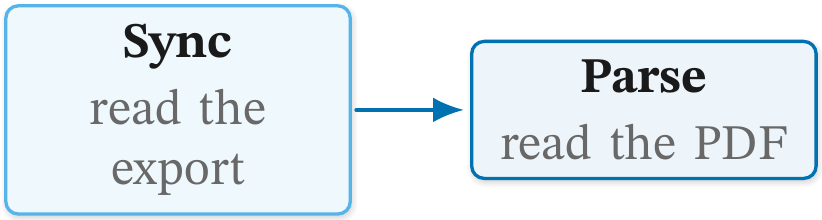
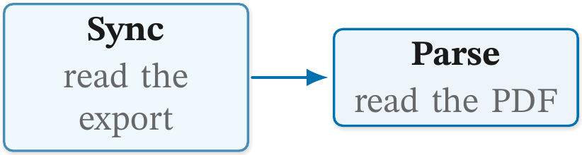
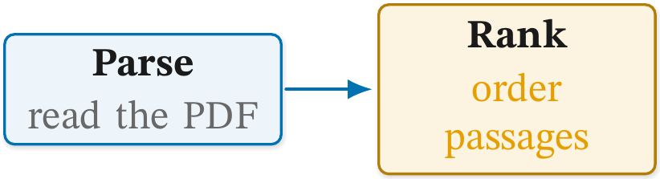
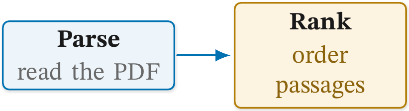
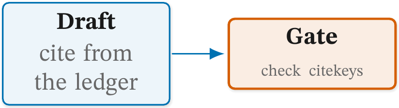
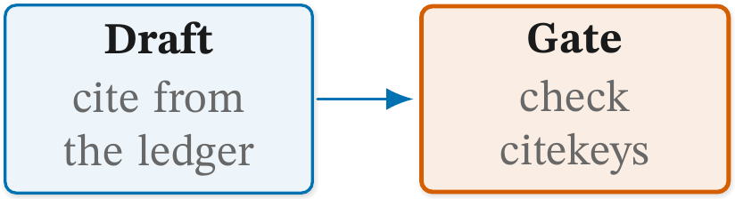
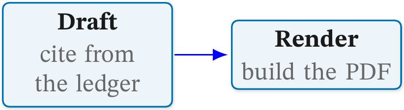
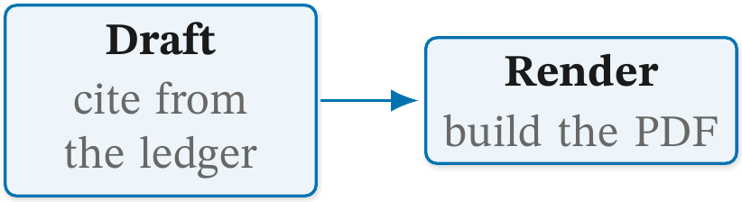
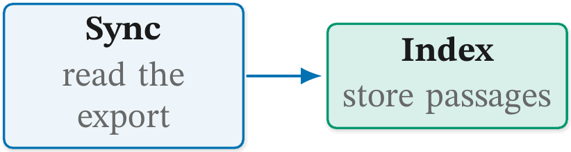
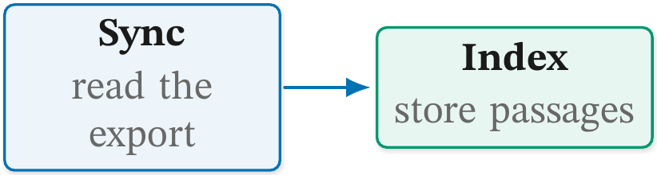

# 🎨 Figure checks: colour and type

Status: **reference.**

The rules about how a figure is coloured and set: a border or a line
too pale for its ground, words too pale for their fill, type smaller
than the body, a colour from outside the house palette, and a card
filled outside the house tint band.
[README.md](README.md) explains how to read a report and how to record a
deliberate exception.

Each rule below shows a faulty figure, the line `figure check` prints
for it, and the fixed figure. Both are real files in
[examples/](examples/), and `tests/test_figure_check_examples.py`
compiles them, so the report lines on this page are what the check
prints today. The listings show the picture only; every file also
carries the house style block above it.

## 🖌️ The house palette

Every fix on this page names one of three roles. Each hue in the house
block has a pale tint to fill with, a darker `Line` shade to draw with,
and a darker still `Text` shade to write with. `cgInk` is the house
black, for labels and default strokes. `cgPaper` is the card ground,
one step off white.

| Hue | Fill (a tint, 6 to 12) | Line (border, edge, rule) | Text (coloured words) |
| --- | --- | --- | --- |
| `cgFlow` | `cgFlow!7` | `cgFlowLine` | `cgFlowText` |
| `cgAccent` | `cgAccent!11` | `cgAccentLine` | `cgAccentText` |
| `cgAlt` | `cgAlt!9` | `cgAltLine` | `cgAltText` |
| `cgAux` | `cgAux!10` | `cgAuxLine` | `cgAuxText` |
| `cgWarm` | `cgWarm!12` | `cgWarmLine` | `cgWarmText` |
| `cgRose` | `cgRose!10` | `cgRoseLine` | `cgRoseText` |
| `cgMute` | `cgPaper` | `cgMuteLine` | `cgMuteText` |

The fill column is what the house styles use (`cgbox`, `cgkey`,
`cgalt`, `cgaux`, `cgwarm`, `cgrose`, `cgplain`); any tint from 6 to 12
is in the band. The `Line` and `Text` shades are mixed towards `cgInk`
until they clear WCAG's 3:1 and 4.5:1 over white, `cgPaper` and every
tint the house block fills with. [TIKZ-STYLE.md](../TIKZ-STYLE.md)
gives the mixing shares and the reasons for each hue.

## 🧭 Rules on this page

- [`k1-stroke`](#k1-stroke)
- [`k2-text`](#k2-text)
- [`type-below-floor`](#type-below-floor)
- [`colour-off-palette`](#colour-off-palette)
- [`tint-outside-band`](#tint-outside-band)

### `k1-stroke`

**Catches.** A box's border, or a connector, under WCAG's 3:1 against
its ground. The target is the node or the edge, `a->b`, and the
measurement names both colours and the ratio. The ground is the box's
own fill, else the innermost filled box that contains it, else white; a
connector's ground is the innermost filled box that holds both its
ends. Colours are what pgf drew with, so a style or `#1` argument is
resolved. A translucent fill is read as opaque, a shadow is not a
ground, and a connector crossing a third zone is measured against its
ends' ground.

**Why it matters.** A border drawn in the same pale tint as its fill
vanishes in print and on a projector, and a pale line looks like a gap.

Faulty: the `Sync` card is drawn in `cgAux`, the hue it is filled with.

```latex
\node[cgaux, draw=cgAux, text width=26mm] (sync) {\cglab{Sync}{read the export}};
\node[cgbox, text width=26mm, right=10mm of sync] (parse) {\cglab{Parse}{read the PDF}};
\draw[cgedge] (sync) -- (parse);
```

```text
  k1-stroke             sync       border cgAux on fill cgAux!10: 2.13:1, needs 3:1
```

`cgAux` is a palette hue, so the same line does not also count as
[`colour-off-palette`](#colour-off-palette): the colour is the house's,
used for the wrong job.

Fixed: the override goes, and `cgaux` draws in `cgAuxLine`.

```latex
\node[cgaux, text width=26mm] (sync) {\cglab{Sync}{read the export}};
```

| Faulty | Fixed |
| --- | --- |
|  |  |

**Fix.** Draw in the hue's `Line` shade (`draw=cgAuxLine`, not
`draw=cgAux`); a palette name fills, a `Line` name draws.

### `k2-text`

**Catches.** A run of a node's text under 4.5:1 against the same ground
as `k1-stroke`, or under 3:1 where it is WCAG's large text (14pt bold,
or 18pt), measured from the typeset size. The target is the node, or
`tag on a->b`. It is read from the glyphs, so `text=`, `\textcolor`,
`\color` and a macro are all seen.

**Why it matters.** Grey or tinted words on a tinted box are the first
thing lost when a page is printed, photocopied or read by someone with
low vision.

Faulty: the gloss of the warm `Rank` card is written in `cgWarm`, the
hue its fill is a tint of.

```latex
\node[cgwarm, text width=26mm, right=10mm of parse] (rank) {\textbf{Rank}\\[1.5pt]\textcolor{cgWarm}{order passages}};
```

```text
  k2-text               rank       text cgWarm on fill cgWarm!12: 2.05:1, needs 4.5:1
```

Fixed: the gloss is written in `cgWarmText`.

```latex
\node[cgwarm, text width=26mm, right=10mm of parse] (rank) {\textbf{Rank}\\[1.5pt]\textcolor{cgWarmText}{order passages}};
```

| Faulty | Fixed |
| --- | --- |
|  |  |

**Fix.** Write in the hue's `Text` shade (`text=cgAccentText`,
`\textcolor{cgAccentText}{...}`), or `cgInk`.

### `type-below-floor`

**Catches.** Text set smaller than the body, 12pt, which is the probe's
and the render's default. The target is the node, and the measurement
is the node's smallest text, `8.0pt, floor 12pt`. It is read from the
glyphs, so `\scriptsize`, a size inherited from a group and a macro are
all seen. A math run is left alone, since a subscript sets at script
size on purpose, unless the node has nothing larger. Text inside a
subscript (`$k_{\text{in}}$`) is text and fires; write `\mathrm` there.

**Why it matters.** A figure whose labels run smaller than the
paragraph beside it reads as an afterthought. Shrinking the type is
never the fix for a box with too many words in it: that is the
conciseness defect, and the fix is fewer words or a wider box.

Faulty: the gate's gloss is shrunk to `\scriptsize` to keep it on one
line.

```latex
\node[cgkey, text width=26mm, right=10mm of draft] (gate) {\textbf{Gate}\\[1.5pt]{\scriptsize\textcolor{cgMuteText}{check citekeys}}};
```

```text
  type-below-floor      gate       8.0pt, floor 12pt
```

Fixed: the size command goes, and the gloss wraps.

```latex
\node[cgkey, text width=26mm, right=10mm of draft] (gate) {\textbf{Gate}\\[1.5pt]{\textcolor{cgMuteText}{check citekeys}}};
```

| Faulty | Fixed |
| --- | --- |
|  |  |

**Fix.** Set the text at the body size: delete `\small`, `\scriptsize`
and the like. If it does not fit, change the layout, never the type.

### `colour-off-palette`

**Catches.** A border, fill, text run or line in a colour the figure's
house block does not define, nor a white tint of one: `draw=blue`,
`fill=red!10`, `black` (the house black is `cgInk`), or a hue darkened
by hand. A framed node with no `draw=` colour is reported as
`border (current colour)`: a node half in the house style. The rule
decides by the colour pgf used, so a `\foreach` variable is read. A
line is named `a->b`, or by its first point. It is not measured without
the house block, and a path's fill outside a node is not read.

**Why it matters.** A figure that invents its own hues reads as
imported from somewhere else, and its colours stop meaning what the
palette says they mean.

Faulty: the arrow from `draft` to `render` is drawn in LaTeX's `blue`.

```latex
\node[cgbox, text width=26mm] (draft) {\cglab{Draft}{cite from the ledger}};
\node[cgbox, text width=26mm, right=10mm of draft] (render) {\cglab{Render}{build the PDF}};
\draw[cgedge, draw=blue] (draft) -- (render);
```

```text
  colour-off-palette    draft->render line blue
```

Fixed: the line is drawn in `cgFlowLine`, the colour `cgedge` already
gives it.

```latex
\draw[cgedge, draw=cgFlowLine] (draft) -- (render);
```

| Faulty | Fixed |
| --- | --- |
|  |  |

**Fix.** Use the house colour for the job: a `cg<Hue>` tint to fill,
`cg<Hue>Line` to draw, `cg<Hue>Text` or `cgInk` to write. A
`(current colour)` border means a `draw` with no house style: use
`cgbox`.

### `tint-outside-band`

**Catches.** A node with text, filled with a house hue mixed with white
outside 6 to 12, or filled solid: the hue itself, or its `Line` or
`Text` shade, which the label drowns in. The target is the node, and
the measurement is the fill, `cgAlt!15, band 6 to 12`. A round node
under 7mm (a step badge, a `Text`-shade disc) and a node with no text
(a timeline's tick) are left out.

**Why it matters.** The band is what keeps a card a wash that text
reads through. A darker tint pulls the eye to that card for no reason,
and the further it goes the closer its label comes to failing
[`k2-text`](#k2-text).

Faulty: the `Index` card is filled with `cgAlt!15`, past the band.

```latex
\node[cgbox, text width=26mm] (sync) {\cglab{Sync}{read the export}};
\node[cgalt, fill=cgAlt!15, text width=26mm, right=10mm of sync] (index) {\cglab{Index}{store passages}};
\draw[cgedge] (sync) -- (index);
```

```text
  tint-outside-band     index      cgAlt!15, band 6 to 12
```

Fixed: the override goes, and `cgalt` fills with `cgAlt!9`.

```latex
\node[cgalt, text width=26mm, right=10mm of sync] (index) {\cglab{Index}{store passages}};
```

| Faulty | Fixed |
| --- | --- |
|  |  |

**Fix.** Fill a card with a tint from 6 to 12 (`fill=cgFlow!8`), never
the hue or its shade.
