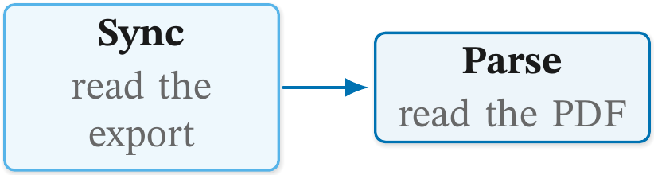
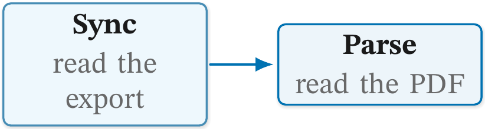
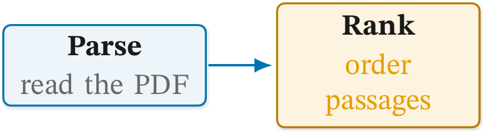
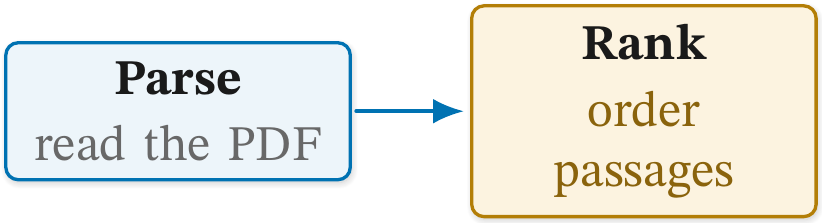
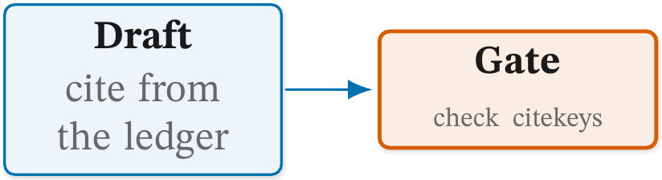
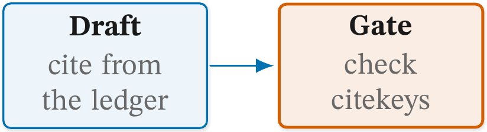
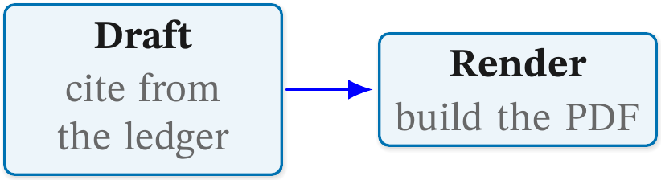
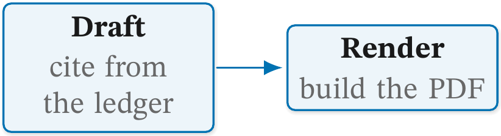
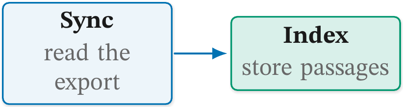
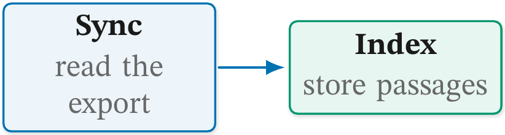

# 🎨 Figure checks: colour and type

Status: **reference.**

The rules about how a figure is coloured and set. [README.md](README.md)
explains how to read a report and record an exception. Each rule shows
a faulty figure, its report line and the fixed figure, all real files
in [examples/](examples/) that `tests/test_figure_check_examples.py`
compiles. Listings show the picture only.

## 🖌️ The house palette

Each house hue has a pale tint to fill with, a darker `Line` shade to
draw with and a darker still `Text` shade to write with. `cgInk` is the
house black, for labels and default strokes; `cgPaper` is the card
ground, one step off white.

| Hue | Fill (a tint, 6 to 12) | Line (border, edge, rule) | Text (coloured words) |
| --- | --- | --- | --- |
| `cgFlow` | `cgFlow!7` | `cgFlowLine` | `cgFlowText` |
| `cgAccent` | `cgAccent!11` | `cgAccentLine` | `cgAccentText` |
| `cgAlt` | `cgAlt!9` | `cgAltLine` | `cgAltText` |
| `cgAux` | `cgAux!10` | `cgAuxLine` | `cgAuxText` |
| `cgWarm` | `cgWarm!12` | `cgWarmLine` | `cgWarmText` |
| `cgRose` | `cgRose!10` | `cgRoseLine` | `cgRoseText` |
| `cgMute` | `cgPaper` | `cgMuteLine` | `cgMuteText` |

The fill column is what the house styles use (`cgbox`, `cgkey`,
`cgalt`, `cgaux`, `cgwarm`, `cgrose`, `cgplain`); any tint from 6 to 12
is in the band. The `Line` and `Text` shades are mixed towards `cgInk`
until they clear WCAG's 3:1 and 4.5:1 over white, `cgPaper` and every
tint the house block fills with. [TIKZ-STYLE.md](../TIKZ-STYLE.md)
gives the mixing shares and the reasons for each hue.

## 🧭 Rules on this page

Each rule below says what it catches and how to fix it.

### `k1-stroke`

**Catches.** A box's border, or a connector, under WCAG's 3:1 against
its ground. Target: the node or the edge, `a->b`. The ground is the
box's own fill, else the innermost filled box containing it, else
white; a connector's is the innermost filled box holding both ends.
Colours are what pgf drew with, so styles and `#1` arguments are
resolved. A translucent fill is read as opaque and a shadow is not a
ground.

Faulty: the `Sync` card is drawn in `cgAux`, the hue it is filled with.

```latex
\node[cgaux, draw=cgAux, text width=26mm] (sync) {\cglab{Sync}{read the export}};
\node[cgbox, text width=26mm, right=10mm of sync] (parse) {\cglab{Parse}{read the PDF}};
\draw[cgedge] (sync) -- (parse);
```

```text
  k1-stroke             sync       border cgAux on fill cgAux!10: 2.13:1, needs 3:1
```

`cgAux` is a house hue used for the wrong job, so this is not also
[`colour-off-palette`](#colour-off-palette).

Fixed: the override goes, and `cgaux` draws in `cgAuxLine`.

```latex
\node[cgaux, text width=26mm] (sync) {\cglab{Sync}{read the export}};
```

| Faulty | Fixed |
| --- | --- |
|  |  |

**Fix.** Draw in the hue's `Line` shade (`draw=cgAuxLine`, not
`draw=cgAux`); a palette name fills, a `Line` name draws.

### `k2-text`

**Catches.** A run of a node's text under 4.5:1 against the same ground
as `k1-stroke`, or under 3:1 where it is WCAG's large text (14pt bold,
or 18pt). Target: the node, or `tag on a->b`. It is read from the
glyphs, so `text=`, `\textcolor`, `\color` and macros are all seen.

Faulty: the gloss of the warm `Rank` card is written in `cgWarm`, the
hue its fill is a tint of.

```latex
\node[cgwarm, text width=26mm, right=10mm of parse] (rank) {\textbf{Rank}\\[1.5pt]\textcolor{cgWarm}{order passages}};
```

```text
  k2-text               rank       text cgWarm on fill cgWarm!12: 2.05:1, needs 4.5:1
```

Fixed: the gloss is written in `cgWarmText`.

```latex
\node[cgwarm, text width=26mm, right=10mm of parse] (rank) {\textbf{Rank}\\[1.5pt]\textcolor{cgWarmText}{order passages}};
```

| Faulty | Fixed |
| --- | --- |
|  |  |

**Fix.** Write in the hue's `Text` shade (`text=cgAccentText`,
`\textcolor{cgAccentText}{...}`), or `cgInk`.

### `type-below-floor`

**Catches.** Text set smaller than the body, 12pt, which is the probe's
and the render's default. Target: the node. It is read from the
glyphs, so `\scriptsize`, an inherited size and macros are all seen. A
math run is left alone unless the node has nothing larger, since a
subscript sets small on purpose; text inside one (`$k_{\text{in}}$`)
fires, so write `\mathrm` there. A box with too many words is the
conciseness defect, fixed with fewer words or a wider box, never
smaller type.

Faulty: the gate's gloss is shrunk to `\scriptsize`.

```latex
\node[cgkey, text width=26mm, right=10mm of draft] (gate) {\textbf{Gate}\\[1.5pt]{\scriptsize\textcolor{cgMuteText}{check citekeys}}};
```

```text
  type-below-floor      gate       8.0pt, floor 12pt
```

Fixed: the size command goes, and the gloss wraps.

```latex
\node[cgkey, text width=26mm, right=10mm of draft] (gate) {\textbf{Gate}\\[1.5pt]{\textcolor{cgMuteText}{check citekeys}}};
```

| Faulty | Fixed |
| --- | --- |
|  |  |

**Fix.** Set the text at the body size: delete `\small`, `\scriptsize`
and the like. If it does not fit, change the layout, never the type.

### `colour-off-palette`

**Catches.** A border, fill, text run or line in a colour the figure's
house block does not define, nor a white tint of one: `draw=blue`,
`fill=red!10`, `black` (the house black is `cgInk`), or a hue darkened
by hand. A framed node with no `draw=` colour is reported as
`border (current colour)`. The rule reads the colour pgf used, so a
`\foreach` variable is resolved. A line is named `a->b`, or by its
first point. It is not measured without the house block, and a path's
fill outside a node is not read.

Faulty: the arrow from `draft` to `render` is drawn in LaTeX's `blue`.

```latex
\node[cgbox, text width=26mm] (draft) {\cglab{Draft}{cite from the ledger}};
\node[cgbox, text width=26mm, right=10mm of draft] (render) {\cglab{Render}{build the PDF}};
\draw[cgedge, draw=blue] (draft) -- (render);
```

```text
  colour-off-palette    draft->render line blue
```

Fixed: `cgFlowLine`, the colour `cgedge` already gives.

```latex
\draw[cgedge, draw=cgFlowLine] (draft) -- (render);
```

| Faulty | Fixed |
| --- | --- |
|  |  |

**Fix.** Use the house colour for the job: a `cg<Hue>` tint to fill,
`cg<Hue>Line` to draw, `cg<Hue>Text` or `cgInk` to write. A
`(current colour)` border means a `draw` with no house style: use
`cgbox`.

### `tint-outside-band`

**Catches.** A node with text, filled with a house hue mixed with white
outside 6 to 12, or filled solid: the hue itself, or its `Line` or
`Text` shade, which the label drowns in. Target: the node. A round
node under 7mm (a step badge) and a node with no text (a timeline's
tick) are left out. A darker tint pulls the eye for no reason and
brings its label closer to failing [`k2-text`](#k2-text).

Faulty: the `Index` card is filled with `cgAlt!15`, past the band.

```latex
\node[cgbox, text width=26mm] (sync) {\cglab{Sync}{read the export}};
\node[cgalt, fill=cgAlt!15, text width=26mm, right=10mm of sync] (index) {\cglab{Index}{store passages}};
\draw[cgedge] (sync) -- (index);
```

```text
  tint-outside-band     index      cgAlt!15, band 6 to 12
```

Fixed: the override goes, and `cgalt` fills with `cgAlt!9`.

```latex
\node[cgalt, text width=26mm, right=10mm of sync] (index) {\cglab{Index}{store passages}};
```

| Faulty | Fixed |
| --- | --- |
|  |  |

**Fix.** Fill a card with a tint from 6 to 12 (`fill=cgFlow!8`), never
the hue or its shade.
