# 🔗 Figure checks: connectors

Status: **reference.**

The rules about the lines between boxes. [README.md](README.md)
explains how to read a report and record a deliberate exception. Each
rule shows a faulty figure, the line `figure check` prints for it, and
the fixed figure, all real files in [examples/](examples/) that
`tests/test_figure_check_examples.py` compiles. Listings show the
picture only; every file also carries the house style block.

## 📏 What a connector is

The rules measure the lines TikZ drew, not the source. A connector is
a line whose ends touch two different nodes; one that leaves no node,
such as an axis, is counted under "lines not between two nodes". An
edge target is written `a->b`, from the node the line leaves to the one
it reaches.

## 🗺 Which rules apply to which layout

*Exempt* means `figure check` skips the rule for a figure whose
`% cg-layout:` line names that layout, whose grammar breaks it on
purpose. *Rare* means it is measured but seldom finds anything.

| Rule | Pipeline | Map | Layered stack | Control loop | Branching tree | Hub-and-spoke | Zoned spine | Comparison | State machine | Sequence | Timeline |
| --- | --- | --- | --- | --- | --- | --- | --- | --- | --- | --- | --- |
| c1-orthogonal | applies | rare | applies | applies | applies | exempt | applies | applies | exempt | applies | applies |
| c2-tag-clearance | applies | rare | applies | applies | applies | applies | applies | applies | applies | applies | rare |
| c3-coincident | applies | rare | applies | applies | applies | applies | applies | applies | applies | rare | rare |
| c4-attach | applies | rare | applies | applies | applies | exempt | applies | applies | exempt | exempt | applies |
| c5-transit | applies | rare | applies | applies | applies | applies | applies | applies | applies | exempt | applies |
| c6-tag-covered | applies | rare | applies | applies | applies | applies | applies | applies | applies | applies | rare |
| c7-dangling-tip | applies | rare | applies | applies | applies | applies | applies | applies | applies | applies | applies |

The layout ids are `pipeline`, `map`, `layered-stack`, `control-loop`,
`branching-tree`, `hub-and-spoke-network`, `zoned-spine`, `comparison`,
`state-machine`, `sequence` and `timeline`.

A map's scaffold draws no line. A timeline's lines are axis pieces,
untagged and never side by side. A comparison's lines stay inside each
panel. A hub's spokes are diagonal and a state machine's transitions
curve and loop, so both are exempt from c1 and c4. A sequence's
messages are level (c1 applies), but meet a lifeline wherever time puts
them and pass over the lifelines between their ends (no c4 or c5).

### `c1-orthogonal`

**Catches.** A connector whose ends differ by more than 1mm in both x
and y, drawn straight or bent instead of as an elbow (`-|`, `|-`).
Target: the edge, `a->b`. A tree is held to it; a control loop's
`bend` passes only between level nodes, as its scaffold draws it. A
slanted line on a grid reads as a different relation, and slants cross
at angles the eye must untangle.

Faulty: `index` sits below and right of `parse`, joined on a slant.

```latex
\node[cgbox, text width=26mm] (parse) {\cglab{Parse}{read the PDF}};
\node[cgkey, text width=26mm, below right=8mm and 14mm of parse] (index) {\cglab{Index}{store passages}};
\draw[cgedge] (parse) -- (index);
```

```text
  c1-orthogonal         parse->index off by 17.0mm in x and 8.0mm in y
```

Fixed: an elbow from the side of `parse` into the top of `index`.

```latex
\draw[cgedge] (parse.east) -| (index.north);
```

| Faulty | Fixed |
| --- | --- |
| 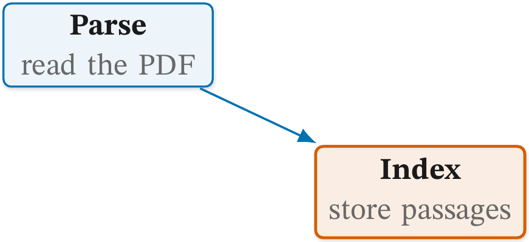 | 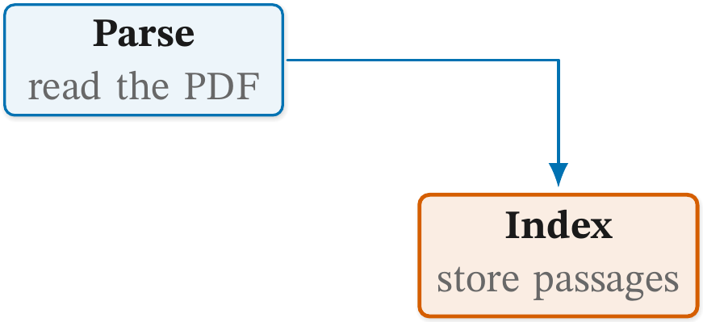 |

**Fix.** Route the edge as an elbow, `-|` or `|-`, or line the two
nodes up.

### `c2-tag-clearance`

**Catches.** A tag whose text is under 1mm or over 3mm from its own
line's ink: the stroke's edge (half the line width off centre), or an
arrowhead the tag sits beside, measured from pgf's outline of the head.
Target: the edge. It measures the text, not the node box (which
`above` and the rest put on the line); the house `cgtag` sets its text
1.5mm off the centreline, about 1.35mm off the stroke. A `sloped` tag
is not measured. A tag on its line cuts it where the eye follows it; a
tag far off is read as the next line's.

Faulty: the tag is filled white and centred on the line.

```latex
\node[cgbox, text width=26mm] (parse) {\cglab{Parse}{read the PDF}};
\node[cgkey, text width=26mm, right=24mm of parse] (index) {\cglab{Index}{store passages}};
\draw[cgedge] (parse) -- node[cgtag, fill=white, anchor=center] {passages} (index);
```

```text
  c2-tag-clearance      parse->index tag 0.0mm from its line
```

Fixed: a plain `cgtag`, just above the line.

```latex
\draw[cgedge] (parse) -- node[cgtag] {passages} (index);
```

| Faulty | Fixed |
| --- | --- |
| 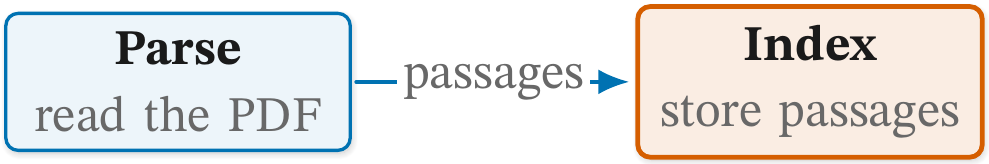 | 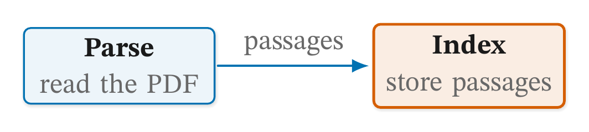 |

**Fix.** Use `cgtag` (unfilled, `auto`), which sits 1.5mm clear; never a
filled tag over its line, nor one beside an arrowhead: move it along with
`pos=`.

### `c3-coincident`

**Catches.** Two connectors running together for more than 2mm, so the
reader sees one and cannot tell where either goes. Target: the pair,
`a->b+c->d`. Two sharing an end point are a fork, not counted.

Faulty: `parse` to `index` climbs to the row and runs along `draft` to
`gate` before turning up.

```latex
\node[cgbox, text width=22mm] (draft) at (0,0) {\cglab{Draft}{cite keys}};
\node[cgkey, text width=22mm] (gate) at (66mm,0) {\cglab{Gate}{check keys}};
\node[cgalt, text width=22mm] (parse) at (22mm,-20mm) {\cglab{Parse}{read PDFs}};
\node[cgalt, text width=22mm] (index) at (44mm,20mm) {\cglab{Index}{store passages}};
\draw[cgedge] (draft) -- (gate);
\draw[cgedge] (parse.north) |- (draft -| index) -- (index.south);
```

```text
  c3-coincident         draft->gate+parse->index share 22.0mm
```

Fixed: the second line turns below the row in its own lane and crosses
the first once.

```latex
\draw[cgedge] (parse.north) -- ++(0,7mm) -| (index.south);
```

| Faulty | Fixed |
| --- | --- |
| 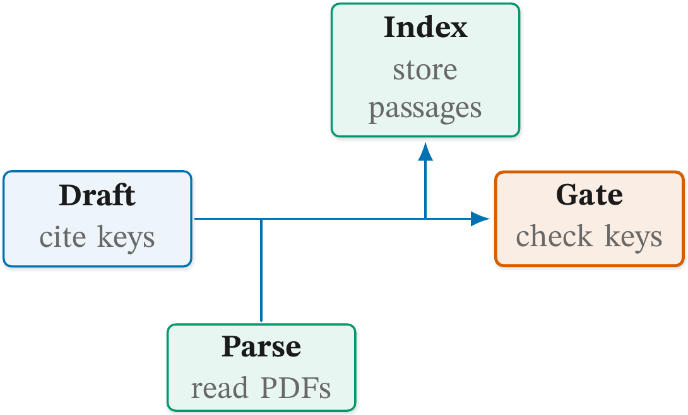 | 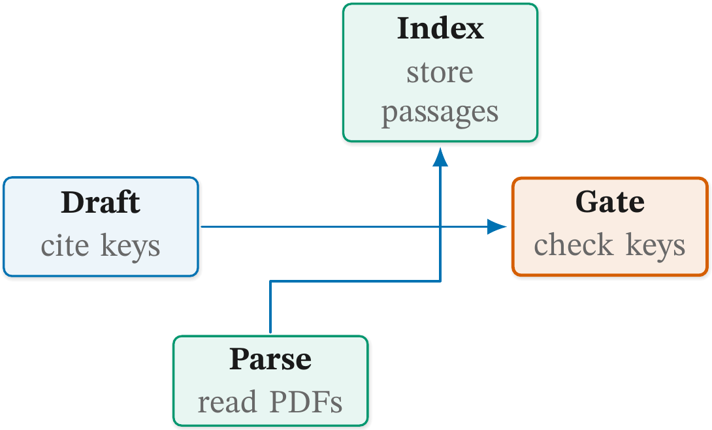 |

**Fix.** Give each edge its own lane: attach at a different point, or
offset one.

### `c4-attach`

**Catches.** One end on a side over 1mm off its midpoint, or several
ends over 1mm off even spacing (`L*k/(N+1)`) or under 2mm apart.
Target: the side, `a.north`. Measured only where a straight connector
meets the side square on (angled or bent ends are `c1-orthogonal`'s),
never on round nodes or zones. A line near a corner looks like the next
box's, and bunched lines read as one wide line.

Faulty: `index` is taller than `parse` with tops aligned, so a level
line from mid-`parse` meets `index` high on its side.

```latex
\node[cgbox, text width=26mm] (parse) {\cglab{Parse}{read the PDF}};
\node[cgkey, text width=26mm, minimum height=22mm, anchor=north west] (index)
  at ([xshift=20mm]parse.north east) {\cglab{Index}{split, embed and store passages}};
\draw[cgedge] (parse.east) -- (parse.east -| index.west);
```

```text
  c4-attach             index.west 1 end 5.7mm off the side's midpoint
```

Fixed: the nodes share a centre line and the edge joins the nodes.

```latex
\node[cgkey, text width=26mm, minimum height=22mm, right=20mm of parse] (index)
  {\cglab{Index}{split, embed and store passages}};
\draw[cgedge] (parse) -- (index);
```

| Faulty | Fixed |
| --- | --- |
| 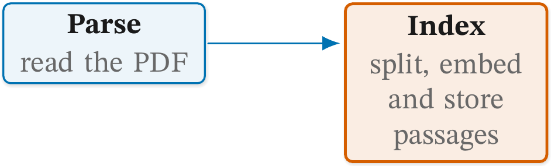 | 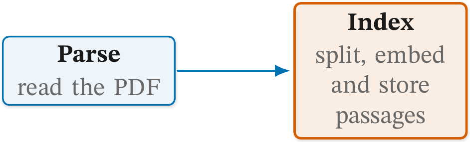 |

**Fix.** Attach a lone edge at the side's midpoint (`a.east`); spread
several evenly along the side, at least 2mm apart.

### `c5-transit`

**Catches.** A connector crossing a node that is neither of its ends,
which claims the line passes through that stage. Target: the edge; the
report names the node. A zone containing an end, a marker under 2mm
and an unframed group (an undrawn `fit`) are not counted.

Faulty: `draft` to `gate` runs straight through `review`.

```latex
\node[cgbox, text width=22mm] (draft) {\cglab{Draft}{cite from the ledger}};
\node[cgplain, text width=22mm, right=10mm of draft] (review) {\cglab{Review}{read by a person}};
\node[cgkey, text width=22mm, right=10mm of review] (gate) {\cglab{Gate}{check citekeys}};
\draw[cgedge] (draft) -- (gate);
```

```text
  c5-transit            draft->gate crosses review
```

Fixed: the line goes round below the row.

```latex
\draw[cgedge] (draft.south) -- ++(0,-5mm) -| (gate.south);
```

| Faulty | Fixed |
| --- | --- |
| 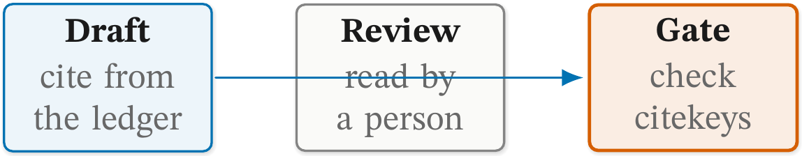 | 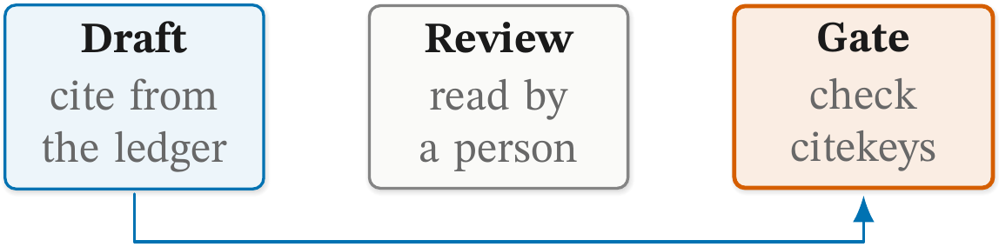 |

**Fix.** Re-route the edge around the node it crosses, or move the
node.

### `c6-tag-covered`

**Catches.** A tag overlapping a node, where it is half hidden or reads
as part of that node's label. Target: the tag's edge, `a->b`; the
report names the node. A zone containing the tag and an unframed group
are not counted.

Faulty: the `ledger` card sits just above the line, and the tag (left
of the direction of travel) runs into it.

```latex
\node[cgbox, text width=32mm] (draft) at (0,0) {\cglab{Draft}{cite from the ledger}};
\node[cgkey, text width=26mm] (gate) at (90mm,0) {\cglab{Gate}{check citekeys}};
\node[cgalt, text width=26mm] (ledger) at (60mm,8.5mm) {\cglab{Ledger}{parsed papers}};
\draw[cgedge] (draft) -- node[cgtag] {citekeys} (gate);
```

```text
  c6-tag-covered        draft->gate tag under ledger
```

Fixed: `swap` sets the tag on the other side, clear of the card.

```latex
\draw[cgedge] (draft) -- node[cgtag, swap] {citekeys} (gate);
```

| Faulty | Fixed |
| --- | --- |
| 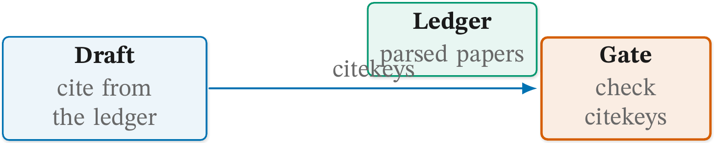 | 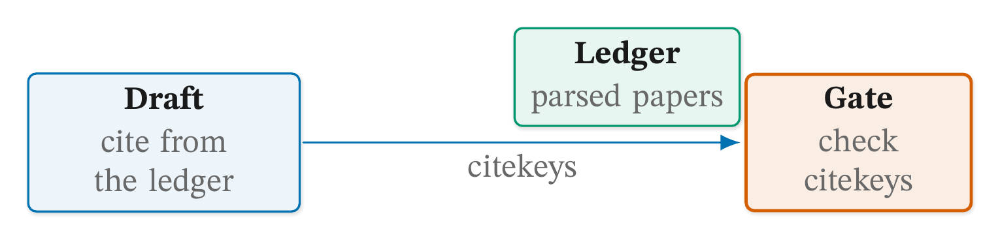 |

**Fix.** Move the tag clear of the node it sits under.

### `c7-dangling-tip`

**Catches.** An arrow leaving a node whose tip lands more than 1mm
from any node or other line, so the reader looks for a missing box.
Target: the point, `(x,y)` in mm. An axis or two-headed dimension line
(leaving no node) is not read. The usual cause is a computed end point,
`(a.south |- b.north)`, landing beside its box.

Faulty: the arrow stops level with `index`'s top, below `parse`, but
`index` is off to the right.

```latex
\node[cgbox, text width=26mm] (parse) {\cglab{Parse}{read the PDF}};
\node[cgkey, text width=26mm, below right=10mm and 4mm of parse] (index) {\cglab{Index}{store passages}};
\draw[cgedge] (parse.south) -- (parse.south |- index.north);
```

```text
  c7-dangling-tip       (0.0,-15.9) arrow tip lands on no node or line
```

Fixed: `index` sits under `parse`, and the arrow ends on it.

```latex
\node[cgkey, text width=26mm, below=10mm of parse] (index) {\cglab{Index}{store passages}};
\draw[cgedge] (parse.south) -- (index.north);
```

| Faulty | Fixed |
| --- | --- |
| 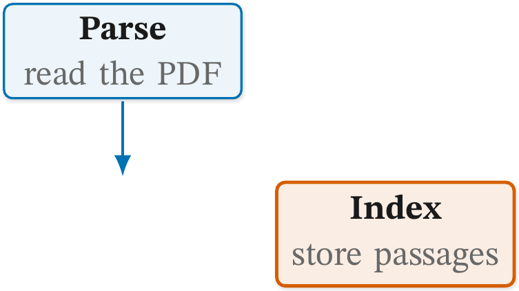 | 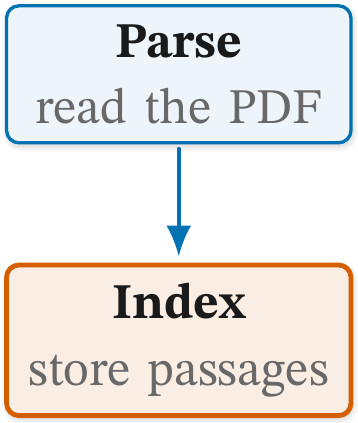 |

**Fix.** End the arrow on the node it points to (`(b)`, `(b.north)`),
not on a computed point beside it.
