# 🔗 Figure checks: connectors

Status: **reference.**

The rules about the lines between boxes: a slanted line on a grid, a
tag on its own line, two lines that hide each other, a line landing off
the middle of a side, a line through a box, a tag under a box, and an
arrow that points at nothing. [README.md](README.md) explains how to
read a report and how to record a deliberate exception.

Each rule below shows a faulty figure, the line `figure check` prints
for it, and the fixed figure. Both are real files in
[examples/](examples/), and `tests/test_figure_check_examples.py`
compiles them, so the report lines on this page are what the check
prints today. The listings show the picture only; every file also
carries the house style block above it.

## 🧭 Rules on this page

- [`c1-orthogonal`](#c1-orthogonal)
- [`c2-tag-clearance`](#c2-tag-clearance)
- [`c3-coincident`](#c3-coincident)
- [`c4-attach`](#c4-attach)
- [`c5-transit`](#c5-transit)
- [`c6-tag-covered`](#c6-tag-covered)
- [`c7-dangling-tip`](#c7-dangling-tip)

## 📏 What a connector is

The connector rules measure the lines TikZ drew, not the source that
asked for them. A connector is a line whose two ends touch two
different nodes. A line that leaves no node, such as an axis, is not a
connector, and the report counts it under "lines not between two
nodes". An edge target is written `a->b`, from the node the line
leaves to the node it reaches.

## 🗺 Which rules apply to which layout

A rule that *applies* is measured on every figure of that layout.
*Exempt* means `figure check` skips the rule for a figure whose
`% cg-layout:` line names that layout, because the layout's grammar
breaks it on purpose. *Rare* means the rule is measured, but the
layout seldom gives it anything to find.

| Rule | Pipeline | Map | Layered stack | Control loop | Branching tree | Hub-and-spoke | Zoned spine | Comparison | State machine | Sequence | Timeline |
| --- | --- | --- | --- | --- | --- | --- | --- | --- | --- | --- | --- |
| c1-orthogonal | applies | rare | applies | applies | applies | exempt | applies | applies | exempt | applies | applies |
| c2-tag-clearance | applies | rare | applies | applies | applies | applies | applies | applies | applies | applies | rare |
| c3-coincident | applies | rare | applies | applies | applies | applies | applies | applies | applies | rare | rare |
| c4-attach | applies | rare | applies | applies | applies | exempt | applies | applies | exempt | exempt | applies |
| c5-transit | applies | rare | applies | applies | applies | applies | applies | applies | applies | exempt | applies |
| c6-tag-covered | applies | rare | applies | applies | applies | applies | applies | applies | applies | applies | rare |
| c7-dangling-tip | applies | rare | applies | applies | applies | applies | applies | applies | applies | applies | applies |

The layout ids are `pipeline`, `map`, `layered-stack`, `control-loop`,
`branching-tree`, `hub-and-spoke-network`, `zoned-spine`, `comparison`,
`state-machine`, `sequence` and `timeline`.

A map argues by where things sit, so its scaffold draws no line, and
c1 to c7 seldom have anything to measure. A timeline's lines are the
pieces of its axis, which carry no tag and never run side by side, so
c2, c3 and c6 seldom fire on it; the rest hold every piece. A
comparison's lines run inside each panel, never between them, and are
held to every rule. A hub's spokes are diagonal and meet the centre at
every angle, so it is exempt from c1 and c4. A state machine is exempt
from the same two, because an automaton's transitions curve and loop
back on their own state. A sequence is held to c1, since its messages
are level, but not to c4 or c5: a message meets a lifeline wherever
time puts it, and passes over the lifelines between its ends.

### `c1-orthogonal`

**Catches.** A connector between nodes whose ends differ by more than
1mm in both x and y, drawn straight or bent instead of as an elbow
(`-|`, `|-`). The target is the edge, `a->b`. Not evaluated for the
`hub-and-spoke-network` and `state-machine` layouts; a tree is held to
it. A control loop's `bend` passes only between nodes that are level
with each other, which is how its scaffold draws it.

**Why it matters.** A slanted line between boxes on a grid reads as a
different kind of relation, and two of them cross at angles the eye has
to untangle.

Faulty: `index` sits below and to the right of `parse`, and the line
cuts across on a slant.

```latex
\node[cgbox, text width=26mm] (parse) {\cglab{Parse}{read the PDF}};
\node[cgkey, text width=26mm, below right=8mm and 14mm of parse] (index) {\cglab{Index}{store passages}};
\draw[cgedge] (parse) -- (index);
```

```text
  c1-orthogonal         parse->index off by 17.0mm in x and 8.0mm in y
```

Fixed: the line leaves the side of `parse` and turns down into the top
of `index`.

```latex
\draw[cgedge] (parse.east) -| (index.north);
```

| Faulty | Fixed |
| --- | --- |
| 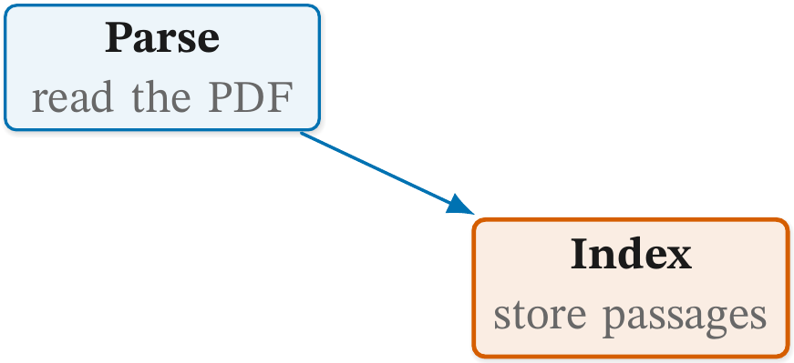 | 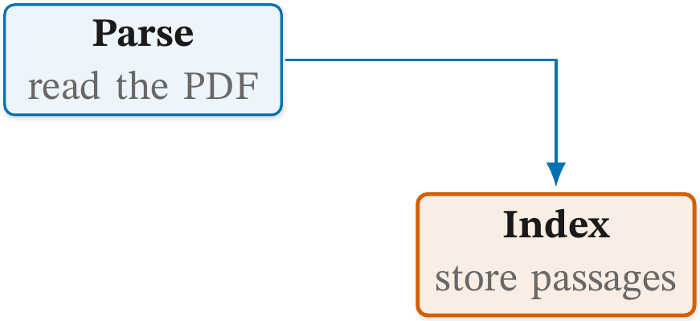 |

**Fix.** Route the edge as an elbow, `-|` or `|-`, or line the two
nodes up.

### `c2-tag-clearance`

**Catches.** A tag whose text is under 1mm or over 3mm from its own
line's ink: the stroke's edge, half the line width off its centre, or an
arrowhead the tag sits beside (its text and the head share a stretch of
the line), measured from the outline pgf gives the head (#1113). The
target is the edge. It is measured from the text, not the node box,
which `above` and the rest put on the line; the house `cgtag` sets its
text 1.5mm off the centreline, about 1.35mm off the house stroke. A
`sloped` tag is not measured.

**Why it matters.** A tag on its line cuts the line where the eye is
following it. A tag far from its line is read as belonging to the next
one.

Faulty: the tag is filled white and centred on the line.

```latex
\node[cgbox, text width=26mm] (parse) {\cglab{Parse}{read the PDF}};
\node[cgkey, text width=26mm, right=24mm of parse] (index) {\cglab{Index}{store passages}};
\draw[cgedge] (parse) -- node[cgtag, fill=white, anchor=center] {passages} (index);
```

```text
  c2-tag-clearance      parse->index tag 0.0mm from its line
```

Fixed: a plain `cgtag`, which sets the word just above the line.

```latex
\draw[cgedge] (parse) -- node[cgtag] {passages} (index);
```

| Faulty | Fixed |
| --- | --- |
| 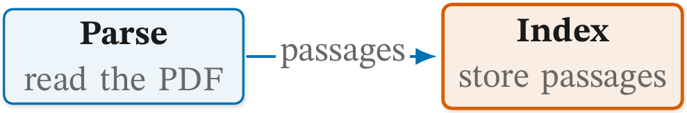 | 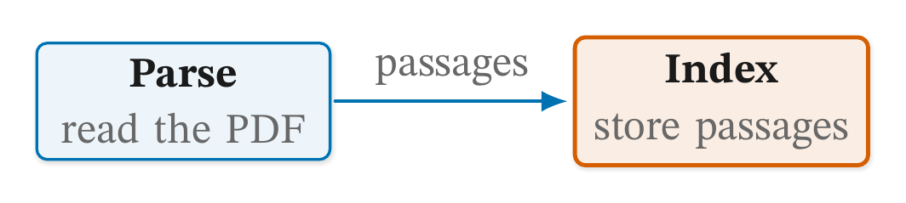 |

**Fix.** Use `cgtag` (unfilled, `auto`), which sits 1.5mm clear; never a
filled tag over its line, nor one beside an arrowhead: move it along with
`pos=`.

### `c3-coincident`

**Catches.** Two connectors that run together for more than 2mm, so
one hides the other. The target is the pair, `a->b+c->d`. Two that
share an end point are a fork, and are not counted.

**Why it matters.** Where two lines coincide the reader sees one, and
cannot tell where either goes.

Faulty: the line from `parse` to `index` climbs to the row and runs
along the `draft` to `gate` line before it turns up.

```latex
\node[cgbox, text width=22mm] (draft) at (0,0) {\cglab{Draft}{cite keys}};
\node[cgkey, text width=22mm] (gate) at (66mm,0) {\cglab{Gate}{check keys}};
\node[cgalt, text width=22mm] (parse) at (22mm,-20mm) {\cglab{Parse}{read PDFs}};
\node[cgalt, text width=22mm] (index) at (44mm,20mm) {\cglab{Index}{store passages}};
\draw[cgedge] (draft) -- (gate);
\draw[cgedge] (parse.north) |- (draft -| index) -- (index.south);
```

```text
  c3-coincident         draft->gate+parse->index share 22.0mm
```

Fixed: the second line turns below the row, in a lane of its own, and
crosses the first instead of following it.

```latex
\draw[cgedge] (parse.north) -- ++(0,7mm) -| (index.south);
```

| Faulty | Fixed |
| --- | --- |
| 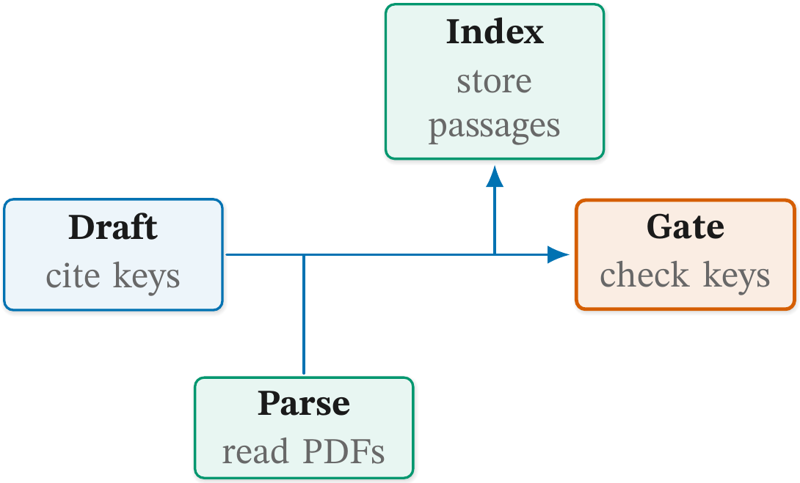 | 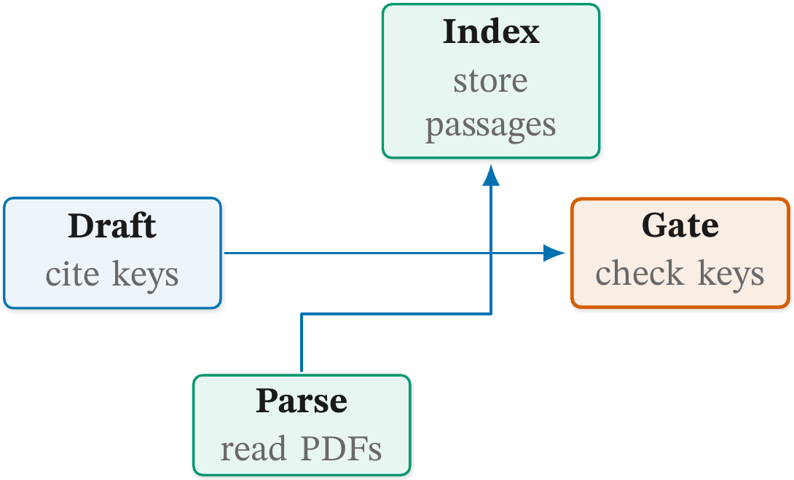 |

**Fix.** Give each edge its own lane: attach at a different point, or
offset one.

### `c4-attach`

**Catches.** One end on a side over 1mm off its midpoint, or several
ends over 1mm off even spacing (`L*k/(N+1)`) or under 2mm apart. The
target is the side, `a.north`. It is measured only where a straight
connector meets the side square on, so an angled or bent end is left to
`c1-orthogonal`. Round nodes and zones are not measured. Not evaluated
for the layouts `c1-orthogonal` exempts, nor for `sequence`.

**Why it matters.** A line that lands near a corner looks as if it
belongs to the next box, and lines bunched at one end of a side read as
a single wider line.

Faulty: `index` is taller than `parse` and their tops are aligned, so
a level line from the middle of `parse` meets `index` high on its
side.

```latex
\node[cgbox, text width=26mm] (parse) {\cglab{Parse}{read the PDF}};
\node[cgkey, text width=26mm, minimum height=22mm, anchor=north west] (index)
  at ([xshift=20mm]parse.north east) {\cglab{Index}{split, embed and store passages}};
\draw[cgedge] (parse.east) -- (parse.east -| index.west);
```

```text
  c4-attach             index.west 1 end 5.7mm off the side's midpoint
```

Fixed: the two nodes share a centre line, and the edge runs between
the nodes themselves.

```latex
\node[cgkey, text width=26mm, minimum height=22mm, right=20mm of parse] (index)
  {\cglab{Index}{split, embed and store passages}};
\draw[cgedge] (parse) -- (index);
```

| Faulty | Fixed |
| --- | --- |
| 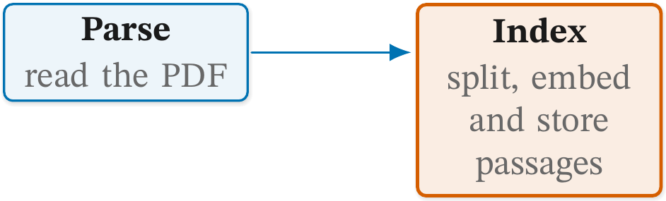 | 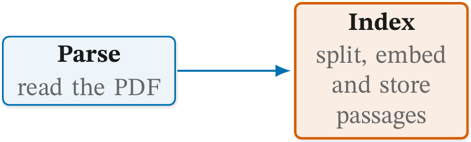 |

**Fix.** Attach a lone edge at the side's midpoint (`a.east`); spread
several evenly along the side, at least 2mm apart.

### `c5-transit`

**Catches.** A connector that crosses a node that is neither of its
ends. The target is the edge, and the report names the node. A zone
containing an end, a marker under 2mm and an unframed group (an
undrawn `fit`) are not counted. Not evaluated for `sequence`, where a
message passes over the lifelines between its ends.

**Why it matters.** A line through a box reads as passing through that
stage, which is a claim the figure did not mean to make.

Faulty: the line from `draft` to `gate` runs straight through
`review`.

```latex
\node[cgbox, text width=22mm] (draft) {\cglab{Draft}{cite from the ledger}};
\node[cgplain, text width=22mm, right=10mm of draft] (review) {\cglab{Review}{read by a person}};
\node[cgkey, text width=22mm, right=10mm of review] (gate) {\cglab{Gate}{check citekeys}};
\draw[cgedge] (draft) -- (gate);
```

```text
  c5-transit            draft->gate crosses review
```

Fixed: the line drops below the row and goes round.

```latex
\draw[cgedge] (draft.south) -- ++(0,-5mm) -| (gate.south);
```

| Faulty | Fixed |
| --- | --- |
| 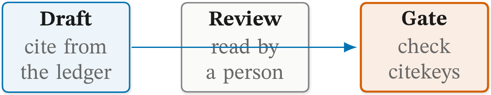 | 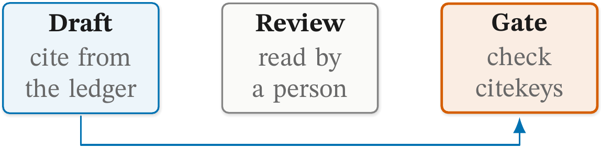 |

**Fix.** Re-route the edge around the node it crosses, or move the
node.

### `c6-tag-covered`

**Catches.** A tag that overlaps a node. The target is the edge whose
tag it is, `a->b`, and the report names the node. A zone containing
the tag and an unframed group are not counted.

**Why it matters.** A tag under a box is half hidden, and a tag over a
box reads as part of that box's label.

Faulty: the `ledger` card sits just above the line, and the tag, set
on the left of the direction of travel, runs into its bottom edge.

```latex
\node[cgbox, text width=32mm] (draft) at (0,0) {\cglab{Draft}{cite from the ledger}};
\node[cgkey, text width=26mm] (gate) at (90mm,0) {\cglab{Gate}{check citekeys}};
\node[cgalt, text width=26mm] (ledger) at (60mm,8.5mm) {\cglab{Ledger}{parsed papers}};
\draw[cgedge] (draft) -- node[cgtag] {citekeys} (gate);
```

```text
  c6-tag-covered        draft->gate tag under ledger
```

Fixed: `swap` sets the tag on the other side of the line, clear of the
card.

```latex
\draw[cgedge] (draft) -- node[cgtag, swap] {citekeys} (gate);
```

| Faulty | Fixed |
| --- | --- |
| 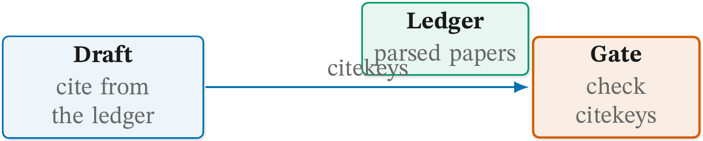 | 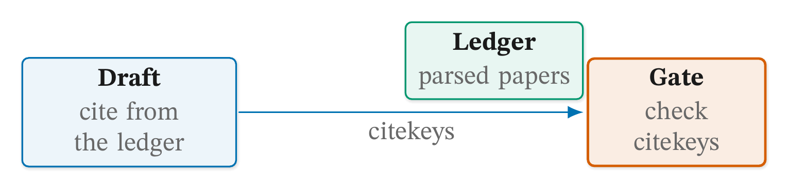 |

**Fix.** Move the tag clear of the node it sits under.

### `c7-dangling-tip`

**Catches.** An arrow leaving a node whose tip lands more than 1mm
from any node or other line. The target is the point, `(x,y)` in mm.
An axis or a two-headed dimension line, which leaves no node, is not
read.

**Why it matters.** An arrow ending in empty space points at nothing,
and the reader looks for the box that is missing. It is most often a
computed end point, `(a.south |- b.north)`, that lands beside the box
it was aimed at instead of on it.

Faulty: the arrow ends at the height of `index`'s top, straight below
`parse`, but `index` is off to the right.

```latex
\node[cgbox, text width=26mm] (parse) {\cglab{Parse}{read the PDF}};
\node[cgkey, text width=26mm, below right=10mm and 4mm of parse] (index) {\cglab{Index}{store passages}};
\draw[cgedge] (parse.south) -- (parse.south |- index.north);
```

```text
  c7-dangling-tip       (0.0,-15.9) arrow tip lands on no node or line
```

Fixed: `index` goes directly under `parse`, and the arrow ends on the
node itself.

```latex
\node[cgkey, text width=26mm, below=10mm of parse] (index) {\cglab{Index}{store passages}};
\draw[cgedge] (parse.south) -- (index.north);
```

| Faulty | Fixed |
| --- | --- |
| 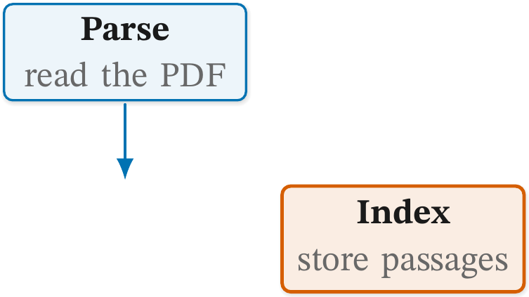 | 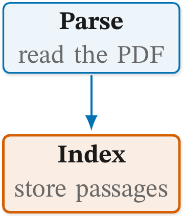 |

**Fix.** End the arrow on the node it points to (`(b)`, `(b.north)`),
not on a computed point beside it.
