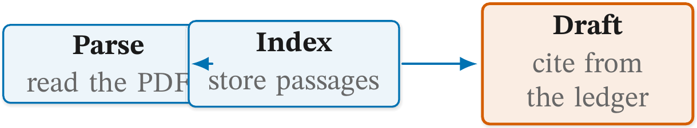
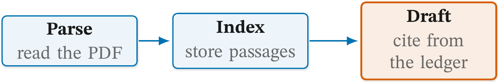
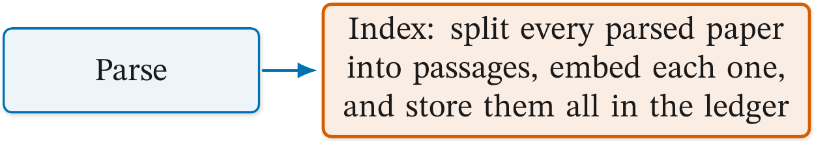
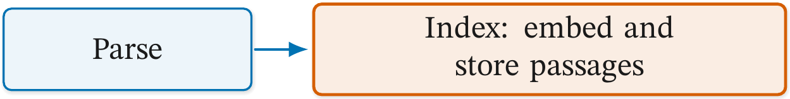
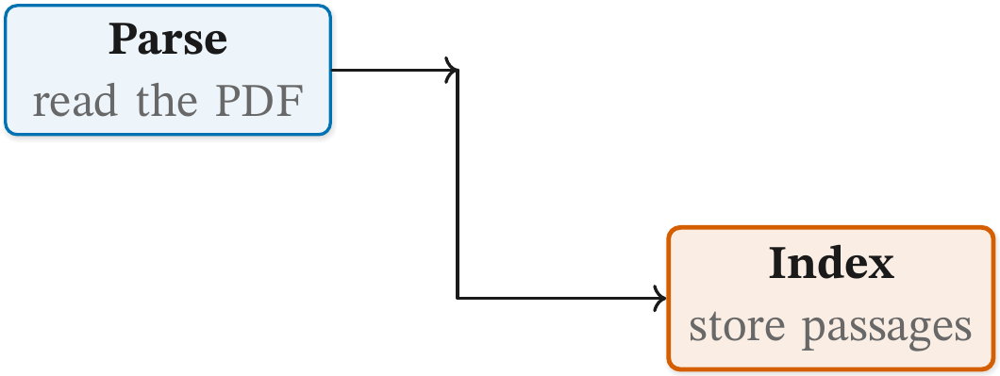
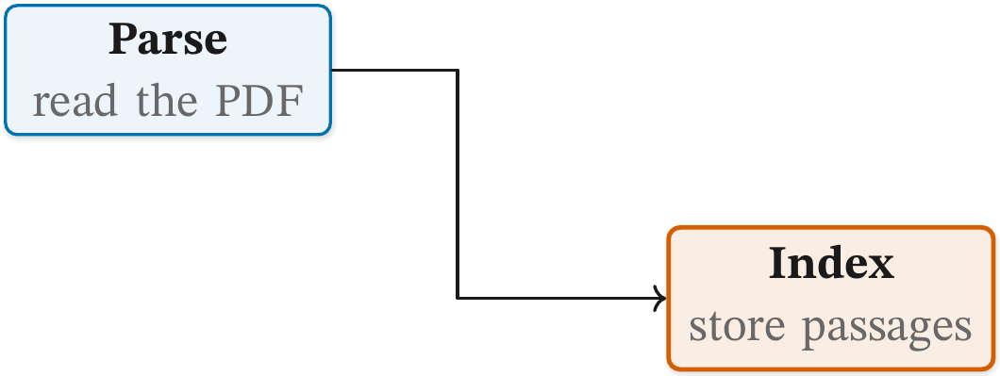
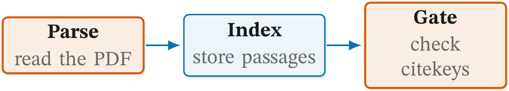
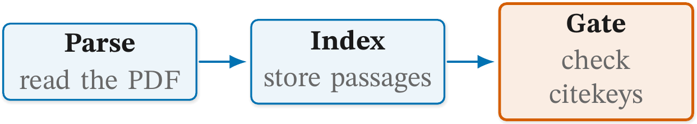
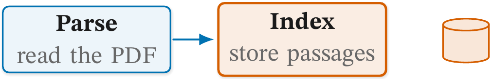
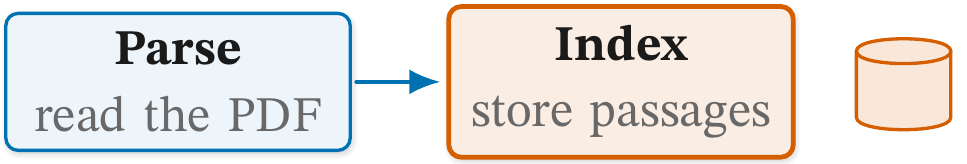

# 🟦 Figure checks: nodes

Status: **reference.**

The rules about the boxes themselves. [README.md](README.md) explains
how to read a report and record an exception. Each rule shows a faulty
figure, its report line and the fixed figure, all real files in
[examples/](examples/) that `tests/test_figure_check_examples.py`
compiles. Listings show the picture only.

## 🧭 Rules on this page

Each rule below says what it catches and how to fix it.

### `node-overlap`

**Catches.** Two nodes whose boxes intersect. Target: the pair,
`a+b`. A zone containing its nodes is not an overlap, nor is a tag on a
line (that is [`c6-tag-covered`](CONNECTORS.md#c6-tag-covered)) or a
round node under 7mm, such as a step badge. Every node TikZ drew is
measured; an unnamed one is named by its centre, `(x,y)` in mm.

Faulty: a negative gap puts `index` on top of `parse`.

```latex
\node[cgbox, text width=28mm] (parse) {\cglab{Parse}{read the PDF}};
\node[cgbox, text width=28mm, right=-4mm of parse] (index) {\cglab{Index}{store passages}};
\draw[cgedge] (parse) -- (index);
\node[cgkey, text width=28mm, right=12mm of index] (draft) {\cglab{Draft}{cite from the ledger}};
\draw[cgedge] (index) -- (draft);
```

```text
  node-overlap          index+parse boxes intersect
```

Fixed: an 8mm gap.

```latex
\node[cgbox, text width=28mm, right=8mm of parse] (index) {\cglab{Index}{store passages}};
```

| Faulty | Fixed |
| --- | --- |
|  |  |

**Fix.** More room between the pair (`node distance`, a gap). A pair
named `(x,y)` is a node the source does not name (a zone title, a note,
a pin, a `child`), at that point in mm. A label turned a quarter is
measured as set; text at any other angle is not.

### `node-text-overload`

**Catches.** A node whose label runs past 15 words, counted from the
source with commands and braces stripped. Target: the node. A sentence
in a box makes the reader stop scanning the figure and start reading.

Faulty: the whole indexing step is spelled out in the box.

```latex
\node[cgbox, text width=30mm] (parse) {Parse};
\node[cgkey, text width=60mm, right=8mm of parse] (index)
  {Index: split every parsed paper into passages, embed each one, and store them all in the ledger};
\draw[cgedge] (parse) -- (index);
```

```text
  node-text-overload    index      17 words (over 15)
```

Fixed: the box names the step; the prose explains it.

```latex
\node[cgkey, text width=60mm, right=8mm of parse] (index)
  {Index: embed and store passages};
```

| Faulty | Fixed |
| --- | --- |
|  |  |

**Fix.** Cut the label to 15 words or split the node.

### `stranded-arrowhead`

**Catches.** A line drawn in pieces where an earlier piece ends in an
arrowhead at a bare coordinate and the next continues from it, so a
head sits mid-line pointing at nothing. Target: the point. The check
reads a head from `->`, an `arrows.meta` tip, or a style that sets one
(`cgedge`), defined in the figure or in the house block.

Faulty: the route is two `\draw` statements, and each carries a head.

```latex
\node[cgbox, text width=26mm] (parse) {\cglab{Parse}{read the PDF}};
\node[cgkey, text width=26mm, below right=8mm and 30mm of parse] (index) {\cglab{Index}{store passages}};
\draw[->, draw=cgInk, thick] (parse.east) -- (2.6,0);
\draw[->, draw=cgInk, thick] (2.6,0) |- (index.west);
```

```text
  stranded-arrowhead    (2.6,0)    arrowhead lands mid-line
```

Fixed: one `\draw` for the whole route.

```latex
\draw[->, draw=cgInk, thick] (parse.east) -- (2.6,0) |- (index.west);
```

| Faulty | Fixed |
| --- | --- |
|  |  |

**Fix.** Draw the whole line as one `\draw`, so only its last piece
carries the head.

### `focal-count`

**Catches.** More than one accented node: `cgkey`, `cgkeystate` on a
state, or `cgfocus` on a timeline tick. It is read from the source, so
an accent reached only through the figure's own style is not seen. The
accent says what the figure is about; two accents say nothing.

Faulty: both the first and the last stage are accented.

```latex
\node[cgkey, text width=26mm] (parse) {\cglab{Parse}{read the PDF}};
\node[cgbox, text width=26mm, right=8mm of parse] (index) {\cglab{Index}{store passages}};
\node[cgkey, text width=26mm, right=8mm of index] (gate) {\cglab{Gate}{check citekeys}};
\draw[cgedge] (parse) -- (index);
\draw[cgedge] (index) -- (gate);
```

```text
  focal-count           figure     2 accented nodes: parse, gate
```

Fixed: `parse` goes back to a plain `cgbox`.

```latex
\node[cgbox, text width=26mm] (parse) {\cglab{Parse}{read the PDF}};
```

| Faulty | Fixed |
| --- | --- |
|  |  |

**Fix.** Keep `cgkey` (`cgkeystate` on a state, `cgfocus` on a
timeline tick) on the one node the figure is about.

### `unnamed-pic`

**Catches.** A house shape (`\pic`) not placed `at` a node the figure
declares with `cgwell`. Target: the pic and its place,
`"cgstore at (6.6,0)"`. No rule measures a pic's paths, so one at a
bare coordinate can cover a label unreported. A pic in a named well is
a node: the overlap rules see it, and a zone can `fit` it.

Faulty: the store icon is placed at a coordinate.

```latex
\node[cgbox, text width=26mm] (parse) {\cglab{Parse}{read the PDF}};
\node[cgkey, text width=26mm, right=8mm of parse] (index) {\cglab{Index}{store passages}};
\pic[cg pic colour=cgAccent] at (6.6,0) {cgstore};
\draw[cgedge] (parse) -- (index);
```

```text
  unnamed-pic           "cgstore at (6.6,0)" not in a named cgwell
```

Fixed: the icon goes into a named well beside `index`.

```latex
\node[cgwell, right=4mm of index] (iindex) {};
\pic[cg pic colour=cgAccent] at (iindex) {cgstore};
```

| Faulty | Fixed |
| --- | --- |
|  |  |

The pictures look alike, but the check can now measure the icon.

**Fix.** Draw the pic into a named well: `\node[cgwell, above=2.5mm of
a] (ia) {};` then `\pic at (ia) {cgstore};`.
