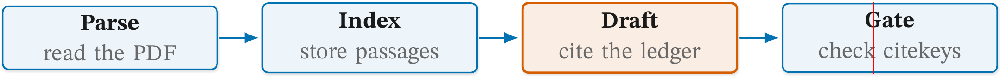
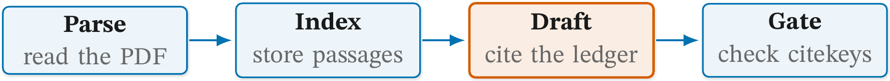
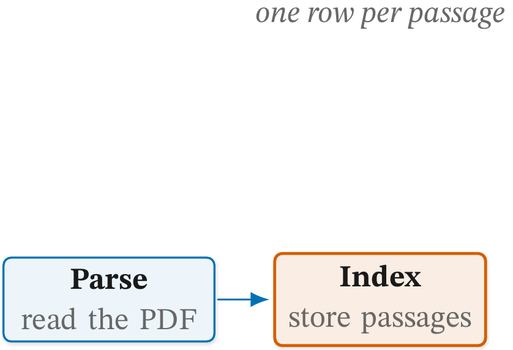
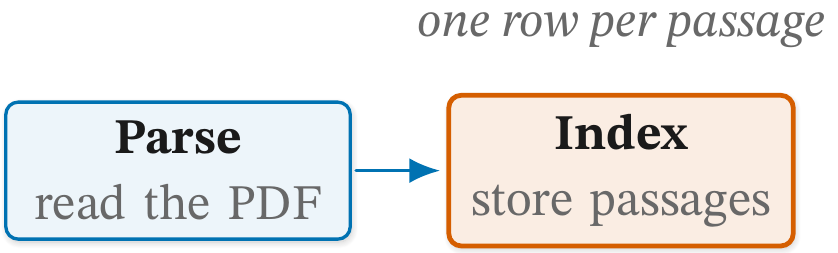
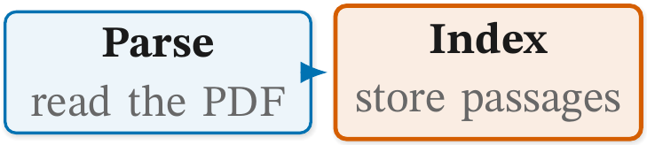
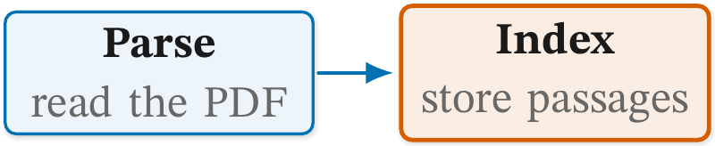

# 📏 Figure checks: size

Status: **reference.**

The rules about how much room a figure takes, then the advisory size
reports. [README.md](README.md) explains how to read a report and
record an exception. Each rule shows a faulty figure, its report line
and the fixed figure, all real files in [examples/](examples/) that
`tests/test_figure_check_examples.py` compiles. Listings show the
picture only, unless the defect is outside it.

## 🧭 Rules on this page

Each rule below says what it catches and how to fix it.

### `size-width`

**Catches.** A picture wider than the target text width: 453pt for
`draft render`'s A4 article page at 1in margins, 437.5pt for a book
unit's figure on `book-assembler`'s page at 80pt margins, or the number
given with `--width`. Target: `figure`. Several pictures in one file
are measured together, since they print side by side. A wider figure
runs into the margin or is scaled down, shrinking its type.

Faulty: four stages in one row, each box 36mm wide.

```latex
\node[cgbox, text width=36mm] (parse) {\cglab{Parse}{read the PDF}};
\node[cgbox, text width=36mm, right=8mm of parse] (index) {\cglab{Index}{store passages}};
\node[cgkey, text width=36mm, right=8mm of index] (draft) {\cglab{Draft}{cite the ledger}};
\node[cgbox, text width=36mm, right=8mm of draft] (gate) {\cglab{Gate}{check citekeys}};
\draw[cgedge] (parse) -- (index);
\draw[cgedge] (index) -- (draft);
\draw[cgedge] (draft) -- (gate);
```

```text
  size-width            figure     517.6pt wide, target 453.0pt
```

Fixed: 28mm boxes, which the labels still fit.

```latex
\node[cgbox, text width=28mm] (parse) {\cglab{Parse}{read the PDF}};
\node[cgbox, text width=28mm, right=8mm of parse] (index) {\cglab{Index}{store passages}};
\node[cgkey, text width=28mm, right=8mm of index] (draft) {\cglab{Draft}{cite the ledger}};
\node[cgbox, text width=28mm, right=8mm of draft] (gate) {\cglab{Gate}{check citekeys}};
```

| Faulty | Fixed |
| --- | --- |
|  |  |

The red line marks where the text width ends.

**Fix.** Wrap a row, cut a gloss, stack panels; see section 3 of
`.claude/skills/figure-drawer/references/figures.md`.

### `size-stray`

**Catches.** The figure, set as one box, is more than 0.5pt wider than
its picture: a line outside the picture that ends without `%` sets a
space. Target: `figure`. A file with several pictures is not measured.
The space shows when a thesis `\input`s the figure inline or measures
it with `\sbox`: it sits off centre, or a row overflows. The renderer's
float drops the space, so the render shows nothing wrong.

Faulty: the library line above the picture ends without `%`.

```latex
\usetikzlibrary{arrows.meta,positioning,fit,backgrounds,calc,shadows.blur}
\begin{tikzpicture}[cg]
```

```text
  size-stray            figure     2.8pt stray (input 193.5pt, picture 190.7pt)
```

Fixed: the line ends with `%`. The two look the same in a float, so
there are no pictures.

```latex
\usetikzlibrary{arrows.meta,positioning,fit,backgrounds,calc,shadows.blur}%
\begin{tikzpicture}[cg]
```

**Fix.** End every line outside the picture with `%`.

### `content-protrusion`

**Catches.** An empty horizontal band taller than a third of the
figure, between the node boxes or between the outermost node and the
picture's edge, so a far-off node and a stray path or label both show.
Only vertical gaps count. Target: `figure`. LaTeX sets a figure as one
rectangle, so the empty band is page the text cannot use.

Faulty: a note sits 30mm above the row it describes.

```latex
\node[cgbox, text width=26mm] (parse) {\cglab{Parse}{read the PDF}};
\node[cgkey, text width=26mm, right=8mm of parse] (index) {\cglab{Index}{store passages}};
\node[cgnote, above=30mm of index] (note) {one row per passage};
\draw[cgedge] (parse) -- (index);
```

```text
  content-protrusion    figure     content protrudes past the main block
```

Fixed: the note sits 3mm above `index`.

```latex
\node[cgnote, above=3mm of index] (note) {one row per passage};
```

| Faulty | Fixed |
| --- | --- |
|  |  |

**Fix.** Pull the stranded element back into the main block.

### `size-squash`

**Catches.** Two nodes joined by an edge that sit under 3mm apart,
edge to edge. Target: the pair, `a+b`. An overlapping pair (that is
[`node-overlap`](NODES.md#node-overlap)), a zone and its child, and a
bend coordinate are not measured. An edge on a path with an `edge`
operator or a named node on it, or with an end built from two nodes
(`b.north |- a`), is listed under "not measured" while the other edges
are still measured, so `size-squash` can appear in both places.
Advisory: it never counts as a finding and cannot be allowed.

Faulty: `index` sits 2mm to the right of `parse`.

```latex
\node[cgbox, text width=26mm] (parse) {\cglab{Parse}{read the PDF}};
\node[cgkey, text width=26mm, right=2mm of parse] (index) {\cglab{Index}{store passages}};
\draw[cgedge] (parse) -- (index);
```

```text
  size-squash           index+parse 2.0mm apart edge to edge, under 3mm
```

Fixed: an 8mm gap.

```latex
\node[cgkey, text width=26mm, right=8mm of parse] (index) {\cglab{Index}{store passages}};
```

| Faulty | Fixed |
| --- | --- |
|  |  |

**Fix.** Advisory. The pair's arrow is under 3mm, too short to read;
give the pair more room.

### 📐 The reference ranges

The four reports below print for every figure that compiles, so they
have no faulty and fixed pair. Each number sits beside the range from
the `## Reference ranges` table in
`.claude/skills/figure-drawer/references/layouts/<layout>.md`, for the
layout the figure's `% cg-layout:` line names
([README.md](README.md#-the-layout-line)) or `--layout` gives; without
one, there is no range. A range never caps a figure: a number outside
it is a question, not a defect. For a small `pipeline`:

```text
  size-height           figure     0.05 of the text height (37pt); pipeline reference 0.10 to 0.37
  size-slack            figure     0.16; pipeline reference 0.56 to 0.69
  budget-nodes          figure     2 nodes; pipeline reference 5 to 11
  budget-edges          figure     1 edge; pipeline reference 3 to 4
```

They cannot be allowed. A file with several pictures has its height
and slack under "not measured", since the probe reads only the last
picture.

### `size-height`

**Catches.** The picture's height as a share of the page's text height
(700.5pt for an article, 685pt for a book unit's figure), with the
height in points. The ranges were measured on the article page, so a
book figure's share reads about 2% higher.

**Fix.** Advisory. Read it beside the reference: far taller than its
layout's figures usually means a row to wrap or a stage to drop.

### `size-slack`

**Catches.** The share of the picture no node fills: `1 -` the area of
the nodes that enclose no other node, over the picture's area. A zone
card is not filled area.

**Fix.** Advisory. The share no node fills, zone cards excluded; well
above the reference, pull the nodes closer or cut the empty zone.

### `budget-nodes`

**Catches.** The count of named nodes, zone cards and icon wells
included.

**Fix.** Advisory. Never a cap: a DP trace has forty cells. Far above
the reference, ask whether this is two figures.

### `budget-edges`

**Catches.** The count of edges the source parser reads. A `\foreach`
body and a `child` are not read, and a bent path counts once per leg.

**Fix.** Advisory. As `budget-nodes`, for the edges the source parser
reads (not a `\foreach` body or a `child`).
