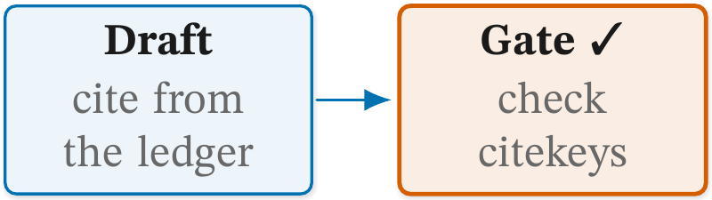
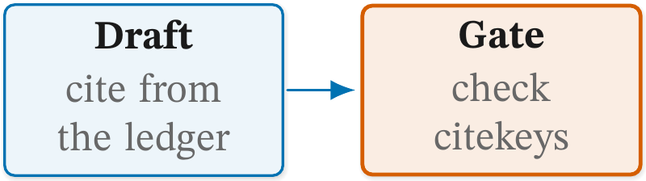
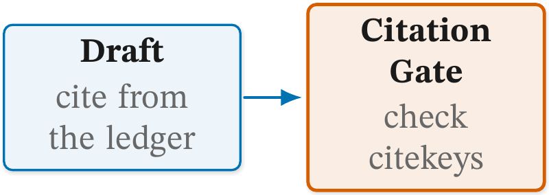
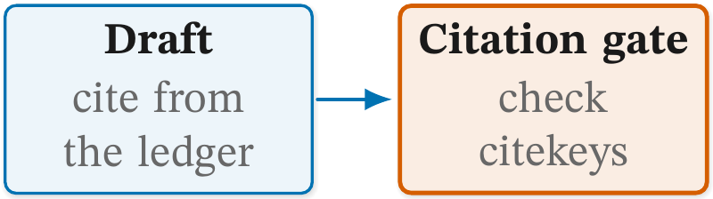
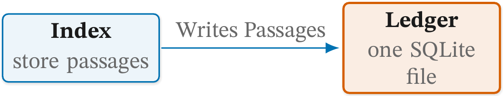
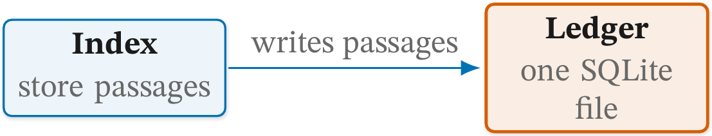
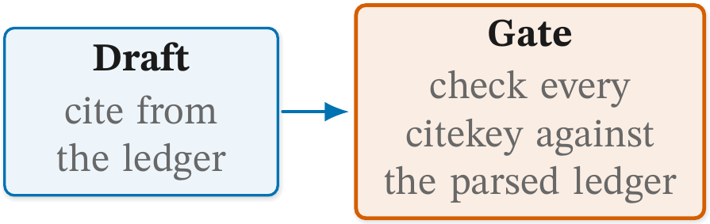
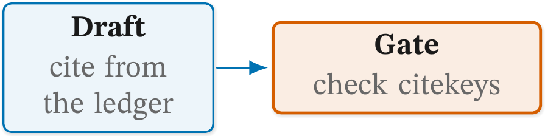

# ✍ Figure checks: wording

Status: **reference.**

The rules about the words in a figure, all read from the source. A
pictograph in a label is a finding. The three house conventions for
names, tags and glosses are advisory reports: they print under their
own heading, never count as findings and cannot be allowed.
[README.md](README.md) explains how to read a report and record an
exception. Each rule shows a faulty figure, its report line and the
fixed figure, all real files in [examples/](examples/) that
`tests/test_figure_check_examples.py` compiles. Listings show the
picture only.

## 🧭 Rules on this page

Each rule below says what it catches and how to fix it.

### `w4-pictograph`

**Catches.** An emoji or pictograph in a label: a character in U+1F000
to U+1FAFF, U+2600 to U+27BF (where `✓` and `★` sit), U+2B00 to
U+2BFF, or the emoji variation selector U+FE0F. Target: the node, or
`figure` for one outside any label. Arrows, `©`, `™`, math and icon
commands (`\ding`, `\fa...`) are not read. The render prints the
character from a fallback font, and a thesis without that font chain
drops it with only a log warning.

Faulty: a tick mark after the gate's name.

```latex
\node[cgbox, text width=26mm] (draft) {\cglab{Draft}{cite from the ledger}};
\node[cgkey, text width=26mm, right=8mm of draft] (gate) {\cglab{Gate ✓}{check citekeys}};
\draw[cgedge] (draft) -- (gate);
```

```text
  w4-pictograph         gate       "✓" (U+2713) in the label
```

Fixed: the tick is gone.

```latex
\node[cgkey, text width=26mm, right=8mm of draft] (gate) {\cglab{Gate}{check citekeys}};
```

| Faulty | Fixed |
| --- | --- |
|  |  |

An emoji such as `🔒` fires the same way; the render prints it from
Unifont's bitmap glyphs.

**Fix.** Delete the character; draw the idea as a house `pic` or say it
in words.

### `w1-case`

**Catches.** A `\cglab` name that starts lower-case, or is in Title
Case: every later word of four letters or more is capitalised.
Target: the name. Acronyms (`RAG`, `PDFs`), `\texttt{}`, math and a
program name lower-case by convention (`pdflatex`) are left alone, so
`Extended Kalman filter` passes. Advisory.

Faulty: the gate's name is in Title Case.

```latex
\node[cgbox, text width=26mm] (draft) {\cglab{Draft}{cite from the ledger}};
\node[cgkey, text width=26mm, right=8mm of draft] (gate) {\cglab{Citation Gate}{check citekeys}};
\draw[cgedge] (draft) -- (gate);
```

```text
advisory (read; never resolved, allowed or capped)
  w1-case               "Citation Gate" Title Case; sentence case capitalises only the first word
```

Fixed: sentence case.

```latex
\node[cgkey, text width=26mm, right=8mm of draft] (gate) {\cglab{Citation gate}{check citekeys}};
```

| Faulty | Fixed |
| --- | --- |
|  |  |

**Fix.** Advisory. Write the `\cglab` name in sentence case: `Feature
store`, not `Feature Store` or `feature store`.

### `w2-tag`

**Catches.** A tag on a `\draw` or `\path` that joins two points, with
more than three words or with a capitalised word (acronyms aside).
Target: the tag's text. A note placed beside a line by its own `\node`
is not a tag. Advisory.

Faulty: the tag is capitalised.

```latex
\node[cgbox, text width=26mm] (index) {\cglab{Index}{store passages}};
\node[cgkey, text width=26mm, right=38mm of index] (ledger) {\cglab{Ledger}{one SQLite file}};
\draw[cgedge] (index) -- node[cgtag] {Writes Passages} (ledger);
```

```text
advisory (read; never resolved, allowed or capped)
  w2-tag                tag "Writes Passages" capitalised; a tag is lower-case
```

Fixed: the tag in lower case.

```latex
\draw[cgedge] (index) -- node[cgtag] {writes passages} (ledger);
```

| Faulty | Fixed |
| --- | --- |
|  |  |

**Fix.** Advisory. A tag is a lower-case phrase of three words or
fewer: `sends request`.

### `w3-gloss`

**Catches.** A `\cglab` gloss over six words. Target: the name the
gloss sits under. A formula counts as one word. Advisory.

Faulty: the gate's gloss runs to seven words.

```latex
\node[cgbox, text width=26mm] (draft) {\cglab{Draft}{cite from the ledger}};
\node[cgkey, text width=34mm, right=8mm of draft] (gate) {\cglab{Gate}{check every citekey against the parsed ledger}};
\draw[cgedge] (draft) -- (gate);
```

```text
advisory (read; never resolved, allowed or capped)
  w3-gloss              "Gate"     "check every citekey against the parsed ledger": 7 words, over 6
```

Fixed: two words, and the prose says the rest.

```latex
\node[cgkey, text width=34mm, right=8mm of draft] (gate) {\cglab{Gate}{check citekeys}};
```

| Faulty | Fixed |
| --- | --- |
|  |  |

**Fix.** Advisory. Cut the `\cglab` gloss to six words or fewer.
