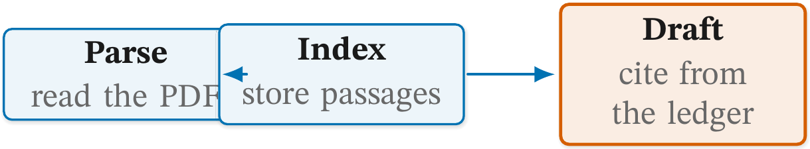
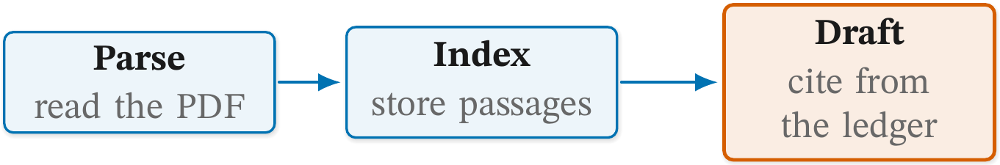
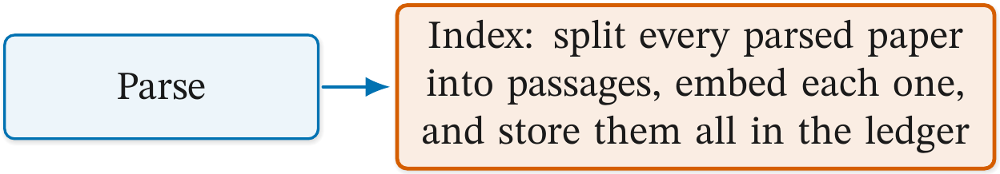
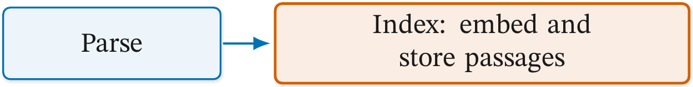
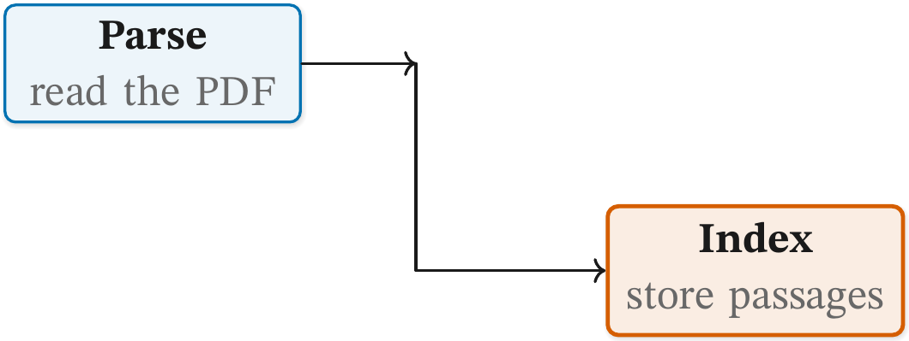
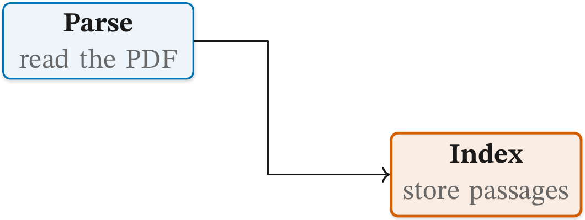
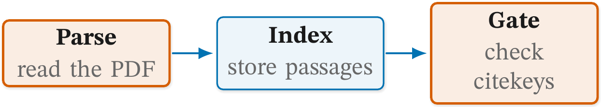
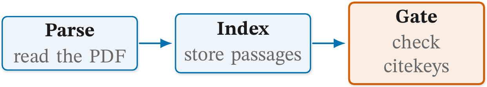
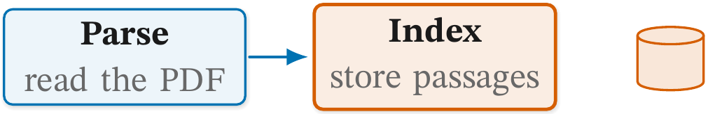
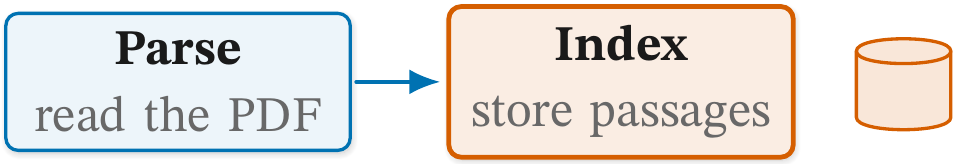

# 🟦 Figure checks: nodes

Status: **reference.**

The rules about the boxes themselves: two that collide, one that says
too much, an arrowhead left in the middle of a line, more than one
accented node, and a house shape placed where nothing measures it.
[README.md](README.md) explains how to read a report and how to record a
deliberate exception.

Each rule below shows a faulty figure, the line `figure check` prints
for it, and the fixed figure. Both are real files in
[examples/](examples/), and `tests/test_figure_check_examples.py`
compiles them, so the report lines on this page are what the check
prints today. The listings show the picture only; every file also
carries the house style block above it.

## 🧭 Rules on this page

- [`node-overlap`](#node-overlap)
- [`node-text-overload`](#node-text-overload)
- [`stranded-arrowhead`](#stranded-arrowhead)
- [`focal-count`](#focal-count)
- [`unnamed-pic`](#unnamed-pic)

### `node-overlap`

**Catches.** Two nodes whose boxes intersect. The target is the pair,
`a+b`. A zone that contains its nodes is not an overlap, and neither is
a tag on a line (that is [`c6-tag-covered`](connectors.md#c6-tag-covered))
or a round node under 7mm, such as a step badge. Every node TikZ drew is
measured, including an unnamed one, which the report names by its
centre, `(x,y)` in mm.

**Why it matters.** The front box hides part of the one behind it, and
the reader cannot tell whether the overlap means something.

Faulty: a negative gap puts `index` on top of `parse`.

```latex
\node[cgbox, text width=28mm] (parse) {\cglab{Parse}{read the PDF}};
\node[cgbox, text width=28mm, right=-4mm of parse] (index) {\cglab{Index}{store passages}};
\draw[cgedge] (parse) -- (index);
\node[cgkey, text width=28mm, right=12mm of index] (draft) {\cglab{Draft}{cite from the ledger}};
\draw[cgedge] (index) -- (draft);
```

```text
  node-overlap          index+parse boxes intersect
```

Fixed: the same figure with an 8mm gap.

```latex
\node[cgbox, text width=28mm, right=8mm of parse] (index) {\cglab{Index}{store passages}};
```

| Faulty | Fixed |
| --- | --- |
|  |  |

**Fix.** More room between the pair (`node distance`, a gap). A pair
named `(x,y)` is a node the source does not name (a zone title, a note,
a pin, a `child`), at that point in mm. A label turned a quarter is
measured as set; text at any other angle is not.

### `node-text-overload`

**Catches.** A node whose label runs past 15 words. The target is the
node. The count is read from the source, with commands and braces
stripped.

**Why it matters.** With a sentence in a box, the reader stops
scanning the figure and starts reading it, and the text is set narrower
than the prose around it.

Faulty: the whole indexing step is spelled out in the box.

```latex
\node[cgbox, text width=30mm] (parse) {Parse};
\node[cgkey, text width=60mm, right=8mm of parse] (index)
  {Index: split every parsed paper into passages, embed each one, and store them all in the ledger};
\draw[cgedge] (parse) -- (index);
```

```text
  node-text-overload    index      17 words (over 15)
```

Fixed: the box names the step, and the prose beside the figure
explains it.

```latex
\node[cgkey, text width=60mm, right=8mm of parse] (index)
  {Index: embed and store passages};
```

| Faulty | Fixed |
| --- | --- |
|  |  |

**Fix.** Cut the label to 15 words or split the node.

### `stranded-arrowhead`

**Catches.** A line drawn in pieces where an earlier piece ends in an
arrowhead at a bare coordinate and the next piece continues from that
point. The target is the point. The head sits in the middle of the
line, pointing at nothing. The check reads `->` in a path's own
options.

**Why it matters.** The reader sees two arrows where the figure means
one, and looks for the box the first one points at.

Faulty: the route is two `\draw` statements, and each carries a head.

```latex
\node[cgbox, text width=26mm] (parse) {\cglab{Parse}{read the PDF}};
\node[cgkey, text width=26mm, below right=8mm and 30mm of parse] (index) {\cglab{Index}{store passages}};
\draw[->, draw=cgInk, thick] (parse.east) -- (2.6,0);
\draw[->, draw=cgInk, thick] (2.6,0) |- (index.west);
```

```text
  stranded-arrowhead    (2.6,0)    arrowhead lands mid-line
```

Fixed: one `\draw` for the whole route, so the only head is at the end.

```latex
\draw[->, draw=cgInk, thick] (parse.east) -- (2.6,0) |- (index.west);
```

| Faulty | Fixed |
| --- | --- |
|  |  |

**Fix.** Put the `->` on the last piece of the line only.

### `focal-count`

**Catches.** More than one accented node: `cgkey`, `cgkeystate` on a
state, or `cgfocus` on a timeline tick. It is read from the source, so
an accent reached only through a style the figure defines itself is not
seen.

**Why it matters.** The accent says "this is what the figure is about".
If two things are accented, neither is.

Faulty: both the first and the last stage are accented.

```latex
\node[cgkey, text width=26mm] (parse) {\cglab{Parse}{read the PDF}};
\node[cgbox, text width=26mm, right=8mm of parse] (index) {\cglab{Index}{store passages}};
\node[cgkey, text width=26mm, right=8mm of index] (gate) {\cglab{Gate}{check citekeys}};
\draw[cgedge] (parse) -- (index);
\draw[cgedge] (index) -- (gate);
```

```text
  focal-count           figure     2 accented nodes: parse, gate
```

Fixed: `parse` goes back to a plain `cgbox`, and only the gate is
accented.

```latex
\node[cgbox, text width=26mm] (parse) {\cglab{Parse}{read the PDF}};
```

| Faulty | Fixed |
| --- | --- |
|  |  |

**Fix.** Keep `cgkey` (`cgkeystate` on a state, `cgfocus` on a
timeline tick) on the one node the figure is about.

### `unnamed-pic`

**Catches.** A house shape (`\pic`) that is not placed `at` a node the
figure declares with `cgwell`. The target is the pic and its place,
`"cgstore at (6.6,0)"`.

**Why it matters.** No rule measures the paths inside a pic. A pic
placed at a bare coordinate can sit on top of a label and nothing
reports it. A pic in a named well is a node like any other: the overlap
rules see it, and a zone can `fit` it.

Faulty: the store icon is placed at a coordinate.

```latex
\node[cgbox, text width=26mm] (parse) {\cglab{Parse}{read the PDF}};
\node[cgkey, text width=26mm, right=8mm of parse] (index) {\cglab{Index}{store passages}};
\pic[cg pic colour=cgAccent] at (6.6,0) {cgstore};
\draw[cgedge] (parse) -- (index);
```

```text
  unnamed-pic           "cgstore at (6.6,0)" not in a named cgwell
```

Fixed: the icon goes into a named well beside `index`.

```latex
\node[cgwell, right=4mm of index] (iindex) {};
\pic[cg pic colour=cgAccent] at (iindex) {cgstore};
```

| Faulty | Fixed |
| --- | --- |
|  |  |

The two pictures look alike. The difference is that the check can now
measure the icon, so the next time it drifts onto a label the report
will say so.

**Fix.** Draw the pic into a named well: `\node[cgwell, above=2.5mm of
a] (ia) {};` then `\pic at (ia) {cgstore};`.
