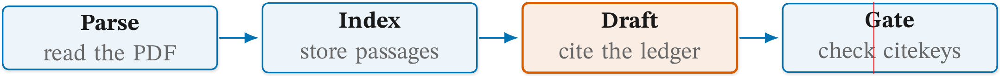
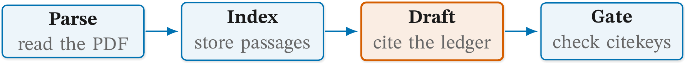
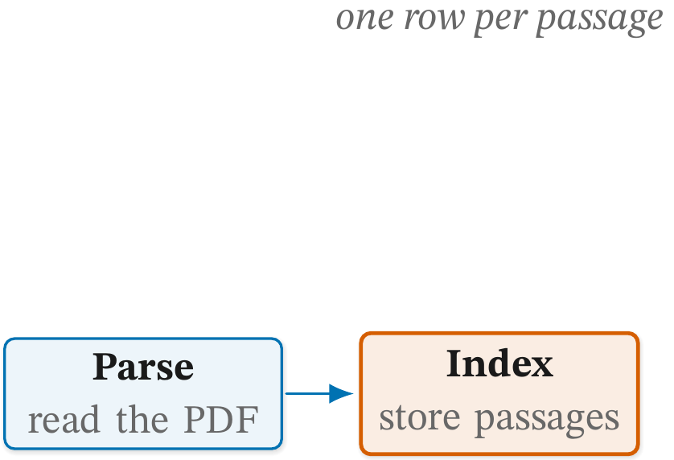
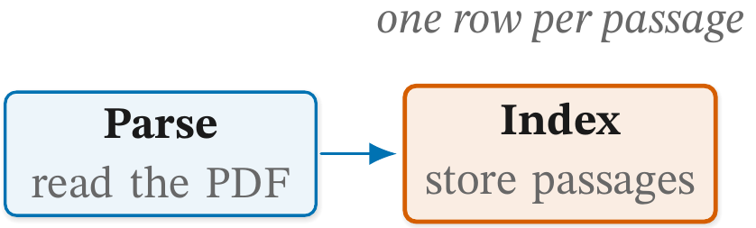
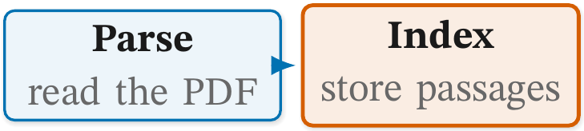
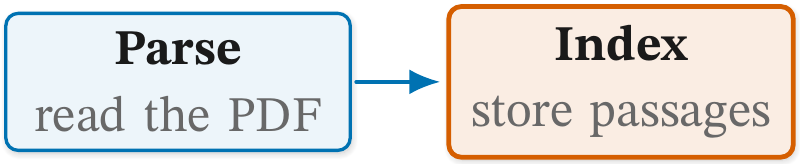

# 📏 Figure checks: size

Status: **reference.**

The rules about how much room the figure takes: a picture wider than
the page, stray space beside it, and a part stranded far from the rest.
Then the advisory size reports, which are read and never resolved: two
nodes squeezed together, and the height, slack and counts that every
report prints beside its layout's usual range.
[README.md](README.md) explains how to read a report and how to record
a deliberate exception.

Each rule below shows a faulty figure, the line `figure check` prints
for it, and the fixed figure. Both are real files in
[examples/](examples/), and `tests/test_figure_check_examples.py`
compiles them, so the report lines on this page are what the check
prints today. The listings show the picture only, unless the defect is
outside it; every file also carries the house style block above it.

## 🧭 Rules on this page

- [`size-width`](#size-width)
- [`size-stray`](#size-stray)
- [`content-protrusion`](#content-protrusion)
- [`size-squash`](#size-squash) (advisory)
- [`size-height`](#size-height) (advisory)
- [`size-slack`](#size-slack) (advisory)
- [`budget-nodes`](#budget-nodes) (advisory)
- [`budget-edges`](#budget-edges) (advisory)

### `size-width`

**Catches.** A picture wider than the target text width. The target
is 453pt by default, the text width of the render's A4 page at 1in
margins, or the number given with `--width`. The target is `figure`,
and the measurement is the picture's width beside the target. Several
pictures in one file are measured together, since they print side by
side.

**Why it matters.** A figure wider than the page either runs into the
margin or gets scaled down to fit, and scaling shrinks its type to a
size nobody chose. The page width is fixed; the layout is what has to
give.

Faulty: four stages in one row, each box 36mm wide.

```latex
\node[cgbox, text width=36mm] (parse) {\cglab{Parse}{read the PDF}};
\node[cgbox, text width=36mm, right=8mm of parse] (index) {\cglab{Index}{store passages}};
\node[cgkey, text width=36mm, right=8mm of index] (draft) {\cglab{Draft}{cite the ledger}};
\node[cgbox, text width=36mm, right=8mm of draft] (gate) {\cglab{Gate}{check citekeys}};
\draw[cgedge] (parse) -- (index);
\draw[cgedge] (index) -- (draft);
\draw[cgedge] (draft) -- (gate);
```

```text
  size-width            figure     517.6pt wide, target 453.0pt
```

Fixed: the same row with 28mm boxes, which the labels still fit.

```latex
\node[cgbox, text width=28mm] (parse) {\cglab{Parse}{read the PDF}};
\node[cgbox, text width=28mm, right=8mm of parse] (index) {\cglab{Index}{store passages}};
\node[cgkey, text width=28mm, right=8mm of index] (draft) {\cglab{Draft}{cite the ledger}};
\node[cgbox, text width=28mm, right=8mm of draft] (gate) {\cglab{Gate}{check citekeys}};
```

| Faulty | Fixed |
| --- | --- |
|  |  |

In the faulty picture the red line is where the text width ends.

**Fix.** Wrap a row, cut a gloss, stack panels; see section 3 of
`.claude/skills/figure-drawer/references/figures.md`.

### `size-stray`

**Catches.** The figure, set as one box, is more than 0.5pt wider than
its picture. A line outside the picture that ends without `%` sets a
space, and the space adds width beside the figure. The target is
`figure`, and the measurement is the stray width with the input's and
the picture's. A file with several pictures is not measured, since the
space between them is deliberate.

**Why it matters.** The space shows when the figure is `\input` inline
or measured with `\sbox`, which is how a thesis or a side-by-side
layout often sets it. The figure then sits off centre, or a row that
fits on paper overflows. The renderer sets each figure in a float,
which drops the space, so the render shows nothing wrong.

Faulty: the library line above the picture ends without `%`.

```latex
\usetikzlibrary{arrows.meta,positioning,fit,backgrounds,calc,shadows.blur}
\begin{tikzpicture}[cg]
```

```text
  size-stray            figure     2.8pt stray (input 193.5pt, picture 190.7pt)
```

Fixed: the line ends with `%`.

```latex
\usetikzlibrary{arrows.meta,positioning,fit,backgrounds,calc,shadows.blur}%
\begin{tikzpicture}[cg]
```

The two figures look the same in a float, so there are no pictures.

**Fix.** End every line outside the picture with `%`.

### `content-protrusion`

**Catches.** An empty horizontal band taller than a third of the
figure. The band is measured between the node boxes, and between the
outermost node and the picture's own edge, so a far-off node and a
stray path or label both show up. Only vertical gaps count: a pipeline
or a hub is made of horizontal gaps. The target is `figure`.

**Why it matters.** LaTeX sets a figure as one rectangle. One element
far above or below the rest makes the rectangle tall, and every bit of
the empty band beside it is page the text cannot use.

Faulty: a note sits 30mm above the row it describes.

```latex
\node[cgbox, text width=26mm] (parse) {\cglab{Parse}{read the PDF}};
\node[cgkey, text width=26mm, right=8mm of parse] (index) {\cglab{Index}{store passages}};
\node[cgnote, above=30mm of index] (note) {one row per passage};
\draw[cgedge] (parse) -- (index);
```

```text
  content-protrusion    figure     content protrudes past the main block
```

Fixed: the note sits 3mm above `index`.

```latex
\node[cgnote, above=3mm of index] (note) {one row per passage};
```

| Faulty | Fixed |
| --- | --- |
|  |  |

**Fix.** Pull the stranded element back into the main block.

### `size-squash`

**Catches.** Two nodes joined by an edge that sit under 3mm apart,
edge to edge, so the arrow between them is too short to read. The
target is the pair, `a+b`. A pair that overlaps (that is
[`node-overlap`](nodes.md#node-overlap)), a zone and its child, and a
bend coordinate are not measured. An edge on a path with an `edge`
operator or a named node on it, or with an end built from two nodes
(`b.north |- a`), is listed under "not measured" rather than guessed
at. The other edges are still measured, so `size-squash` can appear
both among the advisory reports and under "not measured".

This is an advisory report. It prints under its own heading, never
counts as a finding and cannot be allowed.

**Why it matters.** An arrow shorter than its own head reads as a
notch on the box, not as a step from one node to the next.

Faulty: `index` sits 2mm to the right of `parse`.

```latex
\node[cgbox, text width=26mm] (parse) {\cglab{Parse}{read the PDF}};
\node[cgkey, text width=26mm, right=2mm of parse] (index) {\cglab{Index}{store passages}};
\draw[cgedge] (parse) -- (index);
```

```text
  size-squash           index+parse 2.0mm apart edge to edge, under 3mm
```

Fixed: an 8mm gap.

```latex
\node[cgkey, text width=26mm, right=8mm of parse] (index) {\cglab{Index}{store passages}};
```

| Faulty | Fixed |
| --- | --- |
|  |  |

**Fix.** Advisory. The pair's arrow is under 3mm, too short to read;
give the pair more room.

### 📐 The reference ranges

The four reports below print for every figure that compiles. Each is a
number, and no figure breaks it, so they have no faulty and fixed pair.
Each number sits beside the range its layout's scaffold and exemplars
measure, read from the `## Reference ranges` table in
`.claude/skills/figure-drawer/references/layouts/<layout>.md`. The
layout is the one the figure's own `% cg-layout: <layout>` line names,
on a line of its own, or the one given with `--layout`.
[README.md](README.md#-the-layout-line) has more on the layout line. A
figure without one gets the numbers and no range.

A range describes the figures it was measured from and never caps
yours. A number outside it is a question to ask, not a defect. Every
figure on this page is a small `pipeline`, so its reports read, for
example:

```text
  size-height           figure     0.05 of the text height (37pt); pipeline reference 0.10 to 0.37
  size-slack            figure     0.16; pipeline reference 0.56 to 0.69
  budget-nodes          figure     2 nodes; pipeline reference 5 to 11
  budget-edges          figure     1 edge; pipeline reference 3 to 4
```

These are advisory reports. They never count as findings and cannot be
allowed. A file with several pictures has its height and slack listed
under "not measured", since the probe reads only the last picture's
extent.

### `size-height`

**Catches.** The picture's height as a share of the 700pt text height,
with the height in points, beside the layout's reference range.

**Why it matters.** A figure that takes far more of the page than its
layout's usual figures often has a row that should wrap the other way,
or a stage it does not need.

**Fix.** Advisory. Read it beside the reference: far taller than its
layout's figures usually means a row to wrap or a stage to drop.

### `size-slack`

**Catches.** The share of the picture no node fills: `1 -` the area of
the nodes that enclose no other node, over the picture's area. A zone
card is not filled area. It is printed beside the layout's reference
range.

**Why it matters.** Well above the range, the figure spends its page on
empty space, and the type is no bigger for it.

**Fix.** Advisory. The share no node fills, zone cards excluded; well
above the reference, pull the nodes closer or cut the empty zone.

### `budget-nodes`

**Catches.** The count of named nodes, zone cards and icon wells
included, beside the layout's reference range.

**Why it matters.** A figure far above its layout's usual count may be
two figures, each easier to read alone. The count is never a cap: a
dynamic-programming trace has forty cells and needs every one.

**Fix.** Advisory. Never a cap: a DP trace has forty cells. Far above
the reference, ask whether this is two figures.

### `budget-edges`

**Catches.** The count of edges the source parser reads, beside the
layout's reference range. A `\foreach` body and a `child` are not read,
and a bent path counts once per leg.

**Why it matters.** As for `budget-nodes`: far more edges than the
layout usually has can mean two figures drawn as one.

**Fix.** Advisory. As `budget-nodes`, for the edges the source parser
reads (not a `\foreach` body or a `child`).
