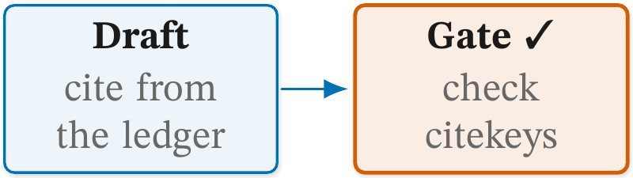
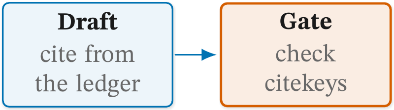
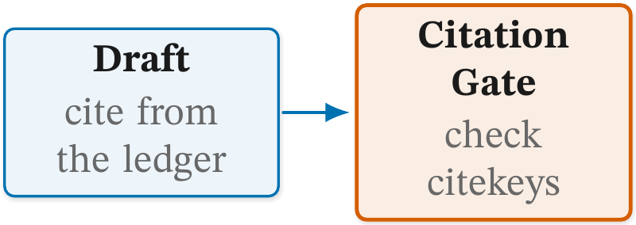
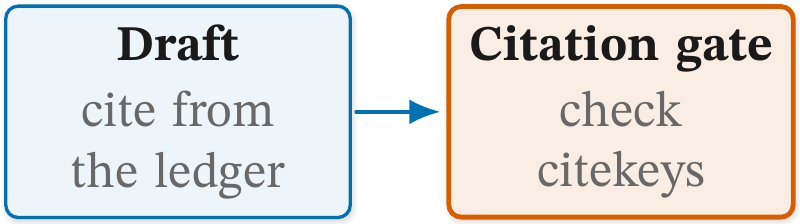
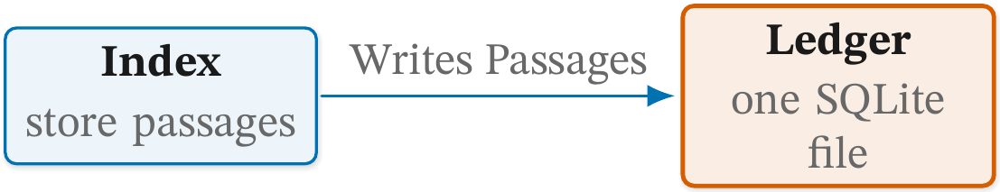
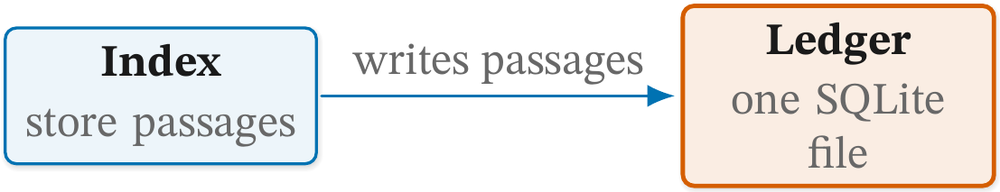
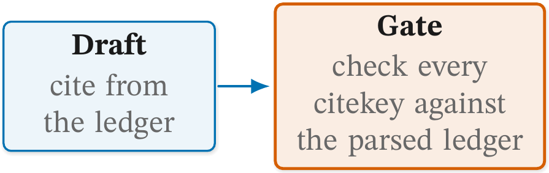
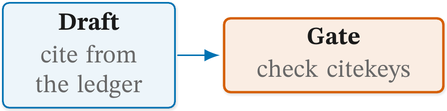

# ✍ Figure checks: wording

Status: **reference.**

The rules about the words in a figure: a pictograph in a label, and
three house conventions for names, tags and glosses. The first is a
finding. The other three are advisory reports: they print under their
own heading, never count as findings and cannot be allowed.
[README.md](README.md) explains how to read a report and how to record a
deliberate exception.

All four are read from the source, because they are about the words as
written. Each rule below shows a faulty figure, the line `figure check`
prints for it, and the fixed figure. Both are real files in
[examples/](examples/), and `tests/test_figure_check_examples.py`
compiles them, so the report lines on this page are what the check
prints today. The listings show the picture only; every file also
carries the house style block above it.

## 🧭 Rules on this page

- [`w4-pictograph`](#w4-pictograph)
- [`w1-case`](#w1-case)
- [`w2-tag`](#w2-tag)
- [`w3-gloss`](#w3-gloss)

### `w4-pictograph`

**Catches.** An emoji or pictograph in a label: a character in U+1F000
to U+1FAFF, U+2600 to U+27BF (where `✓` and `★` sit), U+2B00 to
U+2BFF, or the emoji variation selector U+FE0F. The target is the node,
or `figure` for one outside any label. Arrows, `©`, `™`, math and icon
commands (`\ding`, `\fa...`) are not read.

**Why it matters.** The render prints the character from a fallback
font that matches nothing else in the figure. A thesis that `\input`s
the figure without that font chain drops it, with only a warning in
the log. The house figure draws a shape as a `pic`, never as a glyph.

Faulty: a tick mark after the gate's name.

```latex
\node[cgbox, text width=26mm] (draft) {\cglab{Draft}{cite from the ledger}};
\node[cgkey, text width=26mm, right=8mm of draft] (gate) {\cglab{Gate ✓}{check citekeys}};
\draw[cgedge] (draft) -- (gate);
```

```text
  w4-pictograph         gate       "✓" (U+2713) in the label
```

Fixed: the tick is gone. The gloss already says what the gate does.

```latex
\node[cgkey, text width=26mm, right=8mm of draft] (gate) {\cglab{Gate}{check citekeys}};
```

| Faulty | Fixed |
| --- | --- |
|  |  |

The tick prints here because the render's font chain has it. An emoji
such as `🔒` fires the same way and also compiles, but the render prints
it from Unifont's bitmap glyphs.

**Fix.** Delete the character; draw the idea as a house `pic` or say it
in words.

### `w1-case`

**Catches.** A `\cglab` name that starts lower-case, or is in Title
Case: every later word of four letters or more is capitalised. The
target is the name. Acronyms (`RAG`, `PDFs`), `\texttt{}`, math and a
program name that is lower-case by convention (`pdflatex`) are left
alone, so `Extended Kalman filter` passes.

This is an advisory report. It cannot be allowed.

**Why it matters.** The names in one figure, and in the prose beside
it, read as one voice when they share a case. Title Case makes every
box look like a proper noun.

Faulty: the gate's name is in Title Case.

```latex
\node[cgbox, text width=26mm] (draft) {\cglab{Draft}{cite from the ledger}};
\node[cgkey, text width=26mm, right=8mm of draft] (gate) {\cglab{Citation Gate}{check citekeys}};
\draw[cgedge] (draft) -- (gate);
```

```text
advisory (read; never resolved, allowed or capped)
  w1-case               "Citation Gate" Title Case; sentence case capitalises only the first word
```

Fixed: sentence case.

```latex
\node[cgkey, text width=26mm, right=8mm of draft] (gate) {\cglab{Citation gate}{check citekeys}};
```

| Faulty | Fixed |
| --- | --- |
|  |  |

**Fix.** Advisory. Write the `\cglab` name in sentence case: `Feature
store`, not `Feature Store` or `feature store`.

### `w2-tag`

**Catches.** A tag on a `\draw` or `\path` that joins two points, with
more than three words or with a capitalised word (acronyms aside). The
target is the tag's text. A note placed beside a line by its own
`\node` is not a tag.

This is an advisory report. It cannot be allowed.

**Why it matters.** A tag names what moves along the line. Lower case
keeps it apart from the bold names in the boxes, and three words keep
it a label rather than a sentence stretched over the arrow.

Faulty: the tag is capitalised.

```latex
\node[cgbox, text width=26mm] (index) {\cglab{Index}{store passages}};
\node[cgkey, text width=26mm, right=34mm of index] (ledger) {\cglab{Ledger}{one SQLite file}};
\draw[cgedge] (index) -- node[cgtag] {Writes Passages} (ledger);
```

```text
advisory (read; never resolved, allowed or capped)
  w2-tag                tag "Writes Passages" capitalised; a tag is lower-case
```

Fixed: the tag in lower case.

```latex
\draw[cgedge] (index) -- node[cgtag] {writes passages} (ledger);
```

| Faulty | Fixed |
| --- | --- |
|  |  |

**Fix.** Advisory. A tag is a lower-case phrase of three words or
fewer: `sends request`.

### `w3-gloss`

**Catches.** A `\cglab` gloss over six words. The target is the name
the gloss sits under. A formula counts as one word.

This is an advisory report. It cannot be allowed.

**Why it matters.** The gloss is a hint under the name. Past six words
it is prose in a box, and the explanation belongs in the paragraph
beside the figure.

Faulty: the gate's gloss runs to seven words.

```latex
\node[cgbox, text width=26mm] (draft) {\cglab{Draft}{cite from the ledger}};
\node[cgkey, text width=34mm, right=8mm of draft] (gate) {\cglab{Gate}{check every citekey against the parsed ledger}};
\draw[cgedge] (draft) -- (gate);
```

```text
advisory (read; never resolved, allowed or capped)
  w3-gloss              "Gate"     "check every citekey against the parsed ledger": 7 words, over 6
```

Fixed: two words, and the prose says the rest.

```latex
\node[cgkey, text width=34mm, right=8mm of draft] (gate) {\cglab{Gate}{check citekeys}};
```

| Faulty | Fixed |
| --- | --- |
|  |  |

**Fix.** Advisory. Cut the `\cglab` gloss to six words or fewer.
