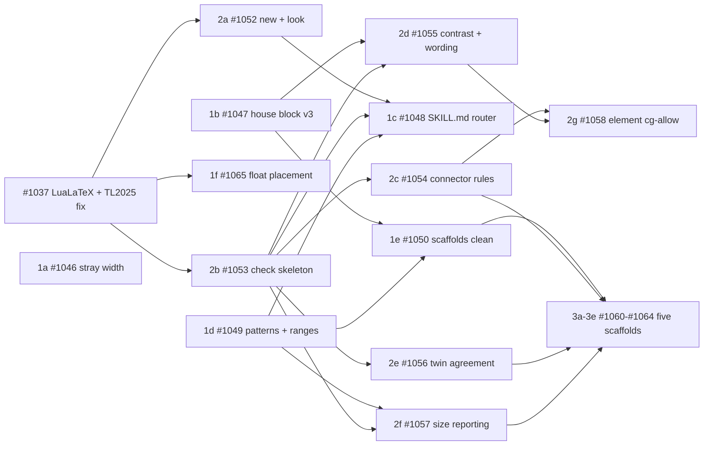

# 🖍 figure-drawer v3: compact figures, numbered rules, one check command

Status: **design, not built.** Written 2026-10-24 against `main` at
`12302d2`, from a brainstorming session that read two outside skills
(below) and measured the scaffolds on this host. Part XII of
[docs/FIGURE-ROADMAP.md](../docs/FIGURE-ROADMAP.md) summarises it and
places it in the build order. Tracked by epic
[#1044](https://github.com/prasadtalasila/chitragupta/issues/1044)
and the sub-issues listed under [Tracking](#tracking).

**Written for** whoever builds any phase of this: a session that changes
`assets/tikz/`, `chitragupta/figure/`, `chitragupta/review/figure_layout/`,
the three copies of the `figure-drawer` skill, `tests/` and `docs/`, and
is therefore governed by `DEVELOPER-AGENTS.md` and
`docs/CODE-STANDARDS.md`.

**Assumed:** `docs/TIKZ-STYLE.md`, `docs/FIGURE-DRAWER.md`,
`docs/FIGURE-ROADMAP.md` Parts II, VI and "Borrowed, with attribution",
`plans/1027-figure-drawer-skill.md`, and open issues #1016 (F4, teach
`review figure` the house vocabulary) and #1037 (run the figure probe on
LuaLaTeX).

**Integration branch.** All of this work was to land on
`improve-figures`, one PR per item, with CI enabled for PRs into that
branch and docs never published from it. **From #1053 on, items branch
off `main` and PR into `main`** (user, 2026-10-28), once `main` carried
everything the integration branch had. An item's issue is not closed
when its PR merges; it gets a comment recording the lessons and
decisions that bear on the items after it.

**Not covered here:** Part X output targets (this plan uses the render's
default text width and a `--width` override until Part X lands), Part XI
rendered images in `md`/`html`/`docx`, any vision critique (Part VIII),
and the existing 43 figures in the drafted book, which are flagged, not
migrated (see [Migration](#migration)).

## Why

Three defects were reported by the person who uses the pipeline:

1. **Figures sprawl.** A figure that could sit in a quarter page takes a
   half or a whole page. The opposite failure, squashing everything into
   the smallest possible box, is equally unwanted.
2. **Layout defects reach the rendered PDF.** Slanted connectors, an
   edge tag sitting on its own line, a lone arrow leaving a box near its
   corner instead of its centre.
3. **Figures carry too much or too little.** Overloaded boxes, or a
   figure where a sentence would do.

`docs/images/figure-drawer/twin-loop.png`, the skill's own documentation
figure, shows all three: two slanted connectors (`forecast`, `reading`),
two tags on their lines (`water`, `ingest`), the `Decide -> Pot` arrow
leaving `Decide` near its right corner although it is the only arrow on
that edge, and an inter-zone gap as tall as a zone, so four nodes take
roughly half a page.

## The reference book

The sample book attached to
[#1045](https://github.com/prasadtalasila/chitragupta/issues/1045)
("Digital Twins for Software Engineers", 294 A4 pages, 37 figures in
chapters 1 to 7, built with pdfTeX before #996) is the reference every
item measures against. What it shows:

- **Narrow, stacked layouts.** Most figures use 35% to 50% of the text
  width and grow downwards: Fig. 2.5 stacks its two panels vertically
  where side by side would take a third of the height; Figs. 2.1, 4.2
  and 4.5 are single tall columns.
- **Float-only pages.** A tall figure is moved to a page of its own and
  centred, with blank space above it (Fig. 2.5 on p. 38). That is the
  render's float placement, not the figure, and is item 1f.
- **Off-centre lone arrows** (Fig. 4.5's "state, digital events").
- **Type below the body size**, from before the type floor existed.

### The reference sources

The drafts behind that PDF are on the development host under
`content/drafts/` (gitignored, never committed), with their pdfTeX
renders of 2026-09-17 under `content/rendered/`. Every item measures on
them, not only on the scaffolds:

| Draft | Figure pairs (`.tex` + `.txt`) |
| --- | --- |
| `books/digital-twins-for-software-engineers` (chapters 1 to 7, appendix A1) | 40 |
| `tutorials/digital-twins-for-software-engineers` | 6 |
| `book-chapters/state-estimator` | 3 |

None of the 49 carries the house style block: they predate it, which
makes them an honest "before" set. `review figure` on them, 2026-10-28:
8 `nothing-measurable` (unnamed nodes or plots), 6 `content-protrusion`,
2 `node-overlap`, 3 `stranded-arrowhead`, and 1 `does-not-compile`
(`run-modes`, chapter 7), which is #1037's first test case.

**Baseline extents**, from `review figure`'s own probe (pdflatex, 10pt
Computer Modern, so a lower bound for the 12pt STIX render), as fractions
of the render's 453pt text width and 700pt text height, over the 48 that
compile. Slack is `1 - leaf node area / picture area`, zone cards
excluded:

| Measure | Median | Min | Max |
| --- | --- | --- | --- |
| Width | 0.81 | 0.44 | 1.03 |
| Height | 0.24 | 0.13 | 0.50 |
| Slack | 0.70 | 0.27 | 0.95 |
| Named nodes | 8 | 0 | 16 |
| Edges | 6 | 0 | 18 |

Over the width: `ensemble-fan` (1.03). Narrow and tall (under 0.6 wide,
over 0.3 high): `watering-strategies` (Fig. 2.5, 0.44 by 0.45),
`two-transport-layers` (0.59 by 0.41), `pump-markov-chain` (0.51 by
0.33). Nine figures have slack above 0.75. These numbers are what 1b's
compact defaults, 2f's reference ranges and 1f's float placement are
judged against, re-measured with the LuaLaTeX probe once #1037 lands.

## Inputs, and what was taken from each

Two outside skills were read. Nothing is vendored from either; both are
re-implemented here, for the reason FIGURE-ROADMAP's "Borrowed, with
attribution" already gives for the first: their checkers read SVG or
drawio geometry, and a TikZ figure has neither. Our probe reads named
node boxes out of the TeX log, which is the right substrate.

- **`cathrynlavery/diagram-design`** (MIT), already partly mined in
  2026-09. New this time: the six connector rules stated as numbered,
  checkable rules, including fanned attach points with the lone-arrow
  case at the edge midpoint; ADR 0005's "a rule only in prose ships
  broken", which means every rule ships with a checker and fixtures in
  both polarities; ADR 0002's "semantic patterns route to layouts and
  never add one"; ADR 0004's SKILL.md as a router under a byte cap.
  **Explicitly not taken:** the 4px grid and absolute coordinates, and
  "shadows are out" (the house `cgsoft` shadow stays).
- **`INTO-CPS-Association/DTaaS` `update-docs-diagrams`**: one command
  per step, each idempotent, with the skill text reduced to "run this,
  read what it prints"; exceptions recorded with a reason instead of
  rules silently skipped; contrast thresholds of 4.5:1 for text and 3:1
  for lines; and a last look at every changed image by eye.

## Decisions

Each was put to the user and answered, except where marked.

| Question | Decision |
| --- | --- |
| Palette | The eight `\definecolor` hex values are unchanged and remain the fills. Strokes and coloured text use derived shades (below) |
| Shadows, grid | Keep `cgsoft`; keep relative placement. No grid |
| Size | Advisory: report height as a fraction of `\textheight`, and *slack*, against each layout's reference range (FIGURE-ROADMAP VI.3). The `\normalsize` floor and a minimum gap prevent the opposite failure. Width overflow is objective |
| Who owns what goes in a figure | `figure-drawer`. The genre still decides *whether* a figure is warranted; the skill owns the pattern, layout, budget, remove test, and may tell the caller "this is two figures" or "a sentence does this" |
| New layouts | Quadrant, side-by-side comparison, state machine (II.4), sequence (II.2), timeline. Twelve in total |
| Label case | Sentence case node names; lowercase edge tags of at most three words; glosses of at most six words; a node of at most fifteen words |
| Twin agreement | Labels and panel letters checked; edge topology stays an eyeball check |
| Migration | `figure sync` moves the block to v3; findings in old figures are fixed when someone redraws them |
| Delivery | Three phases, one epic |
| Exception scope | Element-level for element rules, figure-level only for rules about the whole figure; **figure-level lands first** |
| Enforcement (*not put to the user; settled by SOUL.md*) | `figure check` exits 0 whatever it finds, like every review aid. The skill's procedure tells the agent to resolve each objective finding or record a reasoned `cg-allow`, and to report the rest to the caller. Nothing blocks a draft |

The last row overrides a default proposed during the session ("objective
rules gate inside the skill"). SOUL.md: *"There is exactly one citation
gate. Every other check over a draft ... is advisory wherever in the
tree it lives, and none grows a flag that blocks."* A procedure step in a
skill is guidance a person can overrule; an exit code is a flag.

## Measurements behind the design

Taken on this host on 2026-10-24 with TeX Live from
`scripts/install_full_pipeline.sh os-deps`, LuaLaTeX, article class.

**Scaffold extents** (11pt, libraries preloaded in the preamble, as the
renderer does after #781). The render default is 12pt A4 with 1in
margins, a text width of 453pt and a text height of about 700pt.

| File | Width (pt) | Height (pt) |
| --- | --- | --- |
| pipeline | 307 | 70 |
| zoned-spine | 322 | 121 |
| branching-tree | 283 | 140 |
| hub-and-spoke-network | 269 | 148 |
| map | 226 | 126 |
| control-loop | 225 | 95 |
| layered-stack | 203 | 175 |
| exemplars/architecture | 435 | 234 |
| exemplars/retrieval | 447 | 352 |
| exemplars/rag-stages | **475** | 224 |

So the scaffolds do not sprawl; sprawl enters when a figure is drawn by
hand around them. `rag-stages` overflows the text width at 11pt, before
the 12pt body widens it further.

**Stray width from loading a library in horizontal mode.** A figure file
`\input` inside a box or paragraph, with its `\usetikzlibrary` line *not*
already satisfied by the preamble, adds blank width before the picture:

| Library loaded in the body | Added width |
| --- | --- |
| `arrows.meta` | 0pt |
| `positioning`, `fit`, `backgrounds`, `calc` | about 13pt each |
| `shadows.blur` | about 120pt |
| the house line, all six | about 175pt |

Preloaded, every one adds 0pt, and the house style block itself adds 0pt.
**Corrected 2026-10-28:** the spaces are set only in horizontal mode. A
figure `\input` in vertical mode, which is where the skill's step-7 probe
(`\documentclass{article}\usepackage{tikz}` then `\input`) and every
`figure` float put it, loses them: measured, the leftmost glyph lands at
the same x with and without the libraries preloaded. An earlier version
of this plan, and #1046, said the step-7 probe over-reports width by
about 40%; that was wrong. What is affected is narrower: a `standalone`
preview (which boxes its content), a width measured with `\sbox` or
`\hbox`, and an `\input` inline in running text. The renderer and
`review figure` are unaffected.

**Palette contrast**, WCAG 2 relative luminance, against white, `cgPaper`
and every zone tint the house block defines:

| Role | As a stroke on its own tint | Needs |
| --- | --- | --- |
| `cgFlow` | 4.70 | 3.0 |
| `cgAccent` | 3.37 | 3.0 |
| `cgAlt` | 3.08 | 3.0 |
| `cgRose` | 2.78 | 3.0 |
| `cgAux` | 2.14 | 3.0 |
| `cgWarm` | 2.04 | 3.0 |
| `cgMute` text (glosses) on white | 3.45 | 4.5 |
| `cgAccent` text (edge tags) on white | 3.87 | 4.5 |
| `cgInk` text on any tint | 15 to 16 | 4.5 |

## The rules

Every rule has an id, a scope and a class. The id is what a finding, a
`cg-allow` line, TIKZ-STYLE.md and the skill all quote, so they cannot
drift apart (a test cross-checks the four). **Objective** rules are ones
the skill must resolve or allow; **advisory** rules are reported for
judgement.

### Connector rules

Metaphor-aware: a layout declares itself with a `% cg-layout: <id>` line
that every scaffold carries, and `figure new` keeps. A rule a layout
exempts is not evaluated for it.

| Id | Rule | Scope | Class |
| --- | --- | --- | --- |
| `c1-orthogonal` | An edge between nodes whose centres differ in both x and y by more than 1mm is an elbow (`-\|`, `\|-`), not a straight or bent segment. Exempt: `state-machine` (curved transitions and self-loops are its convention), `hub-and-spoke` (radial spokes) | edge | objective |
| `c2-tag-clearance` | An edge tag sits beside its segment, 0.8mm to 3mm clear of it: not on the line, not floating away from it | edge | objective |
| `c3-coincident` | No two edges share a collinear stretch longer than 2mm | edge pair | objective |
| `c4-attach` | A lone edge on a node side attaches at that side's midpoint, within 0.5mm. N edges on one side attach at `L*k/(N+1)`, within 1mm, and at least 2mm apart | node side | objective |
| `c5-transit` | No edge crosses the box of a node that is neither of its ends. Zone cards that contain an end are not counted | edge | objective |
| `c6-tag-covered` | No edge tag overlaps a node box | edge | objective |

The existing findings keep the names `review figure --json` already
ships as its `kind` strings (`does-not-compile`, `nothing-measurable`,
`node-overlap`, `node-text-overload`, `stranded-arrowhead`,
`loads-library-by-hand`, `content-protrusion`) and their current
classes; emptiness stays a diagnostic, not a finding. **Corrected by
issue #1053**, which found that this list had named them differently
from the shipped ids.

### Contrast, focal and wording

| Id | Rule | Scope | Class |
| --- | --- | --- | --- |
| `k1-stroke` | A `draw=` colour clears 3:1 against the node's ground (its own fill, or the zone it sits in, or white) | element | objective |
| `k2-text` | A `text=` colour clears 4.5:1 against its ground; bold text at `\large` or above clears 3:1 | element | objective |
| `focal-count` | At most one `cgkey` node per figure (TIKZ-STYLE.md: "if two things are accented, neither is"; #1016's `accent-not-unique`) | figure | objective |
| `w1-case` | A node name is in sentence case. `\texttt{}`, math and a name whose first word is all lower-case by convention (`tikz`, `pdflatex`) are left alone | node | advisory |
| `w2-tag` | An edge tag is lower-case and at most three words | edge | advisory |
| `w3-gloss` | A gloss is at most six words (this supersedes the eight in #1016's `gloss-too-long`) | node | advisory |
| `w4-pictograph` | No emoji or pictographic character in any label | element | objective |

### Size

| Id | Rule | Scope | Class |
| --- | --- | --- | --- |
| `size-width` | The picture is no wider than the target text width: 453pt by default (the render's 12pt A4 1in), `--width` to override | figure | objective |
| `size-stray` | The `\input` box is no wider than the picture: any difference is stray space, almost always a library loaded in horizontal mode | figure | objective |
| `size-height` | Height as a fraction of `\textheight`, reported beside the layout's reference range | figure | advisory |
| `size-slack` | `1 - (sum of named non-zone node areas) / (picture area)`, reported beside the layout's reference range | figure | advisory |
| `size-squash` | Two nodes joined by an edge are less than 3mm apart edge to edge, so the arrow is too short to read | edge | advisory |
| `budget-nodes`, `budget-edges` | Node and edge counts, against the layout's reference range. Never a cap: FIGURE-ROADMAP's "Considered and set aside" declines numeric caps, since a forty-cell DP trace is not over budget | figure | advisory |

Reference ranges come from the scaffold and the exemplar of each layout
(VI.3, VI.4), written down in that layout's reference file, so a range
moves only when an exemplar does.

### Twin agreement

| Id | Rule | Scope | Class |
| --- | --- | --- | --- |
| `t1-labels` | Every node name in the `.tex` appears in the `.txt`, compared case-insensitively with TeX markup stripped and whitespace collapsed | node | objective |
| `t2-tags` | Every edge tag in the `.tex` appears in the `.txt` | edge | objective |
| `t3-panels` | The panel letters in the two files are the same set | figure | objective |

## Exceptions: `cg-allow`

A figure that breaks an objective rule on purpose says so in its own
file, which travels with the draft and into a thesis:

```latex
% cg-allow: c1-orthogonal twin->decide -- curved on purpose: the feedback edge reads as a loop
% cg-allow: size-width -- a five-stage pipeline the chapter compares stage by stage
```

- The form is `% cg-allow: <rule-id> [<target>] -- <reason>`. The reason
  is required. A target names a node (`decide`), an edge by its ends
  (`decide->pot`), a pair (`legend+pot`) or a node side
  (`decide.south`).
- **A figure-scope rule takes no target. An element-scope rule requires
  one.** A target-less allow for an element rule is reported as
  malformed, so "allow every slanted edge" cannot be written.
- `figure check` lists every allow it honoured in its report, so an
  exception is always visible.
- An allow whose target no longer exists, or no longer breaks its rule,
  is reported as stale.
- Order of build: **figure-scope allows land first**, with the check
  skeleton (phase 2b). Element-scope allows and stale detection follow
  (phase 2g), once edge geometry exists to name targets with.

## The commands

All three live in `chitragupta/figure/`, beside `sync`, and all exit 0
whatever they find, except on a usage error or a missing toolchain.

- **`chitragupta figure new <figures-dir> <name> --layout <id>`.** Copies
  the scaffold to `<figures-dir>/<name>.tex` and its twin to `<name>.txt`,
  then runs `sync`. Refuses to overwrite. Replaces step 2's `cp` and
  `sync`.
- **`chitragupta figure check <figure.tex> [--width PT] [--json]`.** One
  report: the compile probe (libraries preloaded, so `size-stray` is the
  only place stray width can show), every rule above, the existing
  `review figure` findings for that one file, and the honoured allows.
  One line per finding, `<rule-id> <target> <measurement>`, objective
  findings first. Replaces steps 4 to 8.
- **`chitragupta figure look <figure.tex> [--draft <draft>]`.** Compiles
  the figure alone in the render's own preamble (class, 12pt, fonts, text
  width), draws a hairline at the text width, and writes a PNG under
  `content/rendered/`. With `--draft`, renders the draft instead and
  crops the page that holds the figure. Replaces step 9.

The probe engine is LuaLaTeX with the render's fonts, which #1037 (done
in phase 1) makes true before these commands land.

## The skill

`SKILL.md` becomes a router, in all three harness copies:

1. Who called you, and where the figure goes (unchanged in substance).
2. **Pattern, then layout.** What does the figure argue? Route through
   the pattern table in `references/patterns.md` to one of the twelve
   layouts. A new layout is justified only by a new layout grammar,
   never by a new pattern (diagram-design ADR 0002).
3. **The taste gate, before drawing.** Would a sentence or a table do
   this? Can a node, an edge or a label go? Do two nodes always travel
   together? Is there one focal node? Is this one figure or two
   (overview and detail)? Push back to the caller when the answer says
   so.
4. `figure new`, then draw below the house block.
5. Write the twin.
6. `figure check`; resolve every objective finding or add a `cg-allow`
   with its reason; read the advisory ones.
7. `figure look`, and look at it.
8. Return: the two paths, what `check` reported and what was allowed,
   and whether the look was done.

The prose that today explains each step moves to `references/`, which
issue #1039 keeps once under `.claude/`. A test holds each `SKILL.md` under a
byte cap of 8,000 (it is 11,705 today) and fails if a section moved out
loses its link, as diagram-design's `verify-docs-sync.py` does.

## The house block, v3

- **Derived shades.** For each hue `H`, `cgHLine` (strokes) and `cgHText`
  (coloured text) are `cgH!p!cgInk` with the largest `p` that clears the
  threshold over white, `cgPaper` and every zone tint. Starting values,
  which a test recomputes from the hex values rather than trusting:

  | Hue | `Line` share | `Text` share |
  | --- | --- | --- |
  | Flow | 100 | 95 |
  | Accent | 100 | 80 |
  | Alt | 95 | 70 |
  | Aux | 75 | 55 |
  | Warm | 75 | 55 |
  | Rose | 90 | 65 |

  Plus `cgMuteText = cgInk!65` for glosses and notes. The rule a reader
  remembers: **a palette name fills; a `Line` or `Text` name draws.**
- **Edge tags beside the line.** `cgtag` stops filling over its edge and
  is placed beside the segment (`c2-tag-clearance`), in `cgMuteText`.
- **Compact defaults.** Zone inner sep 3mm, zone title gap 1.5mm, node
  distance 6mm within a zone and 8mm between zones. Type is not touched.
  Every scaffold's slack must not rise and no `size-squash` may appear.
- **Version.** The marker line becomes `v3`;
  `cg-figstyle.versions.toml` records it, so `figure sync` upgrades a v2
  block in place and the render's hand-edit warning keeps working.

## Phases

### Phase 1: foundations

- **1a (bug).** Stray width, narrowed (see the correction above):
  TIKZ-STYLE.md says a preview or a box measurement must preload the
  libraries, and a characterization test pins both halves (a body load
  inside a box adds width; a preloaded one adds none), so `figure look`
  (2a) cannot reintroduce it.
- **1b.** House block v3: derived shades, `cgtag` beside the line,
  compact defaults, a contrast test over the palette and every scaffold,
  and `figure sync` to v3.
- **1c.** `SKILL.md` as a router with the taste gate, the three harness
  copies, the byte-cap and link tests.
- **1d.** `references/patterns.md` (pattern to layout routing) and one
  reference file per layout with its reference ranges. This is
  FIGURE-ROADMAP II.0's split, and VI.6's checklist and anti-pattern
  table land here.
- **1e.** Fix the scaffolds and exemplars that break a rule today:
  `rag-stages`' width, and every lone edge re-anchored to a side
  midpoint.
- **1f.** Float placement: measure which figures land on float-only
  pages in the reference book, and set the render preamble's placement
  default and float fractions so a figure that fits stays in the text.
- **#1037, whole.** Move every remaining pdflatex path to LuaLaTeX: the
  figure-layout probe (so `check` and `look` measure in the fonts that
  print), the thesis-chapter path and the book build. It lands before
  phase 2, which measures with the probe. It starts with a regression
  found on the development host: under TeX Live 2025, `openin_any=p`
  (#823) restricts absolute paths to `$TEXMFOUTPUT`, and `luaotfload`
  opens `ScriptExtensions.txt` by absolute path, so every LuaLaTeX
  render fails there (CI's older TeX Live hides it). The fix keeps
  `openin_any=p` and lets only the TeX distribution's own trees through,
  with a regression test.

### Phase 2: `figure new`, `check` and `look`

- **2a.** `figure new` and `figure look`.
- **2b.** `figure check` skeleton: probe, existing findings, report
  format, figure-scope rules (`size-width`, `size-stray`, `focal-count`)
  and figure-scope `cg-allow`.
- **2c.** Edge geometry and `c1` to `c6`. **Bench first**, per VI.5:
  run each rule over the scaffolds, the exemplars and the 49 draft
  figures before fixing thresholds, with the must-not-fire cases (a
  legitimate crossing, an automaton self-loop, a lifeline with many
  arrows at one x) as the majority of the fixtures.
- **2d.** `k1`, `k2`, `w1` to `w4`. Coordinate with #1016, which proposes
  overlapping source findings; whichever lands second reuses the first's
  parser.
- **2e.** Twin agreement `t1` to `t3`, and a `.txt` twin for every
  existing scaffold, which the fixtures need.
- **2f.** Size: `size-height`, `size-slack`, `size-squash`, the budgets
  and the reference ranges from 1d.
- **2g.** Element-scope `cg-allow` and stale-allow detection.

How edges are measured: the source parser recovers each `\draw` between
named nodes (its anchors, its `--`, `-|`, `|-` or `to[...]` operators,
and any `node` on the path), and the probe supplies the node boxes. A
path the parser cannot read is listed as not measured, the same honesty
as the measured-nothing rule, never silently skipped.

### Phase 3: five scaffolds

One scaffold per layout, each with its twin, its `% cg-layout:` line,
its reference file and an exemplar, and each clean under `figure check`:
`quadrant`, `comparison`, `state-machine` (II.4), `sequence` (II.2) and
`timeline`. `tests/test_tikz_scaffolds.py`'s table-to-directory
cross-check covers them.

## Dependencies and value

An arrow reads "must land before". Value is to the person who reported
the problem: how much of the sprawl, the defects reaching the PDF, and
the too-much-or-too-little each item removes from the reference book.



| Rank | Item | Why it is worth this much | Depends on |
| --- | --- | --- | --- |
| 1 | #1037 LuaLaTeX everywhere, with the TL2025 `openin_any` fix | Every render fails on a current distribution; every measurement after it needs the fonts that print | none |
| 2 | 1b #1047 house block v3 | Compact spacing attacks the sprawl directly; derived shades fix five contrast failures | none |
| 3 | 2b #1053 `figure check` skeleton | Carries every rule after it; on its own, width overflow and focal count | #1037 |
| 4 | 2c #1054 connector rules | The defects that reach the PDF today: slants, tags on lines, off-centre arrows | 2b |
| 5 | 2f #1057 size reporting | Makes the sprawl visible per figure against a range: 9 drafts above 0.75 slack | 2b, 1d |
| 6 | 1f #1065 float placement | Whole pages lost to float-only placement, with no figure change | #1037 |
| 7 | 3b #1061 comparison scaffold | Fig. 2.5's stacked panels are the book's worst sprawl case | 1e, 2c, 2e, 2f |
| 8 | 1d #1049 patterns and reference ranges | Too much or too little: what a figure should hold, per layout | none |
| 9 | 2a #1052 `figure new` and `look` | The look that catches what geometry cannot | #1037 |
| 10 | 1c #1048 SKILL.md router and taste gate | The remove test acts before a figure is drawn | 1d, 2a, 2b |
| 11 | 2e #1056 twin agreement | The md, docx and html readers' only figure | 2b |
| 12 | 1e #1050 scaffolds and exemplars clean | Copying a scaffold no longer imports a defect | 1b, 1d |
| 13 | 2d #1055 contrast and wording | Consistency; overlaps #1016 | 2b, 1b |
| 14 | 3c #1062 state machine | Ch. 6's automata; curved transitions by convention | 1e, 2c, 2e, 2f |
| 15 | 3d #1063 sequence | Protocol figures | 1e, 2c, 2e, 2f |
| 16 | 3e #1064 timeline | Ch. 7's time-axis figures | 1e, 2c, 2e, 2f |
| 17 | 3a #1060 quadrant | No figure in the reference book needs it yet | 1e, 2c, 2e, 2f |
| 18 | 2g #1058 element-scope `cg-allow` | Precision for exceptions; figure-scope already works | 2c, 2d |
| 19 | 1a #1046 stray width | Narrowed by the correction above to previews and box measurements | none |

The build order follows the ranks wherever the dependencies allow: issue
1037, then 1b, 2b, 2c, 1d, 2f, 1f, 2a, 2e, 1e, 3b, 1c, 2d, 3c, 3d, 3e,
3a, 2g and 1a.

## Migration

`figure sync` upgrades the block in every figure that carries one. A
figure body is never rewritten. `figure check` reports what the old
body breaks, and `draft-reviser` fixes it when it next touches the
figure. No sweep of `content/drafts/` is part of this work.

## Tracking

Filed 2026-10-24 as one epic,
[#1044](https://github.com/prasadtalasila/chitragupta/issues/1044),
with a sub-issue per phase and a sub-issue per item under each phase.

| Phase | Issue | Items |
| --- | --- | --- |
| 1 Foundations | [#1045](https://github.com/prasadtalasila/chitragupta/issues/1045) | 1a [#1046](https://github.com/prasadtalasila/chitragupta/issues/1046) (bug), 1b [#1047](https://github.com/prasadtalasila/chitragupta/issues/1047), 1c [#1048](https://github.com/prasadtalasila/chitragupta/issues/1048), 1d [#1049](https://github.com/prasadtalasila/chitragupta/issues/1049), 1e [#1050](https://github.com/prasadtalasila/chitragupta/issues/1050), 1f [#1065](https://github.com/prasadtalasila/chitragupta/issues/1065), [#1037](https://github.com/prasadtalasila/chitragupta/issues/1037) (LuaLaTeX everywhere) |
| 2 `figure new`, `check`, `look` | [#1051](https://github.com/prasadtalasila/chitragupta/issues/1051) | 2a [#1052](https://github.com/prasadtalasila/chitragupta/issues/1052), 2b [#1053](https://github.com/prasadtalasila/chitragupta/issues/1053), 2c [#1054](https://github.com/prasadtalasila/chitragupta/issues/1054), 2d [#1055](https://github.com/prasadtalasila/chitragupta/issues/1055), 2e [#1056](https://github.com/prasadtalasila/chitragupta/issues/1056), 2f [#1057](https://github.com/prasadtalasila/chitragupta/issues/1057), 2g [#1058](https://github.com/prasadtalasila/chitragupta/issues/1058) |
| 3 Five scaffolds | [#1059](https://github.com/prasadtalasila/chitragupta/issues/1059) | 3a [#1060](https://github.com/prasadtalasila/chitragupta/issues/1060), 3b [#1061](https://github.com/prasadtalasila/chitragupta/issues/1061), 3c [#1062](https://github.com/prasadtalasila/chitragupta/issues/1062), 3d [#1063](https://github.com/prasadtalasila/chitragupta/issues/1063), 3e [#1064](https://github.com/prasadtalasila/chitragupta/issues/1064) |
